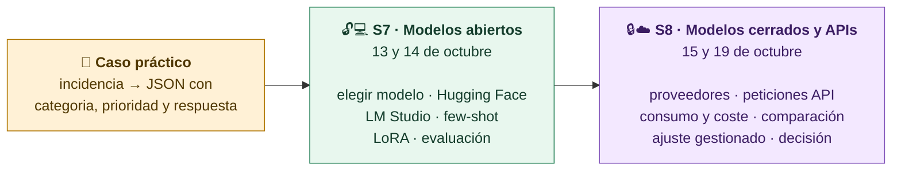

# Modelos abiertos y cerrados · S7 y S8

Material visual de las dos sesiones. Un mismo caso práctico las une: convertir una incidencia ficticia de una plataforma educativa en un JSON con `categoria`, `prioridad` y `respuesta`.

| Clase | Pregunta | Empieza aquí |
|---|---|---|
| **S7 · Modelos abiertos** | ¿Qué modelo puedo utilizar para mi tarea, cómo lo pongo en funcionamiento y cómo compruebo si sus respuestas son suficientemente buenas? | [[00-Guia-S7]] |
| **S8 · Modelos cerrados y APIs** | ¿Cómo conecto mi aplicación a estos modelos y qué pruebas necesito para elegir el que mejor resuelve mi tarea? | [[00-Guia-S8]] |

Cada carpeta tiene sus notas numeradas en orden de clase. Los diagramas están dentro de las notas, en bloques `mermaid`.

> [!tip] Si ves el código en lugar del diagrama
> Obsidian pide permiso antes de dibujar diagramas Mermaid en un vault nuevo. Pulsa el botón de permitir sobre el primer diagrama: se aplica a todo el vault.
