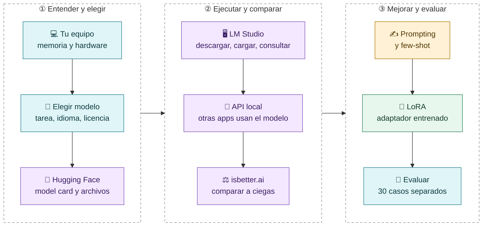
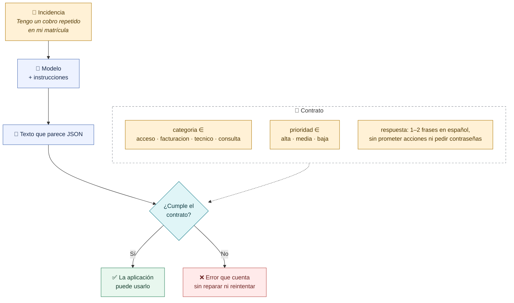
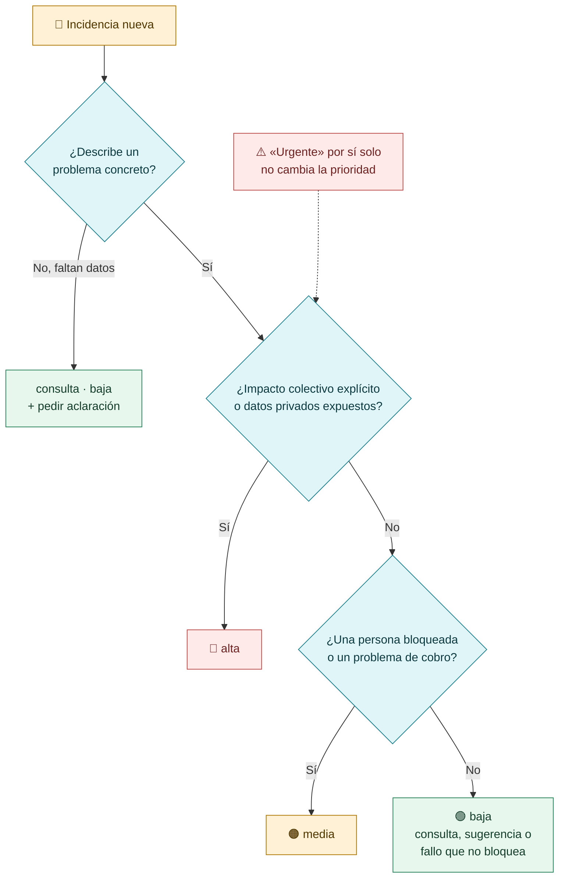
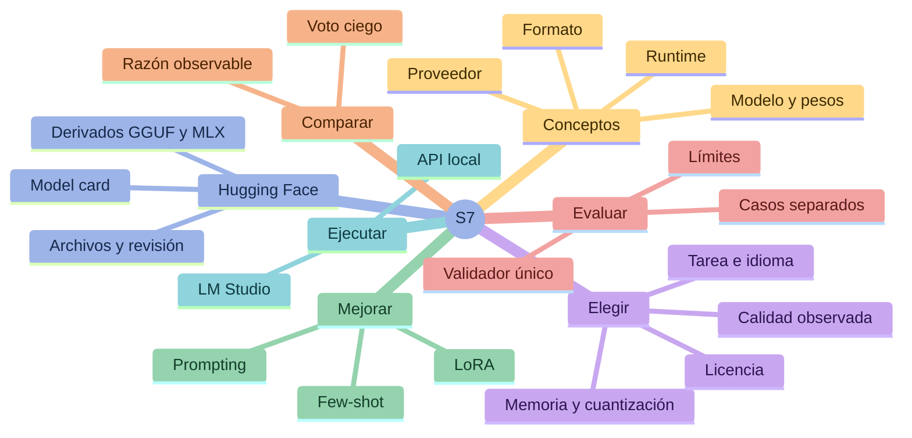

# S7 · Modelos abiertos: del repositorio a una respuesta evaluada

> [!question] La pregunta que resolvemos hoy
> **¿Qué modelo puedo utilizar para mi tarea, cómo lo pongo en funcionamiento y cómo compruebo si sus respuestas son suficientemente buenas?**

Estas notas son la documentación de la sesión para repasar después: cada nota responde a una pregunta, sigue el orden de la clase y usa el mismo caso práctico.

> [!info] Qué se ve en clase y qué queda para después
> En clase usamos la presentación, las herramientas en directo y el repositorio (notebook `notebooks/S7-LoRA.ipynb` y terminal). De estas notas solo abrimos dos partes: [[#El caso práctico que une toda la sesión|el caso práctico]] y la **Parte 1** de [[07-Como-se-entrena-un-LoRA]], donde se lee cómo hicimos el fine-tuning. El resto, con sus comandos, código y cifras, queda como material de consulta. No se entrena en directo. Los números proceden del proyecto `2-modelos`: datos sintéticos, código comentado y ejecuciones fechadas.

## El recorrido de la sesión



## Los 90 minutos

```mermaid
gantt
    title S7 · 18:30–20:00, hora de Madrid
    dateFormat HH:mm
    axisFormat %H:%M
    tickInterval 10minute
    section Entender
        Conceptos con la presentación   :a1, 18:30, 20m
        Caso práctico                   :a2, after a1, 5m
        canirun.ai y Hugging Face       :a3, after a2, 5m
    section Ejecutar
        LM Studio y API local           :b1, 19:00, 12m
        Comparar en isbetter.ai         :b2, after b1, 8m
    section Mejorar
        Prompting y few-shot            :c1, 19:20, 8m
        Cómo hicimos el fine-tuning     :c2, after c1, 15m
        Recargar y comparar             :c3, after c2, 5m
        Evaluación y entrega            :c4, after c3, 7m
    section Cierre
        Preguntas y puente a S8         :d1, 19:55, 5m
```



| Hora | Qué hacemos | Dónde lo vemos en clase | Para repasar |
|---|---|---|---|
| 18:30–18:50 | Conceptos: pesos, licencias, familias, memoria, Hugging Face, LM Studio, isbetter.ai y LoRA | Presentación, diapositivas 1–21 | [[01-Conceptos-modelo-pesos-runtime]], [[02-Elegir-un-modelo]] |
| 18:50–18:55 | El caso práctico: qué debe devolver el modelo y con qué reglas | Esta nota, en Obsidian | Esta nota |
| 18:55–19:00 | Elegir para tu equipo y verificar la ficha, la licencia y el archivo | canirun.ai y Hugging Face (`Qwen/Qwen3-0.6B` y su GGUF) | [[02-Elegir-un-modelo]], [[03-Hugging-Face-y-formatos]] |
| 19:00–19:12 | Descargar, cargar y consultar; servidor y API local | LM Studio y terminal | [[04-LM-Studio-y-API-local]] |
| 19:12–19:20 | La misma web con tres modelos a ciegas: Qwen3.5-4B local, Qwen3-Coder-Next abierto por API y Claude Haiku 5.5 cerrado; votar con pruebas | isbetter.ai | [[05a-isbetter-tres-modelos]], [[05-Comparar-respuestas]] |
| 19:20–19:28 | Prompt básico frente a few-shot: tokens y la trampa de «urgente» | Notebook §3–4 o `scripts/demo.py --fewshot` | [[06-Prompting-few-shot-y-fine-tuning]] |
| 19:28–19:43 | Cómo hicimos el fine-tuning: problema, técnica, datos, archivos, receta, registro y antes y después | Diapositiva 18 como recordatorio y **Parte 1 de la nota 07 en Obsidian** | [[07-Como-se-entrena-un-LoRA]] (Parte 2 para reproducirlo) |
| 19:43–19:48 | Recargar el adaptador y comparar original y LoRA en DE-04, en directo | Terminal (`scripts/servir_comparacion.py`) e isbetter.ai | [[05a-isbetter-tres-modelos#Ronda 2 · El mismo Qwen, con y sin LoRA]], [[07-Como-se-entrena-un-LoRA]] |
| 19:48–19:55 | Resultados de 30 casos, errores, publicación en Hugging Face y entrega | Notebook §7 | [[08-Evaluar-y-entregar]] |
| 19:55–20:00 | Preguntas y puente a S8 | — | [[08-Evaluar-y-entregar]] |

> [!note] La diapositiva del entrenamiento en pocas líneas
> Es una versión mínima (`r = 16`, `alpha = 32`, dos capas). La receta del repositorio usa `r = 8`, `alpha = 16` y siete capas: se explica en [[07-Como-se-entrena-un-LoRA]].

## El caso práctico que une toda la sesión

> [!example] En clase, de 18:50 a 18:55
> Esta sección es la única de las notas que se abre en clase: el contrato de la respuesta y las reglas de prioridad que usaremos en todas las demos.

Clasificamos incidencias ficticias de una plataforma educativa. El modelo debe devolver **solo** un JSON con tres campos:

```json
{
  "categoria": "facturacion",
  "prioridad": "media",
  "respuesta": "Indica el concepto y la fecha del pago para revisar la incidencia de facturación."
}
```



### Las reglas de prioridad

Son las convenciones de nuestro ejercicio, no una taxonomía universal. El modelo las recibe en el prompt; después comprobaremos si las aplica.



> [!question] Pregunta al grupo
> Si alguien escribe «urgente», ¿debe subir siempre la prioridad? Lo comprobaremos con datos en [[06-Prompting-few-shot-y-fine-tuning]].

## Mapa de conceptos



## Notas en orden

| Nota | Pregunta que responde |
|---|---|
| [[01-Conceptos-modelo-pesos-runtime]] | ¿Qué es exactamente un modelo abierto y qué piezas necesito para usarlo? |
| [[02-Elegir-un-modelo]] | ¿Qué modelo elijo para mi tarea y mi equipo? ¿Abierto o por API? |
| [[03-Hugging-Face-y-formatos]] | ¿Cómo verifico qué estoy descargando y qué archivo necesito? |
| [[04-LM-Studio-y-API-local]] | ¿Cómo lo ejecuto y cómo lo usa otra aplicación? |
| [[05-Comparar-respuestas]] | ¿Cómo decido qué respuesta es mejor y por qué? |
| [[05a-isbetter-tres-modelos]] | ¿Da un modelo abierto una calidad parecida a uno cerrado de su misma gama? |
| [[06-Prompting-few-shot-y-fine-tuning]] | ¿Qué mejora el resultado sin entrenar y cuándo conviene entrenar? |
| [[07-Como-se-entrena-un-LoRA]] | ¿Cómo hicimos el fine-tuning con LoRA y qué cambió antes y después? |
| [[08-Evaluar-y-entregar]] | ¿Cómo demuestro que funciona y qué tengo que entregar? |

**Siguiente clase:** [[00-Guia-S8|S8 · Modelos cerrados y APIs]].

## Convenciones visuales

```mermaid
---
config:
  flowchart:
    wrappingWidth: 400
---
flowchart LR
    k1["Datos, instrucciones<br/>y objetivos"]
    k2["Modelo original<br/>y su salida"]
    k3["Adaptación LoRA<br/>y acierto"]
    k4["Error, riesgo<br/>o límite"]
    k5["Herramientas<br/>y plataformas"]
    k6["Preguntas, decisiones<br/>y evaluación"]
    k1 ~~~ k2 ~~~ k3 ~~~ k4 ~~~ k5 ~~~ k6
    classDef datos fill:#fff1d6,stroke:#ae7500,color:#503700
    classDef base fill:#edf2ff,stroke:#4569b2,color:#17294a
    classDef ajuste fill:#e8f7ee,stroke:#268158,color:#143d2c
    classDef aviso fill:#ffeaea,stroke:#b94a48,color:#6c2221
    classDef herramienta fill:#f3e8ff,stroke:#7e4fb8,color:#3b1d63
    classDef decision fill:#e0f5f7,stroke:#1f7f8c,color:#0d3a40
    class k1 datos
    class k2 base
    class k3 ajuste
    class k4 aviso
    class k5 herramienta
    class k6 decision
```



El color acompaña a etiquetas explícitas: cada diagrama se entiende también sin distinguir colores.

## Mensajes que deben quedar

> [!important] Elegir empieza por la tarea
> Primero qué debe hacer, qué significa hacerlo bien y qué restricciones hay. Después, si cabe, si es compatible y si cumple **en nuestros casos**.

> [!important] Comparación controlada
> Mismo Qwen, misma revisión, mismo tokenizer, mismas instrucciones, misma pregunta y misma generación. Lo único que cambia entre original y LoRA es activar el adaptador.

> [!warning] La mejora se comprueba
> LoRA no tiene obligación de ganar. Una respuesta correcta en una demo no demuestra que el sistema funcione en todos los casos.

> [!note] Entrenamiento e inferencia
> Durante el entrenamiento se actualiza el adaptador. Durante una consulta normal no se actualiza ningún peso: chatear no entrena.

## De dónde salen los datos de estas notas

- Datos: `datos/train.jsonl`, `validacion.jsonl`, `test.jsonl` y `desarrollo.jsonl`.
- Receta: `scripts/entrenar_lora.py`. Registro: `modelos/lora-soporte/entrenamiento.json` (2 de octubre de 2026, Apple M5 con 24 GB).
- Comparación de 30 casos: ejecución del 2 de octubre de 2026 con `scripts/evaluar_qwen.py` y `scripts/resumir.py`.
- Comparación original/LoRA en isbetter.ai: ensayos del 9 y 13 de octubre de 2026.
- Lectura guiada del código: `docs/guia-codigo.md` y `notebooks/S7-LoRA.ipynb`.

Las cifras pertenecen a esas ejecuciones identificadas, con datos sintéticos. No son un ranking universal ni una promesa para otro equipo.

## Cómo abrir el material en Obsidian

Abre la carpeta `docs/obsidian` del repositorio como vault: contiene `S7-Modelos-abiertos` y `S8-Modelos-cerrados`. Usa **Vista de lectura** o **Live Preview**. Los diagramas están en bloques `mermaid`; GitHub también los dibuja si lees las notas en la web. La carpeta `ejemplos/` contiene copias de registros reales del dataset.

> [!tip] Si ves el código en lugar del diagrama
> Las versiones recientes de Obsidian piden permiso antes de dibujar diagramas Mermaid en un vault nuevo. Pulsa el botón de permitir que aparece sobre el primer diagrama: se aplica a todo el vault. En modo oscuro, Obsidian invierte los colores del diagrama; los tonos y su significado se mantienen.

[Empezar: conceptos →](01-Conceptos-modelo-pesos-runtime.md)
