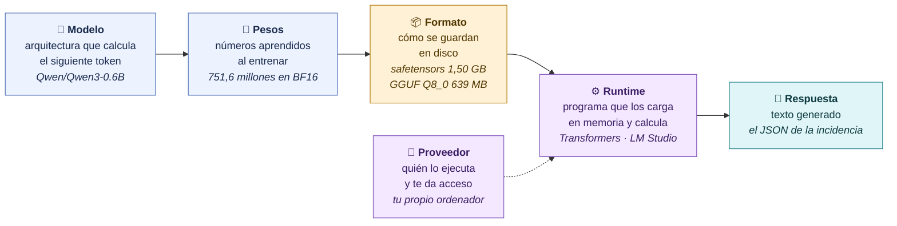
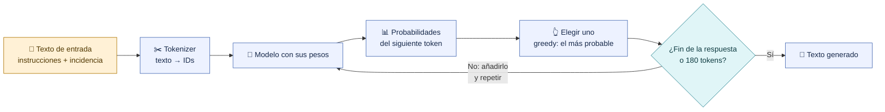
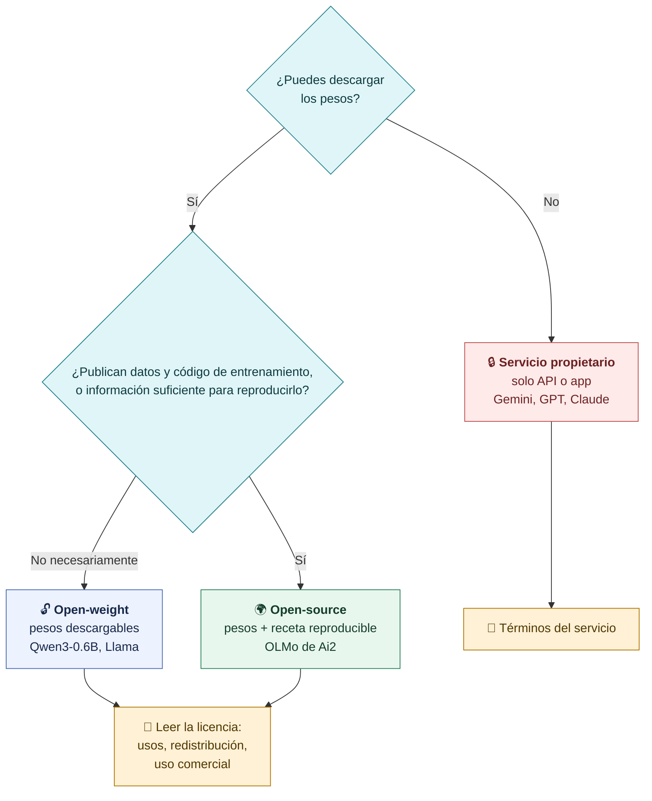
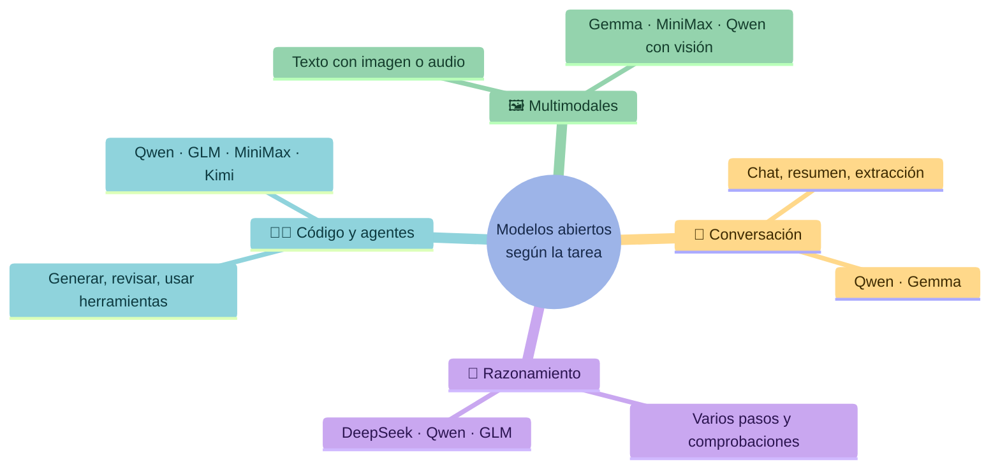

# Modelo, pesos, formato, runtime y proveedor

**Para usar un modelo abierto necesitamos cinco piezas distintas. Confundirlas es el origen de la mayoría de errores al descargar o ejecutar.**

## Las cinco piezas

| Pieza | Qué es | Ejemplo en S7 |
|---|---|---|
| **Modelo** | La red neuronal y su forma de calcular | Qwen3-0.6B, un modelo de lenguaje |
| **Pesos** | Los parámetros numéricos que aprendió | 751.632.384 valores en BF16 |
| **Formato** | El archivo que guarda esos pesos | Safetensors, GGUF o MLX |
| **Runtime** | El programa que los carga en memoria y hace la inferencia | Transformers, LM Studio, llama.cpp, Ollama |
| **Proveedor** | Quién ejecuta el modelo y cómo accedes | Tu Mac, un servidor propio o una API de terceros |

> [!tip] Una frase para recordarlo
> Los pesos son el conocimiento aprendido, el formato es la caja, el runtime es quien abre la caja y calcula, y el proveedor es dónde ocurre todo eso.

## Qué hace un modelo de lenguaje: token a token

Un modelo de lenguaje no «busca» una respuesta: calcula la probabilidad del siguiente token, elige uno, lo añade al texto y repite.

En nuestro experimento la generación es **greedy** (sin azar), con un máximo de **180 tokens** y el modo *thinking* de Qwen desactivado. Así dos ejecuciones con la misma entrada son comparables.

> [!note] Inferencia no es entrenamiento
> Durante esta generación los pesos solo se **leen**. Chatear con un modelo no lo entrena ni le enseña nada de forma permanente.

## Open-weight, open-source o servicio propietario

| | Open-weight | Open-source | Servicio propietario |
|---|---|---|---|
| Pesos descargables | Sí | Sí | No: solo API o app |
| Datos y código de entrenamiento | No necesariamente | Sí, o lo suficiente para reproducirlo | No |
| Ejecución local y adaptación | Sí, si el hardware y la licencia lo permiten | Sí | Solo lo que ofrezca el proveedor |
| Licencia | Fija usos y redistribución; puede limitar el uso comercial | Permite usar, estudiar, modificar y compartir | Términos del servicio |

> [!warning] Dos confusiones frecuentes
> - Un modelo con **pesos abiertos también puede usarse por API**: abierto describe qué se publica, no dónde se ejecuta.
> - **Gemma** (pesos descargables de Google) es distinta de **Gemini** (servicio por API que veremos en S8).

## Familias y tareas

Las familias publican modelos de distintos tamaños y especialidades. Los nombres concretos cambian rápido; lo estable es el método para elegir. Ejemplos de la presentación de S7:

> [!question] Pregunta al grupo
> Si una familia tiene un modelo de 0,6B y otro de cientos de miles de millones de parámetros, ¿comparten capacidades? ¿Y requisitos? La familia orienta; el modelo concreto y su archivo deciden.

[← Guía](00-Guia-S7.md) · [Siguiente: elegir un modelo →](02-Elegir-un-modelo.md)
