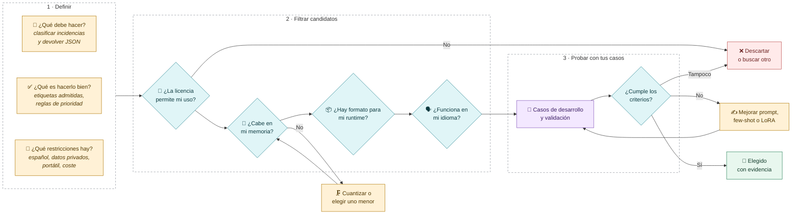
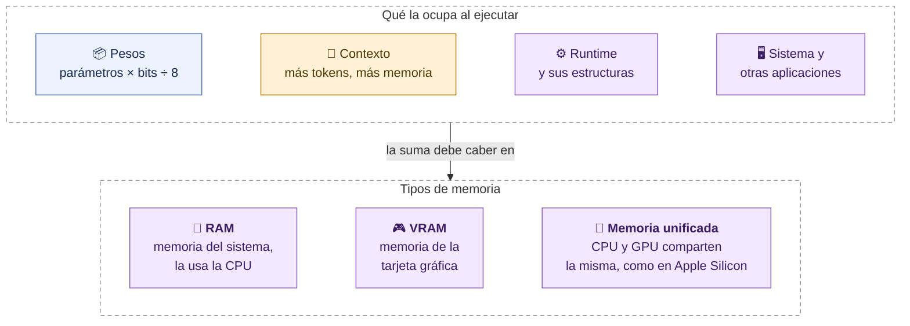
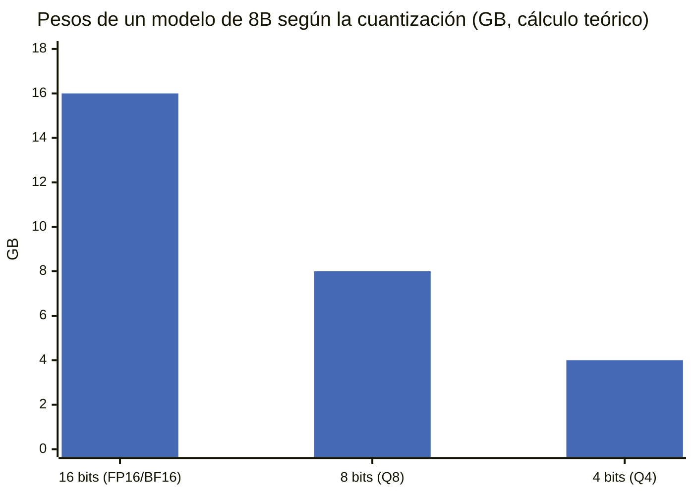
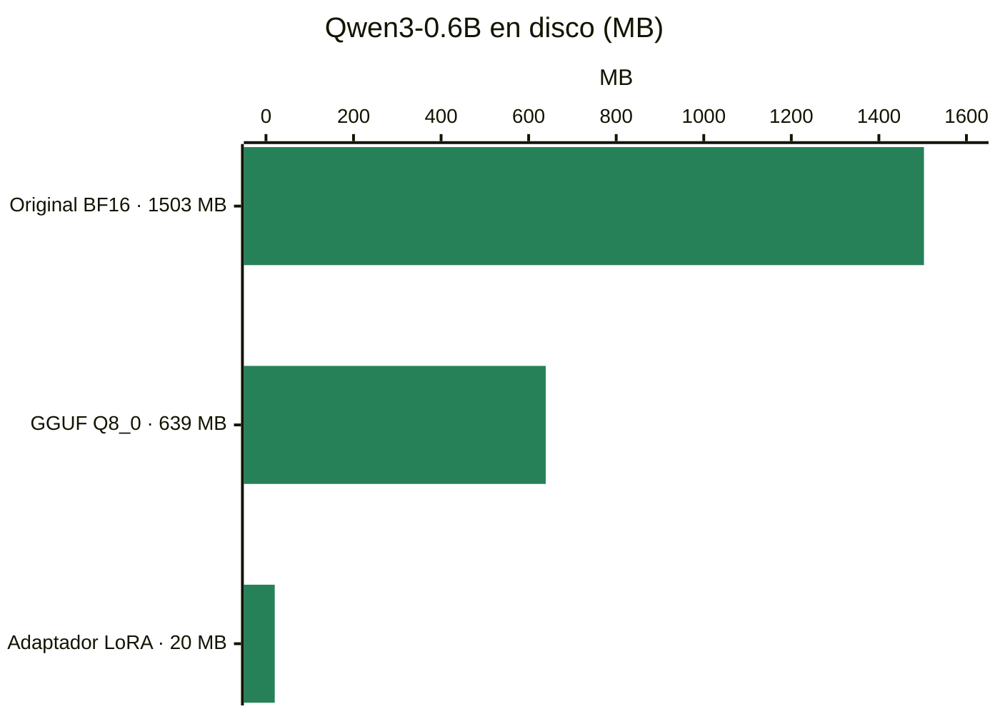
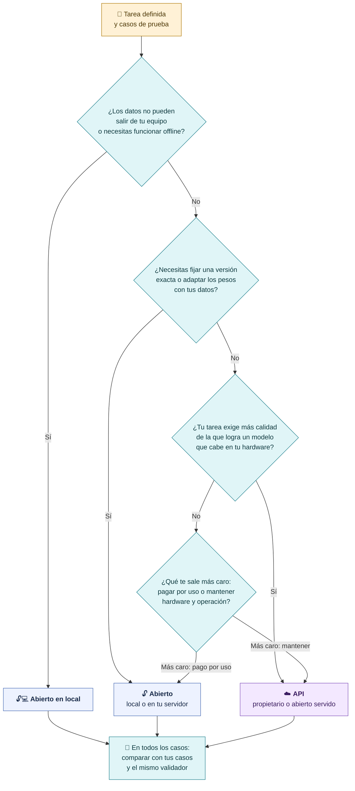

# Elegir un modelo para tu tarea y tu equipo

**La elección empieza por la tarea, no por el ranking. Después comprobamos si el candidato cabe, si es compatible y si cumple en nuestros casos.**

## El recorrido de una elección justificada

| Criterio | Pregunta concreta | Dónde se comprueba |
|---|---|---|
| **Tarea** | ¿Chat, extracción, código, visión, razonamiento? | Model card y pruebas propias |
| **Idioma** | ¿Responde bien en español con nuestro vocabulario? | Casos de desarrollo |
| **Hardware** | ¿Cabe en RAM, VRAM o memoria unificada con el contexto que necesito? | Cálculo + carga real |
| **Licencia** | ¿Permite uso comercial, redistribución, adaptación? | Model card y archivo de licencia |
| **Calidad observada** | ¿Acierta en **nuestros** casos con **nuestro** validador? | Comparación y evaluación |

> [!important] Por qué usamos Qwen3-0.6B en clase
> Es pequeño, tiene licencia Apache-2.0, se descarga en minutos y su LoRA se entrenó en unos 11 minutos en un Mac. Eso lo hace **bueno para aprender el proceso**. No demuestra que sea la mejor opción para un producto: sus errores tampoco representan a toda la familia de modelos abiertos.

## ¿Qué puede ejecutar mi equipo?

### El cálculo teórico de los pesos

> [!example] Memoria de pesos ≈ parámetros × bits ÷ 8
> Un modelo de **8B** (8.000 millones de parámetros):
> - 16 bits → 8.000 M × 16 ÷ 8 = **16 GB**
> - 8 bits → **8 GB**
> - 4 bits → **4 GB**
>
> Es solo la parte de los pesos. El contexto, el runtime y el sistema suman memoria encima.

**Cuantizar** es guardar cada peso con menos bits: ocupa menos memoria y puede perder algo de calidad. Por eso un mismo modelo aparece en varias versiones (Q4, Q8…).

### Nuestros archivos reales

Medidos en disco con el modelo de la clase:

- `model.safetensors`: 751.632.384 parámetros × 16 bits ÷ 8 ≈ **1,50 GB**. Coincide con el cálculo.
- `Qwen3-0.6B-Q8_0.gguf`: **639 MB**, menos de la mitad, para LM Studio.
- Nuestro adaptador LoRA: **20 MB**. No sustituye al modelo: se carga **junto** a él (lo veremos en [[07-Como-se-entrena-un-LoRA]]).

> [!question] Pregunta al grupo
> ¿Qué memoria tiene tu equipo? Con la fórmula, ¿qué tamaño de modelo en 4 bits podrías cargar dejando sitio al contexto y al sistema?

## ¿Modelo abierto en local o modelo por API?

No hay una respuesta universal: depende de la tarea y de las restricciones. En S8 aplicaremos los mismos criterios a Gemini y Claude.

| | Abierto en tu equipo | Por API |
|---|---|---|
| **Datos** | No salen de tu máquina | Viajan al proveedor según sus términos |
| **Coste** | Sin tarifa por consulta; hardware y energía no son gratis | Pago por tokens; sin hardware propio |
| **Control** | Fijas revisión, archivo y parámetros | El proveedor puede cambiar o retirar versiones |
| **Adaptación** | LoRA con tus datos, guardas el adaptador | Solo la que ofrezca el proveedor |
| **Capacidad** | Limitada por tu memoria | Modelos mayores sin instalar nada |
| **Operación** | Tú instalas, actualizas y sirves | Lo gestiona el proveedor |

> [!warning] Mismos criterios para todos
> La marca, el tamaño o un tono seguro no deciden. Decide la calidad observada en tus casos, con los recursos y el control que necesitas.

[← Conceptos](01-Conceptos-modelo-pesos-runtime.md) · [Siguiente: Hugging Face y formatos →](03-Hugging-Face-y-formatos.md)
