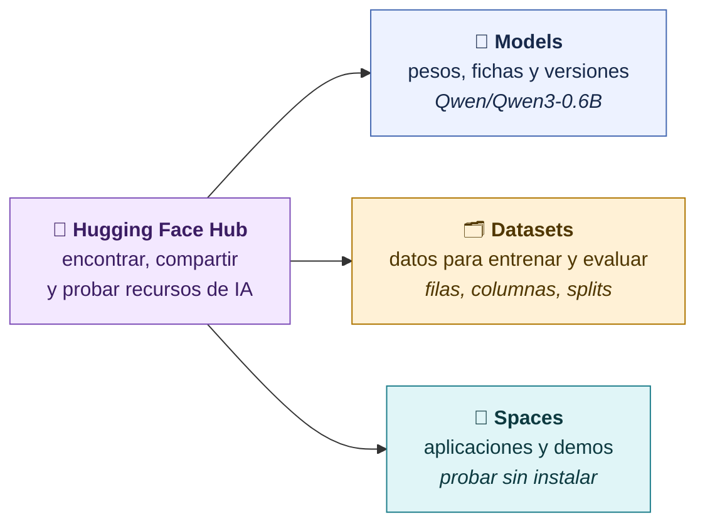
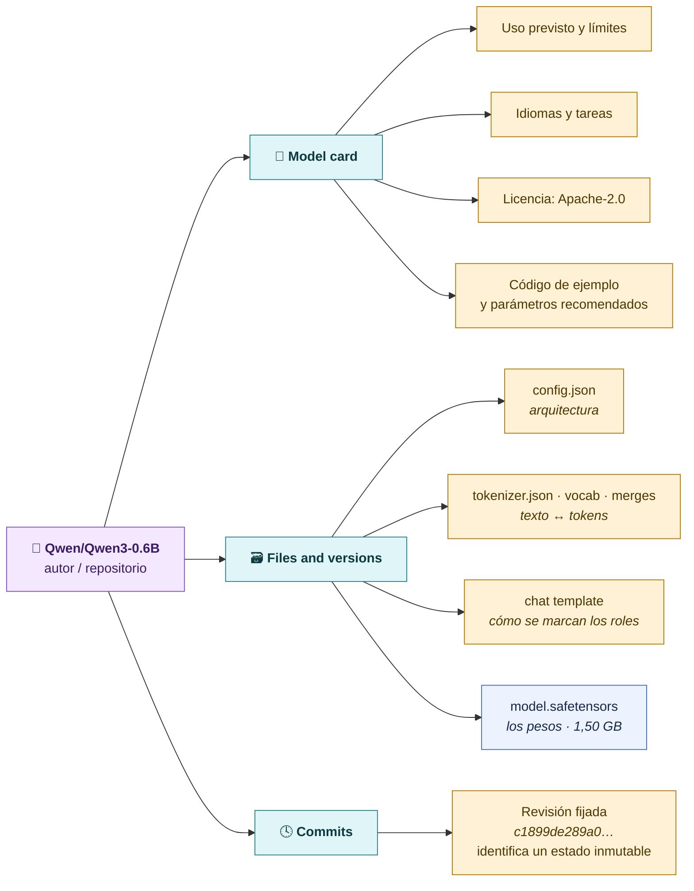
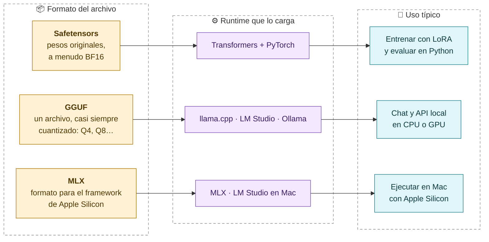
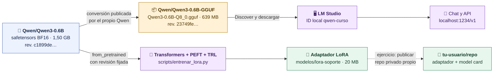

# Hugging Face: encontrar, leer y verificar

**Hugging Face es el lugar donde se publican modelos, datasets y demos. Antes de descargar, verificamos quién publica, qué es, con qué licencia y qué archivo necesita nuestro runtime.**

## Qué hay en Hugging Face



## Anatomía de un repositorio de modelo

Cada modelo es un **repositorio Git** con nombre `autor/repo`. El nombre comercial no basta: el autor dice quién lo publica.



> [!tip] Revisión fijada
> `main` cambia cuando el autor publica una actualización. Un **hash de commit** identifica exactamente qué archivos usaste. Nuestro experimento fija `Qwen/Qwen3-0.6B` en la revisión `c1899de289a04d12100db370d81485cdf75e47ca`.

## Antes de pulsar «descargar»

> [!question] Pregunta al grupo
> ¿Qué información necesitas antes de descargar este archivo?

```mermaid
---
config:
  flowchart:
    wrappingWidth: 400
---
flowchart LR
    A(["1 · 👤 ¿Quién lo publica?<br/>autor original o tercero"]) --> B(["2 · 📄 ¿Qué dice la model card?<br/>uso, idioma, límites"])
    B --> C(["3 · 📜 ¿Licencia compatible<br/>con mi uso?"])
    C --> D(["4 · 🔗 Si es un derivado:<br/>¿de qué base sale<br/>y quién lo convirtió?"])
    D --> E(["5 · 📦 ¿Formato y cuantización<br/>que admite mi runtime?"])
    E --> F(["6 · 💾 ¿Cabe en<br/>mi memoria?"])
    F --> G["✅ Descargar y anotar<br/>repo, archivo y revisión"]
    classDef decision fill:#e0f5f7,stroke:#1f7f8c,color:#0d3a40
    classDef ajuste fill:#e8f7ee,stroke:#268158,color:#143d2c
    class A,B,C,D,E,F decision
    class G ajuste
```



## Safetensors, GGUF y MLX

Los formatos **no son intercambiables**: descarga el que admite tu runtime.



> [!warning] Un derivado debe decir de dónde viene
> Un GGUF o MLX es una **conversión** del modelo original. Debe indicar el modelo base y la cuantización. Si lo convierte un tercero, comprueba quién es y qué cambió.

## El linaje de los archivos de esta clase

De un mismo modelo original salen dos caminos: uno para **ejecutar** en LM Studio y otro para **entrenar** nuestro adaptador.



| Ruta | Repositorio | Archivo | Runtime |
|---|---|---|---|
| Ejecutar en LM Studio | `Qwen/Qwen3-0.6B-GGUF` | `Qwen3-0.6B-Q8_0.gguf` | LM Studio |
| Entrenar y evaluar | `Qwen/Qwen3-0.6B` | `model.safetensors` + tokenizer + template | Transformers |

> [!note] El mismo modelo, dos archivos
> El GGUF Q8_0 y el safetensors BF16 representan el mismo Qwen3-0.6B, pero no son el mismo archivo ni se cargan con el mismo programa. Las respuestas pueden diferir ligeramente por la cuantización y el runtime.

## Descarga reproducible desde Python

Para subir nuestro LoRA, descargar su commit y ejecutarlo con la base del curso, sigue [[08a-Hugging-Face-subir-descargar-y-ejecutar]]. El ejemplo siguiente descarga el GGUF original para LM Studio, que es otro artefacto.

Opcional: la misma descarga sin interfaz gráfica, fijando repo, archivo y revisión.

```python
from huggingface_hub import hf_hub_download

path = hf_hub_download(
    repo_id="Qwen/Qwen3-0.6B-GGUF",
    filename="Qwen3-0.6B-Q8_0.gguf",
    revision="23749fefcc72300e3a2ad315e1317431b06b590a",
)
```

[← Elegir un modelo](02-Elegir-un-modelo.md) · [Siguiente: LM Studio y API local →](04-LM-Studio-y-API-local.md)
