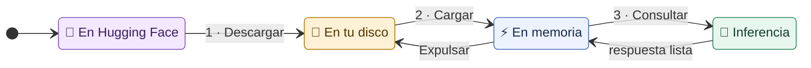
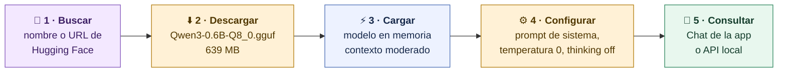
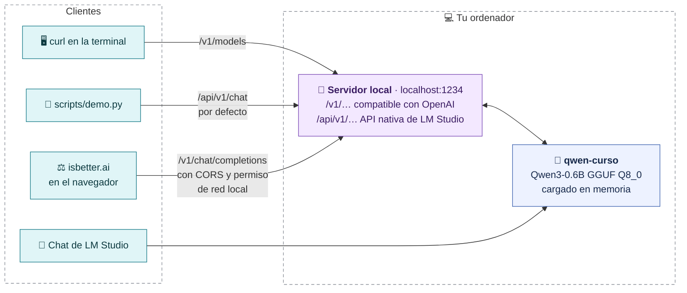
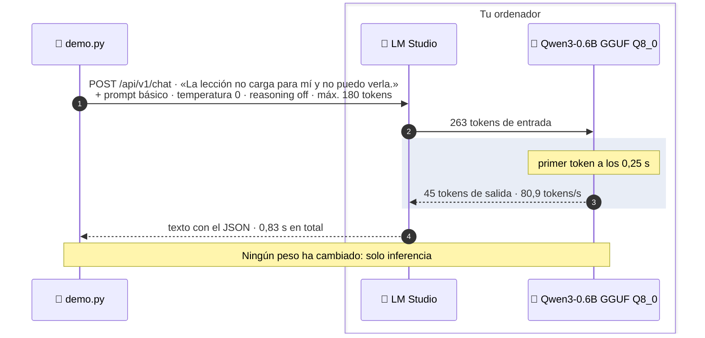
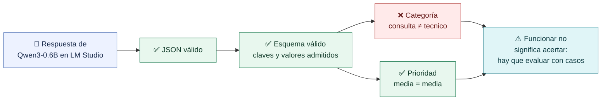
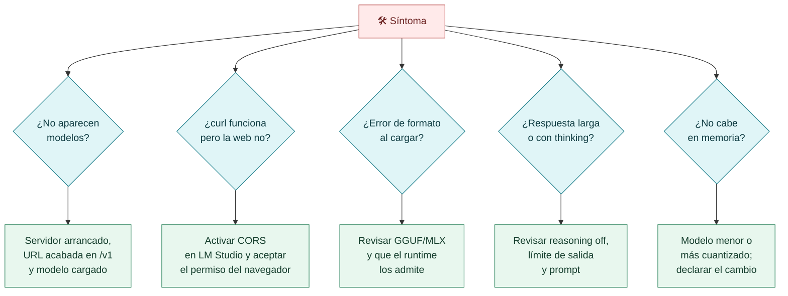

# LM Studio y la API local

**LM Studio no es un modelo: es una aplicación que descarga y ejecuta los modelos compatibles en tu equipo. Descargar, cargar y consultar son tres operaciones diferentes.**

## Descargar ≠ cargar ≠ consultar



| Operación | Qué ocurre | Qué consume | Cómo lo ves en LM Studio |
|---|---|---|---|
| **Descargar** | El archivo GGUF/MLX pasa a tu disco | Red y espacio en disco | Discover y la lista de descargas |
| **Cargar** | El runtime lee los pesos y los coloca en memoria | RAM, VRAM o memoria unificada | Selector de modelo cargado |
| **Consultar** | Inferencia: calcula tokens a partir de tu prompt | Cálculo de CPU/GPU | Chat o servidor local |

> [!question] Pregunta al grupo
> Si apago el ordenador, ¿qué se conserva: lo descargado, lo cargado o lo que hablé en el chat? ¿Alguna de esas cosas cambia los pesos del modelo?

## Los cinco pasos de la demo



En Mac, Discover se abre con **Cmd+2** (Ctrl+2 en Windows/Linux). Anota el ID del modelo, el formato y la cuantización: son parte de la evidencia.

## El chat es solo una interfaz

Un modelo cargado puede atender a varias aplicaciones a través de la **API local**. LM Studio ofrece rutas compatibles con OpenAI (`/v1/…`), que usa isbetter.ai, y una API nativa (`/api/v1/…`), que usa por defecto `scripts/demo.py` para poder desactivar el razonamiento.



```bash
# ¿Qué modelos ofrece el servidor?
curl http://localhost:1234/v1/models

# Una consulta de desarrollo con el script del curso
python scripts/demo.py --proveedor local --caso DE-01
```

## Una consulta real, paso a paso

Evidencia del 2 de octubre de 2026, caso de desarrollo `DE-01`:



La respuesta fue:

```json
{
  "categoria": "consulta",
  "prioridad": "media",
  "respuesta": "No se puede cargar la lección por favor intenta revisar los datos o contacte a un técnico"
}
```



> [!important] Funcionar no es acertar
> El modelo cargó, respondió rápido y produjo JSON válido. Aun así eligió una categoría distinta de la que marcan nuestras reglas. Eso es lo que medimos en las notas siguientes.

> [!note] Coste «cero»
> Sin tarifa por consulta no significa gratis: el hardware y la energía no se han medido. Por eso registramos el coste como no disponible, no como cero.

## Si algo falla



Si tu equipo no puede cargar un modelo grande, no concluyas que «los modelos abiertos no funcionan»: elige uno compatible con tu memoria y declara el cambio.

[← Hugging Face y formatos](03-Hugging-Face-y-formatos.md) · [Siguiente: comparar respuestas →](05-Comparar-respuestas.md)
