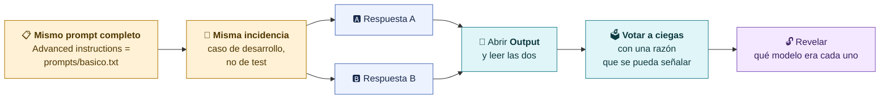
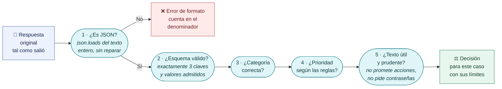
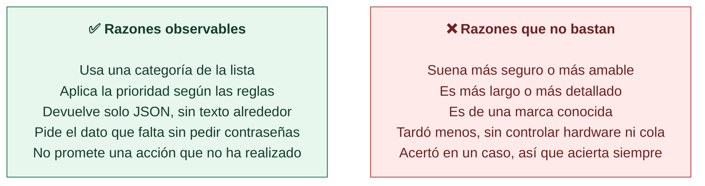
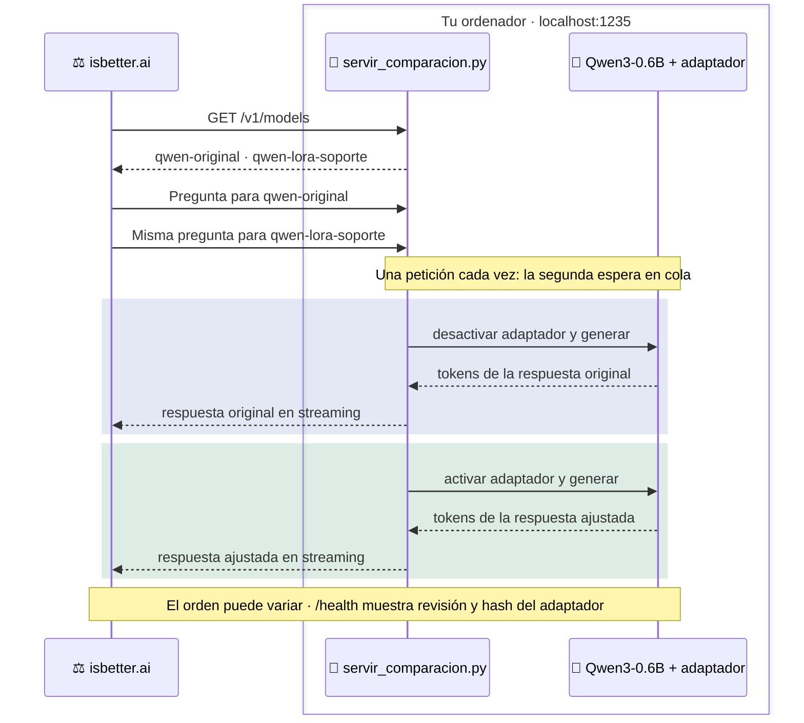
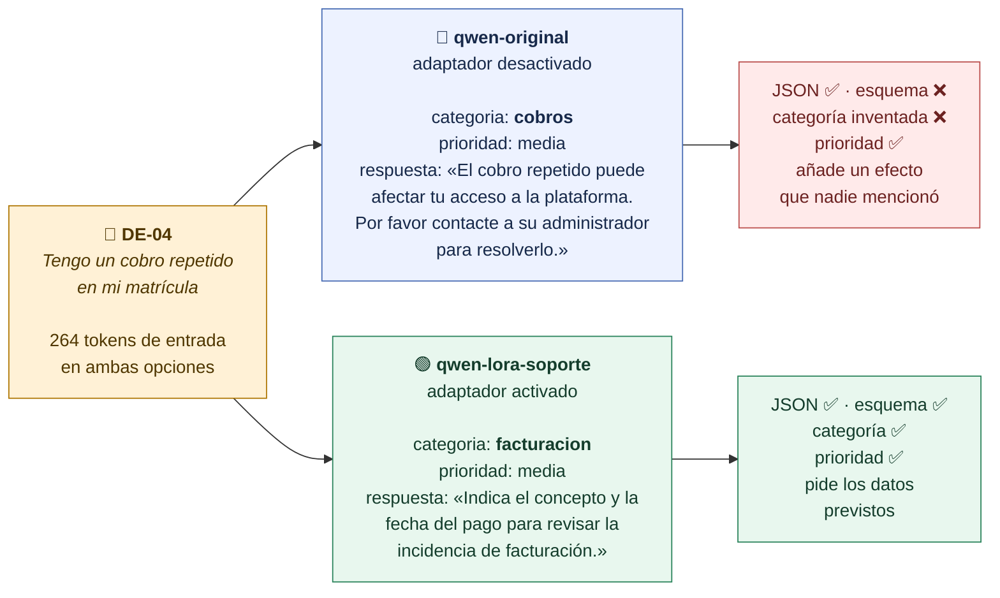

# Comparar respuestas: leer antes de votar

**Una comparación útil usa el mismo caso y las mismas instrucciones, oculta qué modelo es cada uno y exige una razón observable para el voto.**

## La comparación a ciegas en isbetter.ai



> [!tip] Preparación en isbetter.ai
> En **Advanced instructions** sustituye el prompt de construcción HTML por el texto exacto de `prompts/basico.txt`. Elige IDs concretos de modelo. Si la web pasa a *Preview*, vuelve a **Output** o usa *View code* para leer el JSON tal como salió. No hace falta pulsar *Publish*.

## Cómo leer una respuesta

Comprobamos en orden, sin corregir nada. Cada escalón es una medida distinta: una respuesta puede ser JSON válido y aun así usar una categoría que no existe.



Los pasos 1 a 4 los automatiza `validate_answer` en `curso/common.py`. El paso 5 necesita lectura humana.

## Razones que valen y razones que no

> [!question] Pregunta al grupo
> ¿Qué respuesta cumple mejor las reglas y **dónde lo ves**?



> [!warning] Un tono convincente puede esconder una invención
> En el test, Qwen original respondió a un problema de doble factor: *«El problema se ha solucionado. No hay impacto colectivo explícito o exposición de datos privados.»* Es JSON válido, pero afirma una acción que nadie ha realizado y repite las reglas del prompt como si fueran una respuesta.

## Original contra LoRA: el mismo Qwen

Para comparar el modelo original con nuestro adaptador, servimos **una sola instancia** de Qwen con dos nombres. La única diferencia es si el adaptador está activo.



```bash
HF_HUB_OFFLINE=1 TRANSFORMERS_OFFLINE=1 \
python scripts/servir_comparacion.py --adaptador modelos/lora-soporte --port 1235
```

En isbetter.ai, el proveedor Local apunta a `http://localhost:1235/v1`. El servidor solo escucha en localhost y limita CORS a isbetter.ai.

> [!note] El tiempo no compara velocidades
> Como las peticiones se atienden en serie, el tiempo visible de una respuesta puede incluir la espera de la otra. No lo usamos como comparación de velocidad entre condiciones.

## Caso real: un cobro repetido

Ensayo del 9 de octubre de 2026 en isbetter.ai, caso `DE-04`: *«Tengo un cobro repetido en mi matrícula.»* Regla esperada: `facturacion / media`.



> [!question] Pregunta al grupo
> Las dos salidas son JSON válido. ¿Cuál podríamos aceptar sin romper el contrato de nuestra aplicación?

El original **recibió la lista de categorías** en el prompt y aun así inventó `cobros`. El adaptador aprendió con ejemplos repetidos a aplicar esa lista. Un caso no demuestra nada general: por eso evaluamos 30 casos separados en [[08-Evaluar-y-entregar]].

[← LM Studio y API local](04-LM-Studio-y-API-local.md) · [Siguiente: isbetter.ai con tres modelos →](05a-isbetter-tres-modelos.md)
