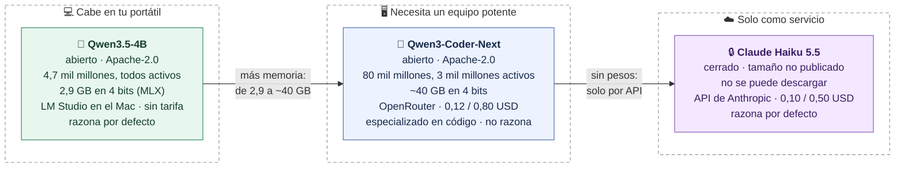

# isbetter.ai en clase: dos rondas

**Ronda 1: pedimos la misma página web a tres modelos y la valoramos a ciegas con pruebas comprobables: uno abierto que cabe en el portátil, uno abierto que necesita un equipo potente y uno cerrado que solo existe como servicio. La pregunta es qué cambia entre ellos y si un abierto puede dar una calidad parecida a la de un cerrado. Ronda 2: el mismo modelo pequeño, con y sin el adaptador LoRA, en nuestra tarea concreta.**

> [!info] Cuándo se usa
> - **Ronda 1**, de 19:12 a 19:20: tres modelos hacen la misma web.
> - **[[#Ronda 2 · El mismo Qwen, con y sin LoRA|Ronda 2]]**, de 19:43 a 19:48: el mismo Qwen3-0.6B con y sin el adaptador LoRA, con el caso DE-04. Va justo después de leer [[07-Como-se-entrena-un-LoRA]].
>
> Ver [[00-Guia-S7#Los 90 minutos|el horario]].

## Los tres modelos



Datos comprobados el **12 y 13 de octubre de 2026** en Hugging Face, OpenRouter, LM Studio y la documentación de Anthropic. Los precios y los catálogos cambian: revísalos antes de cada edición.

|                                  | Qwen3.5-4B                                    | Qwen3-Coder-Next                                        | Claude Haiku 5.5                              |
| -------------------------------- | --------------------------------------------- | ------------------------------------------------------- | --------------------------------------------- |
| **Papel**                        | Abierto que cabe en un portátil               | Abierto que necesita un equipo potente                  | Cerrado, la gama rápida y barata de Anthropic |
| **Fabricante**                   | Alibaba (Qwen)                                | Alibaba (Qwen)                                          | Anthropic                                     |
| **Pesos y licencia**             | Abiertos, Apache-2.0                          | Abiertos, Apache-2.0                                    | Cerrados: términos del servicio               |
| **Parámetros totales**           | 4,7 mil millones (incluye la parte de visión) | 80 mil millones                                         | No publicados                                 |
| **Parámetros activos por token** | Todos (modelo denso)                          | 3 mil millones (modelo MoE)                             | No publicados                                 |
| **Especialidad**                 | General y multimodal: texto, imagen y vídeo   | Código; solo texto                                      | General                                       |
| **¿Razona antes de responder?**  | Sí, por defecto                               | No                                                      | Sí, por defecto                               |
| **Memoria en 4 bits**            | 2,9 GB: cabe de sobra en el Mac de 24 GB      | ~40 GB (80 × 4 ÷ 8): Mac de 64 GB o estación de trabajo | No aplica                                     |
| **Contexto máximo**              | 262.144 tokens                                | 262.144 tokens                                          | Según Anthropic                               |
| **Dónde corre en clase**         | Nuestro Mac (Apple M5, 24 GB)                 | Servidores del proveedor que elige OpenRouter           | Servidores de Anthropic                       |
| **Proveedor en isbetter.ai**     | Local → LM Studio                             | OpenRouter                                              | OpenRouter                                    |
| **Nombre en isbetter.ai**        | `qwen3.5-4b-mlx`                              | **Qwen: Qwen3 Coder Next** (`qwen/qwen3-coder-next`)    | `claude-haiku-5-5`                            |
| **Precio por millón de tokens**  | Sin tarifa                                    | 0,12 USD entrada · 0,80 USD salida                      | 0,10 USD entrada · 0,50 USD salida            |

### Totales frente a activos

Qwen3.5-4B y Qwen3-Coder-Next hacen una cantidad de cálculo parecida por token, unos 3–4 mil millones de parámetros. Coder-Next es un modelo **MoE** (*mixture of experts*, mezcla de expertos): tiene 80 mil millones repartidos en expertos y en cada token solo trabajan unos pocos.

- **La memoria depende de los totales:** hay que cargar los 80 mil millones, unos 40 GB. Por eso no cabe en el Mac.
- **La velocidad depende de los activos:** solo calcula con 3 mil millones por token, así que responde rápido aunque sea grande.
- **El conocimiento depende de los totales:** tiene unas 20 veces más parámetros que el modelo local, y además especializados en código.

### Por qué este trío es razonable

- **Una escalera clara:** portátil → equipo potente → solo servicio. Las dos Qwen son de la misma familia, así que entre ellas cambian sobre todo el tamaño y la especialidad.
- **Qwen3-Coder-Next y Haiku son de la misma gama de precio** y los dos se usan para tareas rápidas.
- **Ninguno tarda demasiado para un directo**, a diferencia de los candidatos descartados (ver [[#Cómo llegamos a este trío|abajo]]).
- **No es una comparación perfectamente igualada:** Coder-Next está especializado en código y no razona, mientras que Haiku es generalista y razona. Conviene decirlo en voz alta.

## Coste orientativo de una web

| Modelo | Cálculo | Coste por web |
|---|---|---|
| Qwen3.5-4B | Sin tarifa; el hardware y la energía no se miden | Desconocido, no cero |
| Qwen3-Coder-Next | Medido en el ensayo por OpenRouter: 2.383 tokens de salida | 0,0020 USD |
| Claude Haiku 5.5 | Medido en el ensayo por OpenRouter: 5.667 tokens de salida | 0,0029 USD |

Cifras del ensayo del 12 de octubre con la primera versión del prompt; con la actual serán parecidas, pero no iguales.

isbetter.ai seguramente **no muestra el coste de Haiku 5.5 por la ruta directa de Anthropic**, porque su tabla de precios llega hasta Haiku 4.5. Por OpenRouter, en cambio, sí lo muestra: el coste lo calcula OpenRouter.

## Preparación, antes de compartir pantalla

1. Arrancar LM Studio con CORS y cargar Qwen3.5-4B:
   ```bash
   ~/.lmstudio/bin/lms server start --port 1234 --cors --bind 127.0.0.1
   ~/.lmstudio/bin/lms load qwen3.5-4b-mlx --identifier qwen3.5-4b-mlx -y
   ```
2. En isbetter.ai, **Connect providers**:
   - **Local**: `http://localhost:1234/v1`. El ejemplo que trae la web, `11434`, es el puerto de Ollama.
   - **OpenRouter**: tu clave `sk-or-…`.
   - **Anthropic**: tu clave `sk-ant-…`.

   Las claves se guardan en el navegador y solo se envían a su proveedor. Nunca se meten con la pantalla compartida.
3. En *Add model*, elegir **modelos fijos, no alias**:
   - `qwen3.5-4b-mlx`, en Local.
   - **Qwen: Qwen3 Coder Next**, en OpenRouter. No confundir con «Qwen3 Coder Flash», «Qwen3 Coder 30B A3B» ni «Qwen3 Coder 480B».
   - `claude-haiku-5-5`, con el icono de Anthropic. Evitar «Claude Haiku Latest»: es un alias de OpenRouter que cambia cuando sale un Haiku nuevo. Si se prefiere OpenRouter, usar el fijo **Anthropic: Claude Haiku 5.5**.
4. Activar el modo ciego.
5. **Advanced instructions: dejar las que trae por defecto.** Ya piden una explicación de 2 a 4 frases y una sola página HTML completa, pulida, responsive y accesible.
6. Al terminar la clase, parar el servidor: mientras tiene CORS activado, cualquier web que visites puede usarlo.
   ```bash
   ~/.lmstudio/bin/lms server stop
   ```

## El prompt

```
Crea una página web, en español, para registrar incidencias de soporte de una plataforma educativa.

Requisitos:
1. Campos: email, selector de categoría con exactamente cuatro opciones (Acceso, Facturación, Técnico, Consulta) y descripción. Un botón «Registrar incidencia».
2. Importante: no uses la etiqueta <form> ni el evento submit, porque la vista previa bloquea el envío de formularios. El botón debe ser type="button" y hacer todo en su evento click.
3. Al pulsar, valida que el email tenga un formato correcto y que la descripción tenga al menos 20 caracteres. Muestra cada error junto a su campo, sin usar alert().
4. Si todo es válido, calcula la prioridad con estas reglas, en este orden:
   - alta: si la descripción habla de todos los usuarios, de un grupo completo o de datos privados;
   - media: si la persona no puede hacer algo («no puedo») o si habla de un cobro;
   - baja: en cualquier otro caso.
   La palabra «urgente» por sí sola no cambia la prioridad.
5. Añade la incidencia a una lista debajo del formulario, con la más reciente arriba. Cada elemento muestra email, categoría, prioridad (con un color distinto para alta, media y baja) y fecha y hora. Después, limpia el formulario.
6. Un contador de caracteres bajo la descripción que se actualice mientras se escribe.
7. No uses librerías externas: solo HTML, CSS y JavaScript propios.
```

- **El requisito 2 es imprescindible.** La vista previa de isbetter.ai se muestra en un iframe aislado (*sandbox*) con permiso solo para `allow-scripts allow-same-origin`, sin `allow-forms` (`src/scripts/preview-security.ts` de isbetter.ai). Sin ese permiso, el navegador bloquea el envío de cualquier `<form>` antes de que se ejecute el código del modelo: el botón no hace nada y no se valida nada. Con la primera versión del prompt, los tres modelos usaron un `<form>` y ninguno registraba la incidencia.
- **El requisito 4 aplica las reglas de prioridad de nuestro caso**, las mismas de `prompts/basico.txt`. Es donde se notan las diferencias entre modelos: la forma de la página es parecida en los tres, pero la lógica puede fallar.
- **El requisito 7 contradice a propósito las instrucciones por defecto**, que permiten librerías externas: así se ve qué modelo obedece la petición concreta.
- Las instrucciones por defecto están en inglés; pedir la interfaz en español es otra prueba.
- No se añade `/no_think`: solo afectaría a los modelos Qwen y la comparación dejaría de ser igual para los tres.

## Las pruebas para votar

Se hacen en *Preview* con cada respuesta, **antes de revelar los modelos**. Usa un email válido, como `alumno@ejemplo.com`, salvo en la prueba del email. Cada fila lleva un ✅ o un ❌.

| Prueba | Qué escribir | Esperado | A | B | C |
|---|---|---|---|---|---|
| Interfaz en español y 4 categorías | Abrir el selector | Acceso, Facturación, Técnico y Consulta | | | |
| Valida el email | Email `hola` con una descripción válida | Error junto al email, sin `alert` | | | |
| Exige 20 caracteres | `no funciona` | Error junto a la descripción | | | |
| Contador | Escribir en la descripción | Se actualiza al escribir | | | |
| Prioridad por impacto colectivo | `Todos los alumnos del grupo no pueden entrar al campus` | **alta** | | | |
| Prioridad por datos privados | `Veo datos privados de otra alumna en mi perfil` | **alta** | | | |
| Prioridad por bloqueo | `No puedo descargar la factura de mi matrícula` | **media** | | | |
| Prioridad por cobro | `Me han hecho un cobro duplicado este mes` | **media** | | | |
| La trampa de «urgente» | `Urgente: ¿cuándo empieza el siguiente módulo del curso?` | **baja** | | | |
| Lista y limpieza | Tras registrar varias | La más reciente arriba, colores por prioridad, fecha y hora; el formulario queda vacío | | | |
| Sin librerías externas | *View code*: buscar `<script src=` o `<link` hacia otra web | Ninguna | | | |
| **Total** | | | /11 | /11 | /11 |

La trampa de «urgente» es la misma que se mide con los 30 casos de test en [[06-Prompting-few-shot-y-fine-tuning]]: una regla escrita en el prompt no garantiza que el modelo la aplique.

## Preguntas para el grupo

### Antes de lanzar

- ¿Cuál creéis que hará la mejor web? ¿Por qué?
- ¿Cuál de los tres podríais ejecutar en vuestro portátil? ¿Y en un PC con una buena tarjeta gráfica?

### Mientras leemos a ciegas

- ¿Qué respuesta cumple más requisitos y **dónde lo veis**?
- ¿Alguna web parece bonita pero falla una prueba?
- ¿Qué modelo aplica bien la regla de «urgente»?
- ¿Alguna ha usado librerías externas aunque se pedía lo contrario?

### Después de revelar

- ¿Os sorprende el resultado? ¿El abierto grande se acerca al cerrado?
- Qwen3-Coder-Next tiene 80 mil millones de parámetros pero solo usa 3 mil millones por token. ¿Qué ocupa memoria y qué marca la velocidad?
- ¿Qué haría falta para ejecutar Qwen3-Coder-Next en casa? Con la fórmula de la diapositiva 9: 80 mil millones × 4 bits ÷ 8 ≈ 40 GB, más el contexto y el sistema.
- ¿Dónde se procesan los datos en cada caso: en vuestro equipo, en un proveedor de OpenRouter o en Anthropic?
- ¿Cuánto costaría cada uno con 10.000 webs al día? ¿Y si el abierto lo ejecutáis vosotros?
- ¿Es justo comparar un modelo especializado en código con uno generalista? ¿Qué cambiaría con otra tarea?
- ¿Una sola web demuestra qué modelo es mejor en todo?

### Puente a la siguiente parte

- ¿Y si la tarea no fuera una web, sino algo concreto como nuestra clasificación de incidencias? ¿Necesitaríamos un modelo grande? Lo vemos con prompting y few-shot ([[06-Prompting-few-shot-y-fine-tuning]]) y con LoRA ([[07-Como-se-entrena-un-LoRA]]).

## Qué conviene decir

- **No es un benchmark:** es una tarea, una ejecución y tres respuestas. Otro prompt podría dar otro resultado.
- **El razonamiento no está igualado:** isbetter.ai no lo controla. En OpenRouter fuerza el razonamiento (`reasoning: {enabled: true}`); los modelos que no razonan, como Qwen3-Coder-Next, lo ignoran. Haiku 5.5 y Qwen3.5-4B razonan por defecto.
- **La velocidad la pone también el proveedor:** OpenRouter, por defecto, da preferencia a los proveedores más baratos, que no siempre son los más rápidos. Abierto o cerrado no decide la velocidad por sí solo.
- **Abierto no significa local:** Qwen3-Coder-Next tiene pesos abiertos, pero hoy lo usamos por API porque no cabe en nuestro equipo.

## Ronda 2 · El mismo Qwen, con y sin LoRA

**El mismo Qwen3-0.6B, con las mismas instrucciones y la misma incidencia. Lo único que cambia es activar el adaptador LoRA.** Responde a la pregunta con la que termina la ronda 1: para una tarea concreta, ¿hace falta un modelo grande?

### Preparación

1. Arrancar el servidor del curso desde la raíz del repositorio, con el entorno activo:
   ```bash
   HF_HUB_OFFLINE=1 TRANSFORMERS_OFFLINE=1 \
   python scripts/servir_comparacion.py --adaptador modelos/lora-soporte
   ```
   Escucha en `127.0.0.1:1235` y solo acepta peticiones de isbetter.ai. Ofrece dos modelos, `qwen-original` y `qwen-lora-soporte`, que son **un único Qwen en memoria**: el servidor activa o desactiva el adaptador en cada petición. Para comprobar que está listo:
   ```bash
   curl http://127.0.0.1:1235/health
   ```
   Debe responder `"status": "ready"` y la huella del adaptador (`adapter_sha256` que empieza por `2ea33355`).
2. En isbetter.ai, **Connect providers → Local**: cambiar a `http://localhost:1235/v1`. Es **1235**, no 1234, que es LM Studio. isbetter.ai solo admite una dirección Local a la vez, así que los modelos de LM Studio desaparecen de la lista. Si los nuevos no aparecen, recargar la página.
3. **Modelos**: quitar los de la ronda 1 y añadir `qwen-original` y `qwen-lora-soporte`. Opcional: `claude-haiku-5-5` como referencia cerrada (no ensayado con este prompt).
4. **Advanced instructions: sustituir las de por defecto por nuestras reglas.** Es imprescindible: las de por defecto piden una web en HTML y el servidor pasa al modelo las instrucciones que envía isbetter.ai. Para copiarlas:
   ```bash
   pbcopy < prompts/basico.txt
   ```
5. Activar **Blind comparison** (tecla B).

### El prompt

Solo la incidencia, el caso DE-04 de `datos/desarrollo.jsonl`:

```
Tengo un cobro repetido en mi matrícula.
```

Se lee en **Output**, no en Preview: la respuesta es JSON, no una web.

### Las pruebas para votar

| Prueba | Esperado | A | B |
|---|---|---|---|
| ¿Es solo JSON? | Sin texto alrededor | | |
| ¿La categoría es una de las 4 permitidas? | acceso, facturacion, tecnico o consulta | | |
| ¿Categoría correcta? | **facturacion** | | |
| ¿Prioridad correcta? | **media**: un problema de cobro | | |
| ¿La respuesta no inventa? | No promete reembolsos, no habla de otros problemas, no pide contraseñas | | |

### Resultado del ensayo

Ensayo del **13 de octubre de 2026** en isbetter.ai. Coincide exactamente con el del 9 de octubre: el servidor genera sin azar (`do_sample: false`, máximo 180 tokens), así que con la misma entrada da la misma salida.

**`qwen-original`**, sin adaptador:

```json
{
  "categoria": "cobros",
  "prioridad": "media",
  "respuesta": "El cobro repetido puede afectar tu acceso a la plataforma. Por favor contacte a su administrador para resolverlo."
}
```

**`qwen-lora-soporte`**, con el adaptador:

```json
{"categoria": "facturacion", "prioridad": "media", "respuesta": "Indica el concepto y la fecha del pago para revisar la incidencia de facturación."}
```

| | qwen-original | qwen-lora-soporte |
|---|---|---|
| JSON válido | ✅ | ✅ |
| Categoría permitida | ❌ `cobros` no existe | ✅ |
| Categoría correcta | ❌ | ✅ `facturacion` |
| Prioridad correcta | ✅ `media` | ✅ `media` |
| La respuesta no inventa | ❌ habla de un acceso que nadie ha mencionado | ✅ |
| Tokens de entrada / salida | 264 / 50 | 264 / 41 |

El original recibió la lista de categorías en las instrucciones y aun así inventó `cobros`. El adaptador aprendió a aplicar esa lista con los 240 ejemplos de entrenamiento.

### Preguntas para el grupo

- ¿Cuál cumple el contrato de nuestra aplicación? ¿Dónde lo veis?
- Los dos han recibido las mismas instrucciones. ¿Qué ha cambiado entonces?
- Hace unos minutos, en la ronda 1, los modelos grandes hacían webs mucho mejores. ¿Por qué aquí basta un modelo de 0,6B ajustado?
- Un caso no demuestra nada general. ¿Cómo lo comprobaríamos de verdad? Con los 30 casos de test: [[08-Evaluar-y-entregar]].

### Qué conviene decir

- **El tiempo que muestra isbetter.ai no compara velocidades:** el servidor atiende las peticiones de una en una, así que la segunda espera a la primera.
- **Consultar no entrena:** ninguna de las dos respuestas cambia los pesos. El adaptador se entrenó antes, en 11 minutos.
- **Si se añade Haiku:** solo recibe las instrucciones, sin los ejemplos few-shot, igual que los dos Qwen. Haiku razona por defecto y no tiene el límite de 180 tokens. En el ejercicio del curso, la condición `claude_prompt` sí lleva los 4 ejemplos.
- **Un segundo caso, si sobra tiempo:** DE-05, «Urgente, me gustaría saber el temario del mes próximo.» (esperado: `consulta` · `baja`). Repite la trampa de «urgente» de la ronda 1. No está ensayado en isbetter.ai.

### Al terminar

- Detener el servidor del curso con Ctrl+C en su terminal.
- Parar LM Studio: `~/.lmstudio/bin/lms server stop`.
- Volver a dejar las Advanced instructions por defecto (**Reset to default**) y Local en `http://localhost:1234/v1` para la próxima clase.

## Cómo llegamos a este trío

Ensayos del **12 de octubre de 2026** en isbetter.ai, con la primera versión del prompt (el formulario con JSON) y las instrucciones por defecto. La versión actual se probó el 13 de octubre con el trío elegido: los tres registran incidencias.

| Modelo probado | Resultado | Decisión |
|---|---|---|
| Claude Haiku 5.5 (alias «Claude Haiku Latest», por OpenRouter) | Web completa: 18,2 s, 4.906 tokens de salida, 330 tokens/s, 0,0025 USD | Se queda, con el ID fijo |
| Gemma 4 31B (OpenRouter) | Web completa, pero **140,6 s** a 21 tokens/s; 2.932 tokens, 0,0010 USD | Descartado: demasiado lento para un directo |
| GLM-5.3-Flash (OpenRouter) | A 41 tokens/s y **sin terminar después de 300 s** | Descartado |
| Qwen3.5-4B (local; prueba por la API de LM Studio, fuera de isbetter.ai) | Web completa: 88 s, 3.138 tokens (449 de razonamiento); sin `alert()` ni librerías externas | Elegido como modelo local |
| Qwen3-Coder-Next (OpenRouter) | Web completa: 38,3 s, 2.383 tokens de salida, 64 tokens/s, 0,0020 USD | Elegido como abierto grande |
| Trío elegido, misma ronda | Haiku 20,4 s y 5.667 tokens (0,0029 USD); Qwen3.5-4B 75,6 s y unos 2.446 tokens; Qwen3-Coder-Next 38,3 s | Los tres terminan en menos de 80 s |

Kimi K3 (2,8 billones de parámetros, 1.561 GB de pesos) se descartó antes de probarlo: solo cabe en un centro de datos y es mucho más caro que Haiku, así que la comparación no sería justa.

## Si algo falla

| Problema | Qué hacer |
|---|---|
| isbetter.ai no conecta con Local | Comprobar `curl http://localhost:1234/v1/models`. Si la API responde y el navegador no, seguir con los otros dos y enseñar la web local generada en el ensayo, diciendo que es una ejecución anterior |
| Qwen3.5-4B no termina o tarda demasiado | Anotarlo como resultado; el modelo local depende del Mac y de lo que haya abierto |
| Un proveedor devuelve error | Conservar el error, no cambiar de modelo en silencio y seguir con los otros dos |
| Qwen3-Coder-Next va lento | La velocidad depende del proveedor que elija OpenRouter; comentarlo y valorar solo la calidad |
| El botón no hace nada en ninguna web | La web usa `<form>`: la vista previa bloquea los formularios. Comprobar que el prompt incluye el requisito 2 |
| La web pasa a *Preview* y no se ve el código | Usar *View code* |
| Ronda 2: no aparecen `qwen-original` ni `qwen-lora-soporte` | El servidor del curso no está arrancado o Local sigue en `:1234`. Comprobar `curl http://127.0.0.1:1235/health` y recargar isbetter.ai |
| Ronda 2: el modelo devuelve HTML en vez de JSON | Las Advanced instructions siguen siendo las de por defecto: pegar `prompts/basico.txt` |

[← Comparar respuestas](05-Comparar-respuestas.md) · [Siguiente: prompting, few-shot y fine-tuning →](06-Prompting-few-shot-y-fine-tuning.md)
