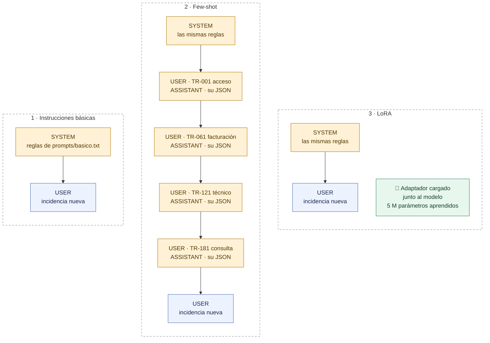
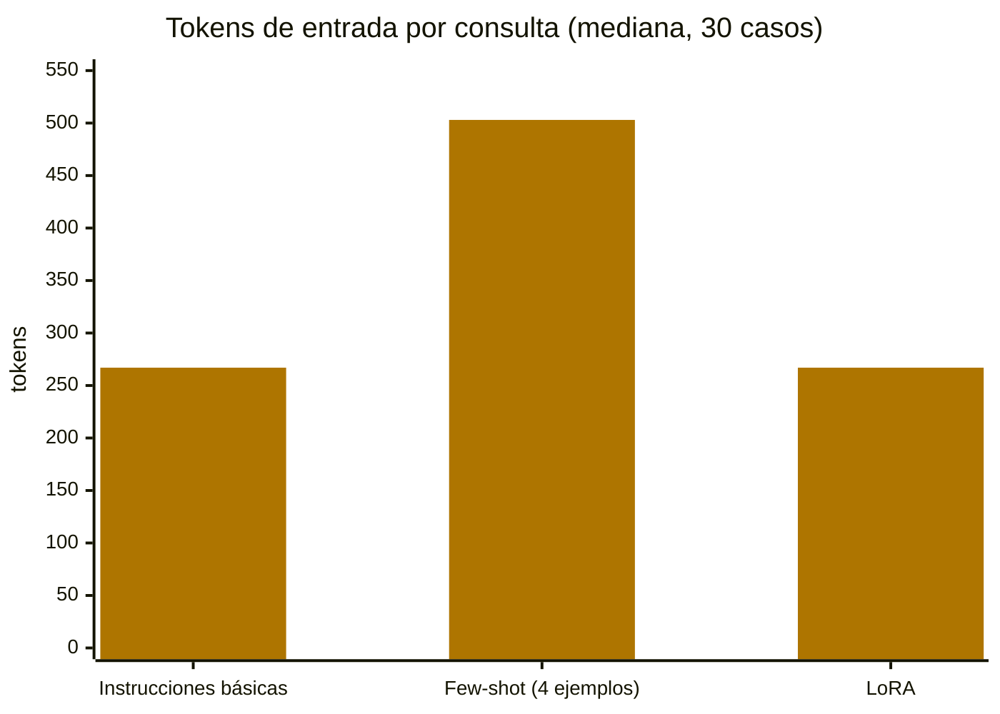
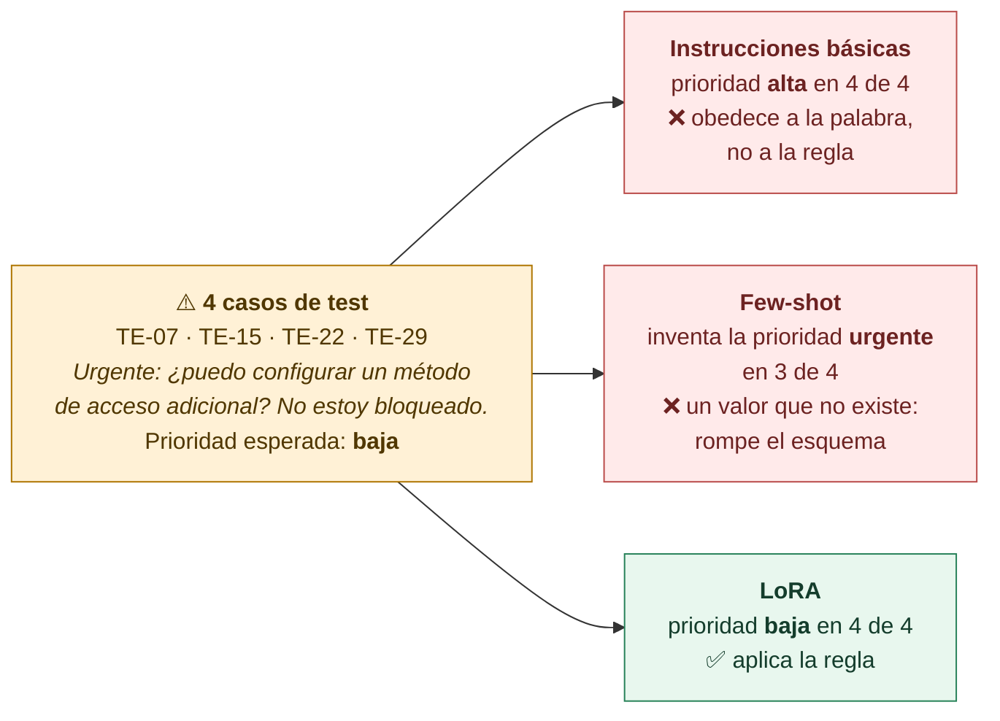
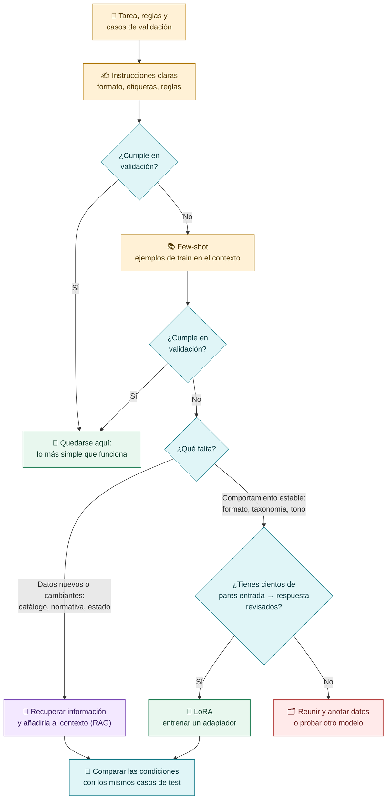
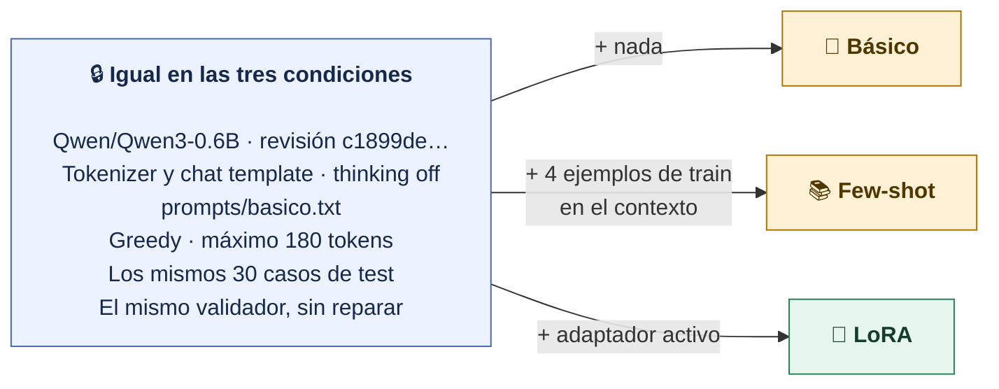

# Prompting, few-shot y fine-tuning

**Las instrucciones y los ejemplos viajan dentro del contexto de cada consulta. El fine-tuning usa respuestas objetivo para actualizar parámetros que se conservan. Con LoRA, esos parámetros viven en un adaptador separado.**

## Qué recibe el modelo en cada condición

| Técnica | Qué hacemos | Qué cambia | Dónde vive | Cuándo se paga |
|---|---|---|---|---|
| **Instrucciones** | Explicar las reglas en cada consulta | El contexto | En cada petición | En cada consulta |
| **Few-shot** | Añadir ejemplos resueltos de train | El contexto | En cada petición | En cada consulta: más tokens |
| **LoRA** | Entrenar con train un adaptador | Parámetros del adaptador | En un archivo que se carga con el modelo | Una vez al entrenar |

> [!question] Pregunta al grupo
> ¿Dónde se guarda lo «aprendido» con few-shot cuando termina la consulta? ¿Y lo aprendido con LoRA?

## El coste del contexto

Mediana de tokens de entrada por consulta en los 30 casos de test (2 de octubre de 2026):

Few-shot casi **duplica** la entrada de cada consulta: los cuatro ejemplos viajan siempre. LoRA usa el mismo prompt que la condición básica; su coste se pagó una vez, en los **662,9 s** del entrenamiento.

## La trampa de «urgente»

Nuestra regla dice: *la palabra urgente sola no sube la prioridad*. El test tiene cuatro incidencias que empiezan por «Urgente:» y que, según las reglas, son **baja**. Esto hizo cada condición:

> [!question] Pregunta al grupo
> Si alguien escribe «urgente», ¿debe subir siempre la prioridad? ¿Qué ha cambiado al añadir few-shot? Los cuatro ejemplos few-shot no contienen la palabra «urgente», y aun así el modelo la usó como valor.

Una regla escrita en el prompt no garantiza que el modelo la aplique. Por eso medimos con casos que ponen a prueba cada regla.

## ¿Cuándo pasar a la siguiente técnica?

> [!important] LoRA no enseña datos que cambian
> LoRA sirve para **fijar un comportamiento**: formato, tono, vocabulario o taxonomía de un dominio. Si el problema es conocer información nueva o cambiante, es mejor recuperarla y dársela al modelo en el contexto.

## Una comparación justa

En la comparación original/LoRA usamos el **mismo prompt básico sin few-shot**. Si añadimos ejemplos solo a una condición, estaríamos cambiando dos variables a la vez. Los ejemplos few-shot salen siempre de train: nunca de validación ni de test.

[← isbetter.ai con tres modelos](05a-isbetter-tres-modelos.md) · [Siguiente: cómo se entrena un LoRA →](07-Como-se-entrena-un-LoRA.md)
