# Cómo hicimos el fine-tuning con LoRA

**Partimos de un Qwen3-0.6B que no aplicaba bien nuestras reglas. Le enseñamos con 240 ejemplos sintéticos a clasificar incidencias y, en lugar de modificar el modelo, entrenamos un adaptador LoRA de 20 MB. En 30 casos nuevos pasó de 3 a 26 aciertos completos.**

> [!info] Cómo usar esta nota
> - **Parte 1 · Lo que hicimos** (secciones 1 a 9) se lee en clase de arriba abajo: problema, técnica, datos, archivos, entrenamiento, resultado y un antes y después real.
> - **Parte 2 · Para reproducirlo** (secciones 10 a 15) es la referencia para la práctica: comandos y código de `scripts/entrenar_lora.py` bloque a bloque.
>
> No entrenamos en directo: el entrenamiento se ejecutó el **2 de octubre de 2026** en un Apple M5 con 24 GB y tardó **662,9 s** (unos 11 minutos). Todo lo que aparece aquí sale de esa ejecución y de sus archivos.

# Parte 1 · Lo que hicimos

## 1 · El problema de partida

Queremos que el modelo lea una incidencia de una plataforma educativa ficticia y devuelva **solo** un JSON con `categoria`, `prioridad` y `respuesta`, siguiendo las reglas de `prompts/basico.txt` (ver [[00-Guia-S7#El caso práctico que une toda la sesión|el caso práctico]]).

Con esas instrucciones, Qwen3-0.6B **original** devolvía JSON, pero aplicaba mal las reglas. Ejemplo real, caso `DE-04` (9 de octubre de 2026):

> **Incidencia:** «Tengo un cobro repetido en mi matrícula.»
> **Lo esperado según las reglas:** `facturacion` · `media`

```json
{
  "categoria": "cobros",
  "prioridad": "media",
  "respuesta": "El cobro repetido puede afectar tu acceso a la plataforma. Por favor contacte a su administrador para resolverlo."
}
```

`cobros` no es una de las cuatro categorías permitidas, aunque el prompt las enumera. Y la respuesta habla de un acceso que nadie ha mencionado.

En los 30 casos de test, antes de entrenar:

| Condición | Qué recibe el modelo | Categoría y prioridad correctas a la vez |
|---|---|---:|
| Original con instrucciones | El prompt con las reglas | **3 de 30** |
| Original con few-shot | El prompt y 4 ejemplos resueltos | **10 de 30** |

Few-shot ayudaba, pero no bastaba. Por eso probamos a **entrenar**. Este es el recorrido completo que seguimos:

```mermaid
---
config:
  flowchart:
    wrappingWidth: 400
---
flowchart LR
    D["🗂️ <b>Datos</b><br/>train.jsonl<br/>240 pares"] --> C["💬 <b>Conversaciones</b><br/>system + user<br/>+ assistant objetivo"]
    C --> T["✂️ <b>Tokens y etiquetas</b><br/>chat template<br/>prompt con -100"]
    T --> E["🔁 <b>Entrenar</b><br/>SFTTrainer<br/>60 pasos, solo A y B"]
    E --> A["🧩 <b>Adaptador</b><br/>adapter_model.safetensors<br/>20 MB"]
    A --> R["♻️ <b>Recargar</b><br/>base + adaptador<br/>en un proceso nuevo"]
    R --> V["🧪 <b>Evaluar</b><br/>30 casos de test<br/>sin reajustar"]
    classDef datos fill:#fff1d6,stroke:#ae7500,color:#503700
    classDef ajuste fill:#e8f7ee,stroke:#268158,color:#143d2c
    classDef base fill:#edf2ff,stroke:#4569b2,color:#17294a
    classDef decision fill:#e0f5f7,stroke:#1f7f8c,color:#0d3a40
    class D,C,T datos
    class E,A ajuste
    class R base
    class V decision
```

## 2 · La técnica: fine-tuning supervisado con LoRA

### Qué es fine-tuning

Un modelo es una enorme colección de números, los **pesos** (Qwen3-0.6B tiene 751,6 millones). **Fine-tuning** es seguir entrenándolo con ejemplos nuestros para que esos números cambien y el modelo responda como queremos sin explicárselo en cada petición. Prompting y few-shot no cambian ningún peso: solo añaden texto a la petición.

Hicimos **SFT** (*Supervised Fine-Tuning*, ajuste supervisado): le mostramos pares **incidencia → respuesta correcta** y el modelo aprende a producir esa respuesta.

### Por qué LoRA y no un fine-tuning completo

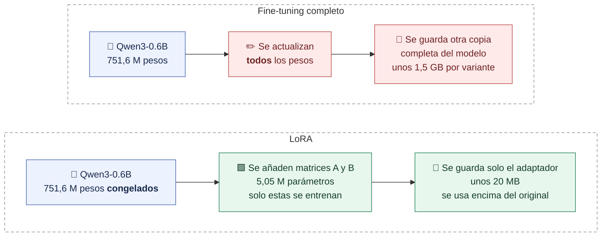

**LoRA** (*Low-Rank Adaptation*, adaptación de bajo rango) congela el modelo original y añade, junto a algunas de sus matrices, dos matrices pequeñas **A** y **B**. Solo se entrenan A y B. El resultado es un **adaptador**: un archivo pequeño que se carga encima del modelo original.

Lo elegimos por cuatro razones:

| Razón | En nuestro caso |
|---|---|
| **Cabe en un portátil** | Solo se calculan gradientes de 5,05 M parámetros, no de 751,6 M; se entrenó en un Mac en 11 minutos |
| **Ocupa poco** | El adaptador pesa 20,2 MB frente a 1,5 GB del modelo |
| **La base no cambia** | Original y LoRA comparten exactamente el mismo modelo: la comparación es justa, y quitando el adaptador vuelves al original |
| **Es lo que pide la tarea** | Queremos fijar un **comportamiento** (formato, categorías, reglas de prioridad), no enseñar información nueva |

Una imagen para clase: el modelo base es un libro impreso y el adaptador es una hoja de correcciones que se coloca encima. No reimprimimos el libro, y sin el libro la hoja no sirve de nada.

> [!warning] Qué no es LoRA
> - **No es una base de datos** de ejemplos: el adaptador guarda números aprendidos, no busca frases de `train.jsonl`.
> - **No es few-shot**: los ejemplos no viajan en cada petición; su efecto queda en A y B.
> - **No sirve para datos que cambian**: para información nueva o cambiante es mejor recuperarla y dársela al modelo en el contexto.
> - **No garantiza mejorar**: por eso se evalúa con un test separado.

### Por qué Qwen3-0.6B

Es pequeño (se descarga y entrena en minutos), tiene licencia Apache-2.0 y sus pesos originales están en Safetensors, el formato que usan Transformers y PEFT para entrenar. Es bueno para **aprender el proceso**; no demuestra que sea el mejor modelo para un producto.

### Qué hace LoRA dentro de una capa

LoRA deja intacta la matriz original `W₀` y le suma una corrección hecha con dos matrices estrechas:

$$
W_{\mathrm{efectiva}} = W_0 + \frac{\alpha}{r}\,B A
$$

- **`r`, el rango**: el ancho de A y B. Cuanto mayor, más capacidad y más parámetros. Usamos `r = 8`.
- **`alpha`**: un volumen que escala la corrección. La escala real es `alpha ÷ r`; con `alpha = 16` y `r = 8` vale 2.

Con números reales de una proyección `q_proj` de Qwen3-0.6B:

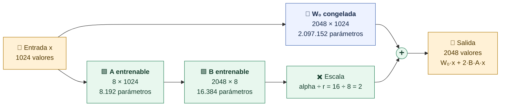

En esta capa, A y B suman **24.576 parámetros entrenables frente a 2.097.152 congelados (1,2 %)**. Antes de entrenar, B empieza en ceros: el adaptador recién creado no cambia nada.

Aplicamos LoRA a **7 proyecciones** (`q_proj`, `k_proj`, `v_proj`, `o_proj`, `gate_proj`, `up_proj`, `down_proj`) en cada una de las **28 capas**: 28 × 7 × 2 = **392 matrices**.

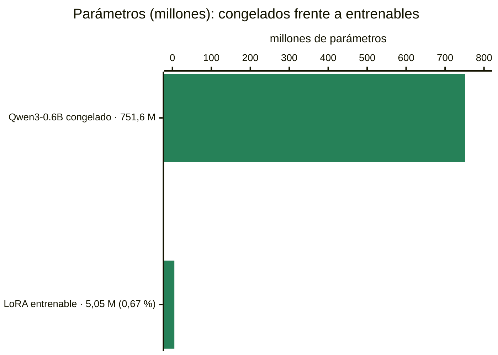

## 3 · Los datos que usamos

### Qué tipo de datos

- **Sintéticos**: incidencias ficticias escritas para el curso, sin datos de personas reales.
- **En español**, de una plataforma educativa: acceso, facturación, problemas técnicos y consultas.
- **Anotados antes de entrenar**: cada incidencia trae su respuesta correcta según las reglas del prompt.
- **En formato JSONL**: un objeto JSON por línea.

Un registro real, `TR-061` de `datos/train.jsonl`:

```json
{
  "id": "TR-061",
  "familia": "train-facturacion-00",
  "incidencia": "Tengo dos cargos del mismo curso en mi tarjeta.",
  "objetivo": {
    "categoria": "facturacion",
    "prioridad": "media",
    "respuesta": "Indica el concepto y la fecha del pago para revisar la incidencia de facturación."
  }
}
```

`id` y `familia` son metadatos para nosotros. **Solo `incidencia` y `objetivo` entran en el entrenamiento.**

### Cómo se construyeron

`scripts/preparar_datos.py` contiene **40 situaciones de train** escritas a mano, 10 por categoría, cada una con su prioridad. A cada una le añade **6 prefijos** («», «Os escribo por lo siguiente: », «Quería comunicar esto: », «Sobre el campus del curso: », «Necesito orientación: », «Buenas, mi situación es esta: »). Resultado: **240 ejemplos**, 60 por categoría.

| Categoría | Alta | Media | Baja | Total |
|---|---:|---:|---:|---:|
| acceso | 12 | 30 | 18 | 60 |
| facturacion | 12 | 30 | 18 | 60 |
| tecnico | 12 | 30 | 18 | 60 |
| consulta | — | — | 60 | 60 |

Incluye a propósito casos que ponen a prueba las reglas, por ejemplo «Urgente: quiero información sobre los precios para el próximo año.» etiquetado como `baja`.

> [!warning] Diversidad limitada
> Los 240 ejemplos son 40 situaciones con variantes cercanas, y cada categoría tiene **una sola respuesta tipo** (por ejemplo, «Indica el concepto y la fecha del pago para revisar la incidencia de facturación.» aparece 60 veces). Es suficiente para una demostración controlada; una aplicación real necesitaría más variedad y respuestas revisadas.

### Las cuatro particiones

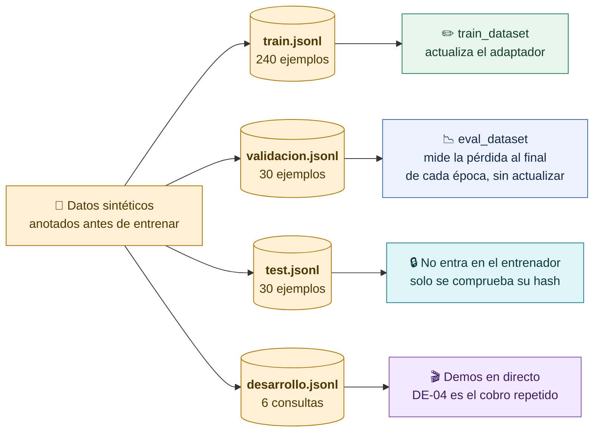

Validación y test tienen un caso por familia y sin prefijos. Las particiones no comparten ID, texto ni familia: el test contiene incidencias que el modelo nunca vio. Los 4 ejemplos de few-shot son `TR-001`, `TR-061`, `TR-121` y `TR-181`, uno por categoría, todos de train.

## 4 · Dónde están los archivos

| Qué | Archivo | En Git |
|---|---|---|
| Ejemplos de entrenamiento | `datos/train.jsonl` (240) | Sí |
| Ejemplos de validación | `datos/validacion.jsonl` (30) | Sí |
| Casos de test | `datos/test.jsonl` (30) | Sí |
| Casos para demos | `datos/desarrollo.jsonl` (6, DE-01 a DE-06) | Sí |
| Cómo se generaron los datos | `scripts/preparar_datos.py` | Sí |
| Instrucciones comunes | `prompts/basico.txt` | Sí |
| Ejemplos de few-shot | `prompts/fewshot-ids.json` | Sí |
| Hashes del experimento congelado | `config/experimento-congelado.json` | Sí |
| Receta de entrenamiento | `scripts/entrenar_lora.py` | Sí |
| Carga del modelo y chat template | `curso/qwen.py` (`load_qwen`, `render`) | Sí |
| Lectura de datos, prompt y validador | `curso/common.py` | Sí |
| Recorrido guiado | `notebooks/S7-LoRA.ipynb` | Sí |
| **El adaptador entrenado** | `modelos/lora-soporte/` | No: se obtiene al entrenar |
| Respuestas y resultados de test | `resultados/`, generados con `scripts/evaluar_qwen.py` y `scripts/resumir.py` | No: se obtienen al evaluar |
| Comparación DE-04 en isbetter.ai | Ensayos del 9 y 13 de octubre de 2026, citados en la sección 9 | No |

El modelo base no está en el repositorio: se descarga con `scripts/descargar_modelo.py` a la caché de Hugging Face, en la revisión `c1899de289a04d12100db370d81485cdf75e47ca`.

## 5 · Cómo se convierte un ejemplo en algo que el modelo puede aprender

Cada fila se convierte en una conversación con tres papeles. El **system** lleva las mismas instrucciones que usamos al consultar, el **user** la incidencia y el **assistant** la respuesta correcta:

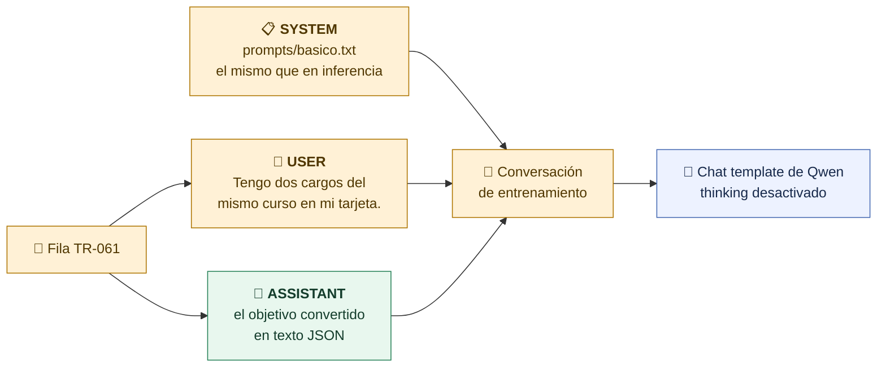

El **chat template** de Qwen pone marcas de rol, y el **tokenizer** convierte el texto en números, los **tokens**. En `TR-061` salen **263 tokens de contexto** y **42 de respuesta**:

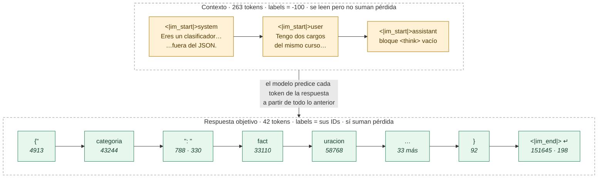

La clave está en las **etiquetas** (`labels`):

- En el contexto valen `-100`, que significa «ignorar»: el modelo lo lee, pero no se le corrige por él.
- En la respuesta, cada etiqueta es el token correcto: el modelo aprende a predecirlos uno a uno.

Así aprende a **contestar** a la incidencia, no a repetir el prompt.

## 6 · La receta y el entrenamiento

| Parámetro | Valor | Qué significa | Criterio |
|---|---|---|---|
| `r` | 8 | Ancho de A y B | Suficiente para una tarea de formato y clasificación; adaptador pequeño |
| `lora_alpha` | 16 | Volumen de la corrección (16 ÷ 8 = 2) | Convención habitual: el doble del rango |
| `target_modules` | 7 proyecciones | Dónde se añaden A y B | Atención y MLP: más sitios con poco rango |
| `lora_dropout` | 0,05 | Apaga al azar un 5 % de la entrada de LoRA al entrenar | Evita depender de detalles concretos |
| Épocas | 2 | Pasadas completas por los 240 ejemplos | Con más, el riesgo es memorizar las variantes |
| Learning rate | 0,0002 | Tamaño de cada corrección; baja hasta casi cero | Valor habitual para LoRA |
| Batch × acumulación | 2 × 4 | 8 ejemplos por actualización | Poca memoria a la vez |
| Longitud máxima | 768 tokens | Un ejemplo más largo se rechaza | No cortar respuestas en silencio |
| Semilla | 42 | Repite el azar | Reproducibilidad |

Son valores habituales para un modelo pequeño y una tarea de formato. La receta se fijó **antes** de mirar el test: no se probaron valores para mejorar el resultado.

**240 ejemplos ÷ batch 2 = 120 tandas por época. ÷ acumulación 4 = 30 actualizaciones por época. × 2 épocas = 60 pasos.** En cada paso:

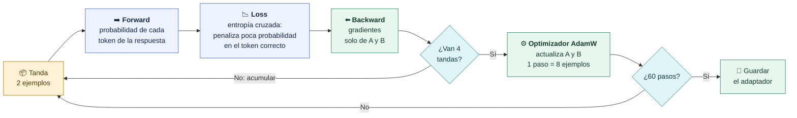

- **Forward**: el modelo calcula, para cada posición de la respuesta, la probabilidad de cada token posible.
- **Loss** (pérdida): cuánto se equivoca. Es baja si dio mucha probabilidad al token correcto.
- **Backward**: calcula los **gradientes**, la dirección en que habría que mover cada número para equivocarse menos. Solo se calculan para A y B.
- **Optimizador**: mueve A y B un poco en esa dirección.

### La ejecución

| Dato | Valor |
|---|---|
| Comando | `python scripts/entrenar_lora.py --salida modelos/lora-soporte` |
| Fecha | 2 de octubre de 2026 |
| Equipo | Apple M5 con 24 GB, GPU del Mac (MPS), precisión FP32, sin cuantizar |
| Duración | 662,9 s |
| Librerías | torch 2.8.0, transformers 4.56.2, trl 0.23.1, peft 0.17.1, datasets 4.1.1, accelerate 1.10.1 |
| Coste | No medido (local; energía y hardware no contabilizados) |

## 7 · Qué pasó durante el entrenamiento

Valores reales de `modelos/lora-soporte/entrenamiento.json`, registrados cada 10 pasos:

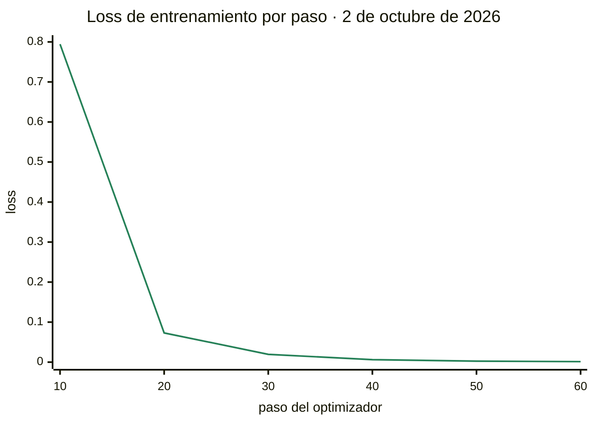

| Paso | Época | Loss train | Loss validación | Precisión media por token (train) |
|---:|---:|---:|---:|---:|
| 10 | 0,33 | 0,7944 | — | 0,818 |
| 20 | 0,67 | 0,0730 | — | 0,979 |
| 30 | 1,00 | 0,0195 | **0,0156** | 0,993 |
| 40 | 1,33 | 0,0062 | — | 0,999 |
| 50 | 1,67 | 0,0025 | — | 1,000 |
| 60 | 2,00 | 0,0013 | **0,0122** | 1,000 |

- La **loss** mide cuánto se equivoca el modelo al predecir la respuesta correcta. Cae muy rápido: los ejemplos son muy repetitivos.
- La loss de **validación** también baja (0,0156 → 0,0122): no hay la señal típica de sobreajuste, que sería verla subir mientras la de train baja.

> [!warning] Una loss baja no es un 100 % de acierto
> La precisión por token llega a 1,000 en train, pero mide respuestas ya vistas. Lo que importa es acertar categoría y prioridad en incidencias **nuevas**: eso lo dice el test.

## 8 · Qué produjo el entrenamiento

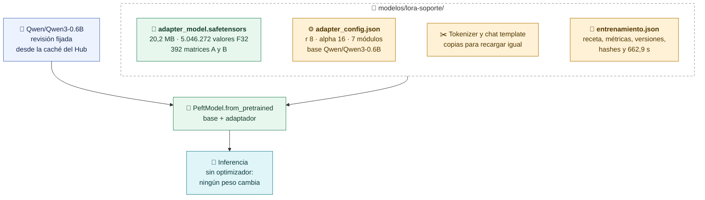

Para usarlo se carga Qwen3-0.6B y encima el adaptador (`PeftModel.from_pretrained` en `curso/qwen.py:load_qwen`). Consultar **no entrena**: no hay optimizador y ningún peso cambia.

## 9 · Antes y después

### El mismo caso, el mismo modelo, con y sin adaptador

`DE-04` en isbetter.ai, 9 de octubre de 2026. El mismo Qwen3-0.6B, la misma revisión, el mismo prompt básico **sin few-shot**, generación sin azar y como máximo 180 tokens. La única diferencia es activar el adaptador.

> **Incidencia:** «Tengo un cobro repetido en mi matrícula.» · **Esperado:** `facturacion` · `media`

**Antes, Qwen original:**

```json
{
  "categoria": "cobros",
  "prioridad": "media",
  "respuesta": "El cobro repetido puede afectar tu acceso a la plataforma. Por favor contacte a su administrador para resolverlo."
}
```

**Después, Qwen con el adaptador LoRA:**

```json
{"categoria": "facturacion", "prioridad": "media", "respuesta": "Indica el concepto y la fecha del pago para revisar la incidencia de facturación."}
```

| | Original | Con LoRA |
|---|---|---|
| JSON válido | ✅ | ✅ |
| Categoría permitida | ❌ `cobros` no existe | ✅ |
| Categoría correcta | ❌ | ✅ `facturacion` |
| Prioridad correcta | ✅ `media` | ✅ `media` |
| Tokens de entrada / salida | 264 / 50 | 264 / 41 |

Las dos respuestas se conservan tal como salieron: no se reparó ni se reintentó nada.

### Tres casos de test

Respuestas originales de las tres condiciones, 2 de octubre de 2026:

| Caso | Esperado | Original | Few-shot | LoRA |
|---|---|---|---|---|
| `TE-05` «En mi perfil autenticado puedo ver el teléfono privado de otra alumna.» | `acceso` · `alta` (datos privados expuestos) | `consulta` · `media` ❌ | `tecnico` · `media` ❌ | `acceso` · `alta` ✅ |
| `TE-15` «Urgente: ¿las tarifas publicadas incluyen los impuestos? Solo estoy consultando» | `facturacion` · `baja` («urgente» no sube) | `consulta` · `alta` ❌ | `consulta` · `baja` ❌ | `facturacion` · `baja` ✅ |
| `TE-25` «¿Los directos se quedan grabados durante todo el programa?» | `consulta` · `baja` | `consulta` · `media` ❌ | `tecnico` · `media` ❌ | `tecnico` · `media` ❌ |

`TE-25` es uno de los 4 fallos del LoRA: lo aprendido no es infalible.

### El resultado en los 30 casos de test

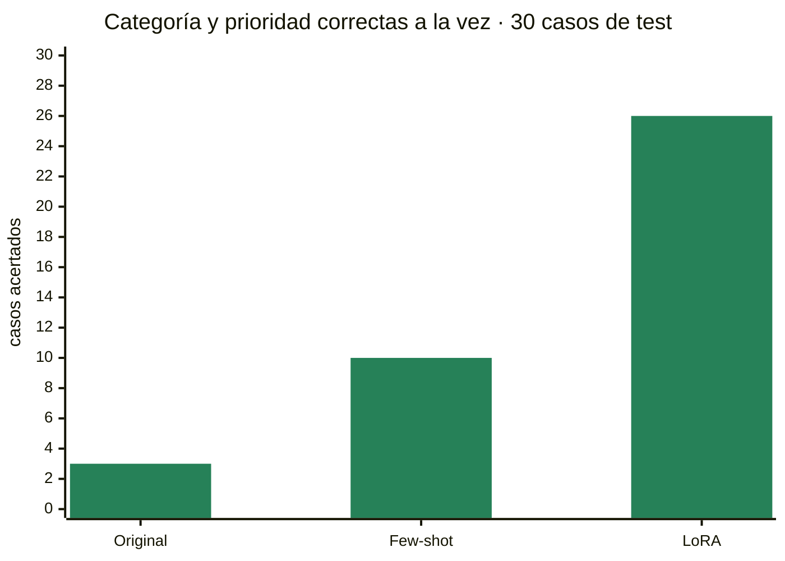

| Condición | JSON válido | Categoría | Prioridad | **Ambas** |
|---|---:|---:|---:|---:|
| Original con instrucciones | 30/30 | 14/30 | 7/30 | **3/30** |
| Original con few-shot | 30/30 | 15/30 | 19/30 | **10/30** |
| Original con LoRA | 30/30 | 26/30 | 29/30 | **26/30** |

Las cuatro incidencias de test que empiezan por «Urgente:» y son `baja` las acertó el LoRA; el original y few-shot fallaron las cuatro.

> [!note] Qué aprendió y qué no
> - **Mejoró mucho la clasificación**: usa solo las categorías permitidas y aplica las reglas de prioridad.
> - **La respuesta es una plantilla**: como en train cada categoría tenía una sola respuesta tipo, el LoRA la reproduce. Es correcta y prudente, pero genérica.
> - Son **30 casos sintéticos**: un buen resultado aquí no demuestra que funcione con incidencias reales.

El análisis completo de errores, la publicación en Hugging Face y la entrega están en [[08-Evaluar-y-entregar]].

# Parte 2 · Para reproducirlo

## 10 · Los comandos, de una copia nueva al adaptador recargado

Todos se ejecutan **desde la raíz del repositorio** y con el entorno de entrenamiento activo. El paso 3 entrena: tarda y no se hace en clase.

### Paso 0 · Preparar el entorno (una vez)

```bash
uv venv --python 3.12 .venv
uv pip sync --python .venv requirements-training.lock
source .venv/bin/activate
```

`requirements-training.lock` incluye PyTorch, Transformers, PEFT, TRL, Datasets y Jupyter con versiones exactas. Sin `uv`: `python -m venv .venv`, activar y `python -m pip install --require-hashes -r requirements-training.lock`. En Windows se activa con `.venv\Scripts\Activate.ps1`.

### Paso 1 · Descargar el modelo base (una vez, con red)

```bash
python scripts/descargar_modelo.py
```

Descarga `Qwen/Qwen3-0.6B` en una revisión fijada (unos 1,5 GB) a la caché de Hugging Face. Al terminar imprime `{"modelo": "Qwen/Qwen3-0.6B", "revision": "...", "descargado": true}`. Descargar **no entrena ni consulta** nada.

### Paso 2 · Comprobar antes de entrenar

```bash
python scripts/preflight.py
python -m unittest discover -s tests -v
```

`preflight.py` comprueba datos, hashes, dependencias y si ya existe un adaptador, sin hacer inferencia. Los tests usan simulaciones: no demuestran que tu equipo pueda entrenar, pero detectan datos o código alterados.

### Paso 3 · Entrenar

```bash
python scripts/entrenar_lora.py --salida modelos/lora-soporte
```

Si ya descargaste el modelo y quieres trabajar sin red:

```bash
HF_HUB_OFFLINE=1 TRANSFORMERS_OFFLINE=1 \
python scripts/entrenar_lora.py --salida modelos/lora-soporte
```

Qué verás en la terminal:

1. La carga del modelo y una barra de progreso de **60 pasos**.
2. Cada 10 pasos, un diccionario con `loss`, `learning_rate`, `mean_token_accuracy` y `epoch`.
3. Al final de cada época, la validación: `eval_loss`.
4. Al terminar, una línea como `{"adapter": ".../modelos/lora-soporte", "duracion_s": 662.88, "device": "mps"}`.

> [!warning] Antes de lanzarlo
> - Tarda: unos 11 minutos en el Mac de referencia; en CPU puede tardar mucho más. Usa CUDA, MPS o CPU automáticamente.
> - Es local: no usa servicios de pago ni sube datos.
> - **No sobrescribe**: si la carpeta de `--salida` ya tiene contenido, se detiene con `Salida no vacía; usa otro --salida para conservar el entrenamiento anterior`. Para un segundo intento usa otra carpeta, por ejemplo `--salida modelos/lora-soporte-2`.

### Paso 4 · Mirar lo que ha generado

```bash
ls -lh modelos/lora-soporte
python -m json.tool modelos/lora-soporte/adapter_config.json
python -m json.tool modelos/lora-soporte/entrenamiento.json
```

### Paso 5 · Recargar y probar original frente a LoRA

```bash
# Original: sin adaptador
python scripts/demo.py --proveedor qwen --caso DE-04

# El mismo Qwen con el adaptador encima, en un proceso nuevo
python scripts/demo.py --proveedor qwen --caso DE-04 --adaptador modelos/lora-soporte
```

DE-04 es el caso del cobro repetido de `datos/desarrollo.jsonl`. Consultar **no entrena**: no hay optimizador y ningún peso cambia.

### Paso 6 · Evaluar en test y comparar

```bash
python scripts/evaluar_qwen.py --condicion qwen_lora --split test \
  --adaptador modelos/lora-soporte --salida resultados/ensayo/qwen_lora.jsonl
python scripts/resumir.py --carpeta resultados/ensayo --destino resultados/ensayo/informe
```

La evaluación completa de las tres condiciones está en [[08-Evaluar-y-entregar]]; la comparación en isbetter.ai, en [[05-Comparar-respuestas]].

| Paso | Comando | Escribe | Red | Tiempo aproximado |
|---|---|---|---|---|
| 0 | `uv pip sync … requirements-training.lock` | `.venv/` | Sí | Minutos |
| 1 | `scripts/descargar_modelo.py` | Caché de Hugging Face | Sí | Según conexión, unos 1,5 GB |
| 2 | `scripts/preflight.py` | Nada | No | Segundos |
| 3 | `scripts/entrenar_lora.py` | Carpeta de `--salida` | No, si el modelo ya está | ~11 min en el Mac de referencia |
| 5 | `scripts/demo.py --adaptador …` | Nada, salvo con `--salida` | No | Segundos |
| 6 | `scripts/evaluar_qwen.py` | Archivo de `--salida` | No | Minutos |

> [!tip] Desde el notebook
> `notebooks/S7-LoRA.ipynb` recorre lo mismo con explicaciones. El entrenamiento está desactivado por defecto: cambia `RUN_TRAINING = True` y la celda ejecutará `scripts/entrenar_lora.py` con el mismo intérprete.

## 11 · Mapa del código

El entrenamiento vive en un único script, `scripts/entrenar_lora.py`, que reutiliza piezas de `curso/`:

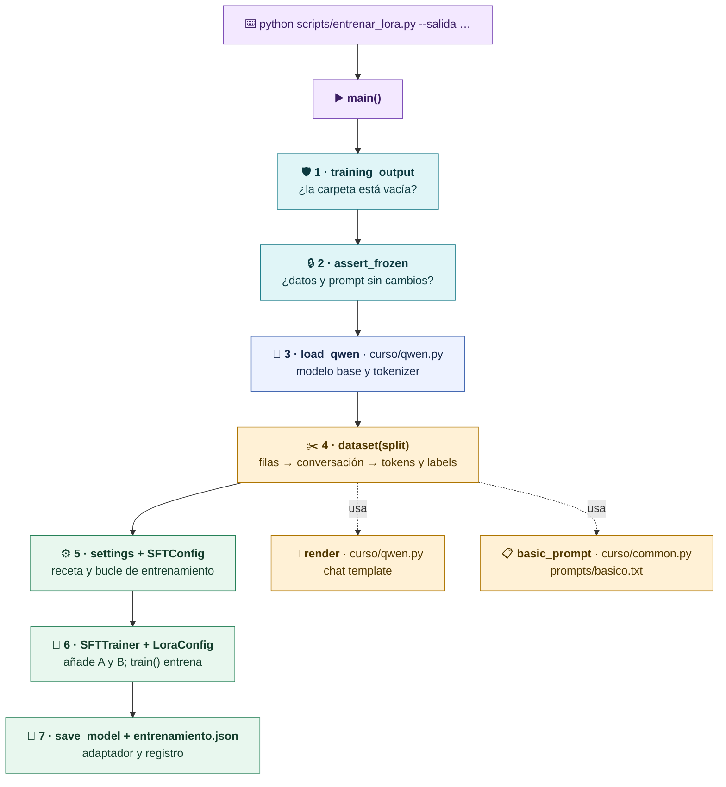

| Parte | Dónde | Qué hace | ¿Carga el modelo o entrena? |
|---|---|---|---|
| Cabecera e importaciones | `entrenar_lora.py`, líneas 1-40 | Prepara rutas, variables de entorno y utilidades comunes | No |
| `training_output` | líneas 45-55 | Rechaza una carpeta de salida con contenido | No |
| Inicio de `main` | líneas 60-91 | Lee `--salida`, comprueba el protocolo, fija la semilla y carga Qwen | Carga el modelo |
| `dataset(split)` | líneas 97-158 | Convierte cada fila en tokens y etiquetas | No |
| `settings` | líneas 163-192 | Guarda la receta para el registro | No |
| `SFTConfig` | líneas 194-233 | Configura el bucle: batch, épocas, learning rate, validación | No |
| `SFTTrainer` + `LoraConfig` | líneas 235-261 | Añade A y B a la base congelada y prepara el entrenador | Prepara |
| `trainer.train()` y guardado | líneas 263-269 | **Entrena** y guarda el adaptador y el tokenizer | **Entrena** |
| Registro | líneas 271-312 | Escribe `entrenamiento.json` e imprime el resumen | No |

## 12 · El código parte por parte

Los fragmentos son copias del código actual, sin los comentarios línea a línea que el archivo sí tiene.

### 12.1 · Cabecera e importaciones

```python
import _bootstrap  # noqa: F401
import argparse, importlib.metadata, json, os, time, platform
from pathlib import Path

os.environ.setdefault("HF_HUB_DISABLE_TELEMETRY", "1")
os.environ.setdefault("TOKENIZERS_PARALLELISM", "false")
from curso.common import ROOT, assert_frozen, read_jsonl, basic_prompt
```

*(Simplificado: en el archivo cada `import` va en su línea.)*

- `_bootstrap` permite importar `curso` aunque el archivo esté dentro de `scripts/`.
- Las dos variables de entorno desactivan la telemetría del Hub y el paralelismo interno del tokenizer.
- De `curso/common.py` vienen la raíz del proyecto, la comprobación del protocolo, el lector de JSONL y el prompt común.

Todavía no se importan PyTorch, PEFT ni TRL: eso ocurre dentro de `main`, cuando de verdad se va a entrenar.

### 12.2 · `training_output`: no pisar un entrenamiento anterior

```python
def training_output(path):
    output = Path(path).resolve()
    if output.exists() and (not output.is_dir() or any(output.iterdir())):
        raise ValueError(
            "Salida no vacía; usa otro --salida para conservar el entrenamiento anterior"
        )
    return output
```

- **Recibe** la ruta de `--salida`.
- **Devuelve** la ruta absoluta si la carpeta no existe o está vacía.
- **Efecto**: ninguno; no crea ni borra nada. Si la carpeta tiene archivos, para el script **antes** de cargar el modelo, para no perder 11 minutos.

### 12.3 · Inicio de `main`: opciones, protocolo, semilla y modelo

```python
parser = argparse.ArgumentParser()
parser.add_argument("--salida", default=str(ROOT / "modelos/lora-soporte"))
args = parser.parse_args()
output = training_output(args.salida)
frozen = assert_frozen()

from datasets import Dataset
from peft import LoraConfig
from trl import SFTTrainer, SFTConfig
from transformers import set_seed
from curso.qwen import load_qwen, render

set_seed(42)
model, tokenizer, device = load_qwen()
model.config.use_cache = False
```

- `--salida` es la única opción del script. Por defecto, `modelos/lora-soporte`.
- `assert_frozen()` compara con `config/experimento-congelado.json` el modelo, la revisión, los parámetros de generación y los hashes de train, validación, test, prompt y few-shot. Si algo cambió, para con `Datos o protocolo cambiaron después de congelar el experimento`. Devuelve el manifiesto, que acaba en el registro.
- Las librerías del ecosistema se importan aquí:
  - `Dataset` (Datasets) guarda los ejemplos para el entrenador.
  - `LoraConfig` (PEFT) describe dónde y cómo añadir A y B.
  - `SFTTrainer` y `SFTConfig` (TRL) ejecutan y configuran el ajuste supervisado.
- `set_seed(42)` fija el azar de Python, NumPy y PyTorch para poder repetir la receta.
- `load_qwen()` carga **la misma base** que se usa en inferencia. `use_cache = False` desactiva una caché que solo sirve para generar texto, no para entrenar.

`load_qwen` está en `curso/qwen.py`:

```python
device = (
    "cuda" if torch.cuda.is_available()
    else "mps" if torch.backends.mps.is_available()
    else "cpu"
)
tokenizer = AutoTokenizer.from_pretrained(
    MODEL_ID, revision=REVISION, token=False, trust_remote_code=False
)
model = AutoModelForCausalLM.from_pretrained(
    MODEL_ID, revision=REVISION,
    dtype=torch.float32 if device == "mps" else "auto",
    attn_implementation="eager", token=False,
    trust_remote_code=False, use_safetensors=True,
).to(device)
```

*(Simplificado en el formato de las líneas.)*

- Elige el dispositivo: GPU NVIDIA (**CUDA**), GPU del Mac (**MPS**) o **CPU**.
- Carga tokenizer y pesos de la revisión fijada. `trust_remote_code=False` impide ejecutar código descargado del Hub.
- En MPS usa `float32` (32 bits por número) porque es más estable para entrenar este modelo pequeño.

### 12.4 · `dataset(split)`: de una fila a tokens con etiquetas

Es la parte más importante para entender qué aprende el modelo. Se llama dos veces: `dataset("train")` y `dataset("validacion")`. **Nunca** con `test`.

Usa el registro `TR-061` de la [[#3 · Los datos que usamos|sección 3]].

#### Paso A · Construir la conversación

```python
for row in read_jsonl(ROOT / f"datos/{split}.jsonl"):
    msg = [
        {"role": "system", "content": basic_prompt()},
        {"role": "user", "content": row["incidencia"]},
    ]
    prompt = render(tokenizer, msg)
    whole = render(
        tokenizer,
        msg + [{"role": "assistant",
                "content": json.dumps(row["objetivo"], ensure_ascii=False)}],
        False,
    )
```

- `msg` es una lista de mensajes con **rol**: `system` (las reglas de `prompts/basico.txt`, las mismas que en inferencia) y `user` (la incidencia).
- `prompt` es el texto que vería el modelo en una consulta normal: termina abriendo el turno del asistente.
- `whole` es la conversación completa, con la respuesta correcta como turno `assistant`. `json.dumps` convierte el diccionario `objetivo` en texto JSON. El `False` indica que no se abra otro turno al final.
- `render` (en `curso/qwen.py`) aplica el **chat template** de Qwen con `enable_thinking=False`: el formato con marcas de rol que el modelo espera.

#### Paso B · Comprobaciones de seguridad

```python
if not whole.startswith(prompt):
    raise ValueError("Template entrenamiento/inferencia no coincide")
input_ids = tokenizer(whole, add_special_tokens=False)["input_ids"]
prompt_ids = tokenizer(prompt, add_special_tokens=False)["input_ids"]
if input_ids[: len(prompt_ids)] != prompt_ids:
    raise ValueError("Tokenización del prefijo distinta")
if len(input_ids) > 768:
    raise ValueError("Ejemplo excede max_length; no truncar respuesta silenciosamente")
```

- La conversación de entrenamiento debe **empezar exactamente** por el texto de inferencia. Si no, el modelo aprendería con un formato distinto al que verá después.
- El **tokenizer** convierte texto en una lista de números, los **IDs de token**. Un token no es una palabra: `facturacion` son dos tokens, `fact` y `uracion`.
- Se comprueba que los tokens del contexto no cambian al añadir la respuesta; si cambiaran, las etiquetas quedarían desalineadas.
- Un ejemplo de más de 768 tokens **se rechaza** en lugar de cortarse en silencio.
- Tokenizamos nosotros (y no TRL) porque TRL añadiría un fin de texto duplicado a estos textos.

#### Paso C · Las etiquetas: qué tokens se aprenden

```python
rows.append({
    "input_ids": input_ids,
    "attention_mask": [1] * len(input_ids),
    "labels": [-100] * len(prompt_ids) + input_ids[len(prompt_ids):],
    "completion_mask": [0] * len(prompt_ids)
                     + [1] * (len(input_ids) - len(prompt_ids)),
})
...
return Dataset.from_list(rows)
```

- `input_ids`: toda la conversación en números.
- `attention_mask`: `1` en cada token real; el relleno (*padding*) para igualar longitudes lo añade después el entrenador.
- `labels`: lo que el modelo debe predecir. **`-100` significa «ignorar»**: el contexto se lee, pero no suma pérdida. En la respuesta, cada etiqueta es el ID del token correcto.
- `completion_mask`: la misma idea con `0` y `1`, para que TRL calcule la pérdida solo en la respuesta.
- `Dataset.from_list(rows)` entrega una fila por ejemplo al entrenador.

En `TR-061` salen **263 tokens de contexto** y **42 tokens de respuesta**; el diagrama está en la [[#5 · Cómo se convierte un ejemplo en algo que el modelo puede aprender|sección 5]].

El modelo aprende a predecir los tokens de la respuesta **uno a uno**, usando como prefijo todo lo anterior. Así aprende a contestar a la incidencia, no a repetir el prompt.

### 12.5 · `settings`: la receta, por escrito

```python
settings = {
    "r": 8,
    "lora_alpha": 16,
    "lora_dropout": 0.05,
    "target_modules": ["q_proj", "k_proj", "v_proj", "o_proj",
                       "gate_proj", "up_proj", "down_proj"],
    "epochs": 2,
    "learning_rate": 0.0002,
    "batch_size": 2,
    "gradient_accumulation_steps": 4,
    "seed": 42,
    "max_length": 768,
}
```

Este diccionario no entrena nada: se copia en `entrenamiento.json` para que quede constancia de la receta.

El significado de cada valor está en la tabla de la [[#6 · La receta y el entrenamiento|sección 6]].

No hicimos búsqueda de hiperparámetros para mejorar el test: la configuración se fijó antes.

### 12.6 · `SFTConfig`: cómo se ejecuta el bucle

```python
config = SFTConfig(
    output_dir=str(output / "checkpoints"),
    num_train_epochs=settings["epochs"],
    per_device_train_batch_size=2,
    per_device_eval_batch_size=2,
    gradient_accumulation_steps=4,
    learning_rate=0.0002,
    logging_steps=10,
    save_strategy="no",
    eval_strategy="epoch",
    max_length=768,
    packing=False,
    completion_only_loss=True,
    report_to="none",
    dataset_kwargs={"skip_prepare_dataset": True},
    fp16=False,
    bf16=False,
    seed=42,
    dataloader_pin_memory=False,
    optim="adamw_torch",
)
```

| Opción | Qué hace aquí |
|---|---|
| `logging_steps=10` | Imprime y registra métricas cada 10 pasos |
| `save_strategy="no"` | No guarda copias intermedias; el adaptador final se guarda a mano |
| `eval_strategy="epoch"` | Mide la validación al final de cada época, sin elegir automáticamente un «mejor» punto |
| `packing=False` | Cada ejemplo va solo; no se pegan varios para llenar los 768 tokens |
| `completion_only_loss=True` | La pérdida se calcula solo sobre la respuesta |
| `skip_prepare_dataset` | TRL no vuelve a formatear ni tokenizar: ya lo hizo `dataset` |
| `fp16` / `bf16` en `False` | Sin precisión reducida: se entrena con la precisión con que se cargó el modelo |
| `report_to="none"` | No envía métricas a ningún servicio externo |
| `optim="adamw_torch"` | Optimizador AdamW de PyTorch: decide cuánto mover A y B en cada paso |

### 12.7 · `SFTTrainer` y `LoraConfig`: aquí se añade LoRA

```python
trainer = SFTTrainer(
    model=model,
    processing_class=tokenizer,
    args=config,
    train_dataset=dataset("train"),
    eval_dataset=dataset("validacion"),
    peft_config=LoraConfig(
        r=8,
        lora_alpha=16,
        lora_dropout=0.05,
        bias="none",
        task_type="CAUSAL_LM",
        target_modules=settings["target_modules"],
    ),
)
```

- `model` es la base cargada. Al recibir `peft_config`, el entrenador usa **PEFT** para insertar A y B en las 7 proyecciones de las 28 capas y **congelar todo lo demás**.
- `train_dataset` aporta los ejemplos que actualizan A y B; `eval_dataset` solo mide.
- `bias="none"`: no se entrenan los términos de sesgo de la base.
- `task_type="CAUSAL_LM"`: modelo que predice el siguiente token a partir de los anteriores.

En este momento todavía no se ha entrenado nada: solo está todo preparado.

### 12.8 · `trainer.train()` y el guardado

```python
start = time.perf_counter()
result = trainer.train()
trainer.save_model(str(output))
tokenizer.save_pretrained(str(output))
```

`trainer.train()` es **la única línea que entrena**. Repite 60 veces el bucle forward → loss → backward → optimizador de la [[#6 · La receta y el entrenamiento|sección 6]].

Después, `save_model` guarda **solo el adaptador** (`adapter_model.safetensors` y `adapter_config.json`), no la base. `save_pretrained` guarda una copia del tokenizer y del chat template para recargar igual.

### 12.9 · El registro: `entrenamiento.json`

```python
receipt = {
    "fecha": ..., "duracion_s": ...,
    "device": device, "hardware": ...,
    "configuracion": settings,
    "experimento": frozen,
    "metricas": result.metrics,
    "log_history": trainer.state.log_history,
    "versiones": {...},  # torch, transformers, datasets, trl, peft, accelerate
    "coste_usd": None,
    "coste_metodo": "Entrenamiento local; energía/hardware no medidos",
}
(output / "entrenamiento.json").write_text(json.dumps(receipt, ensure_ascii=False, indent=2) + "\n", encoding="utf-8")
```

*(Simplificado: se omiten las expresiones de fecha, hardware y versiones.)*

Guarda la receta, el manifiesto congelado, las métricas, el historial de pérdida y las versiones de las librerías. `coste_usd` es `None` porque no se midió: **desconocido, no cero**. Al final imprime la línea con `adapter`, `duracion_s` y `device`.

## 13 · El ecosistema que ejecuta todo esto

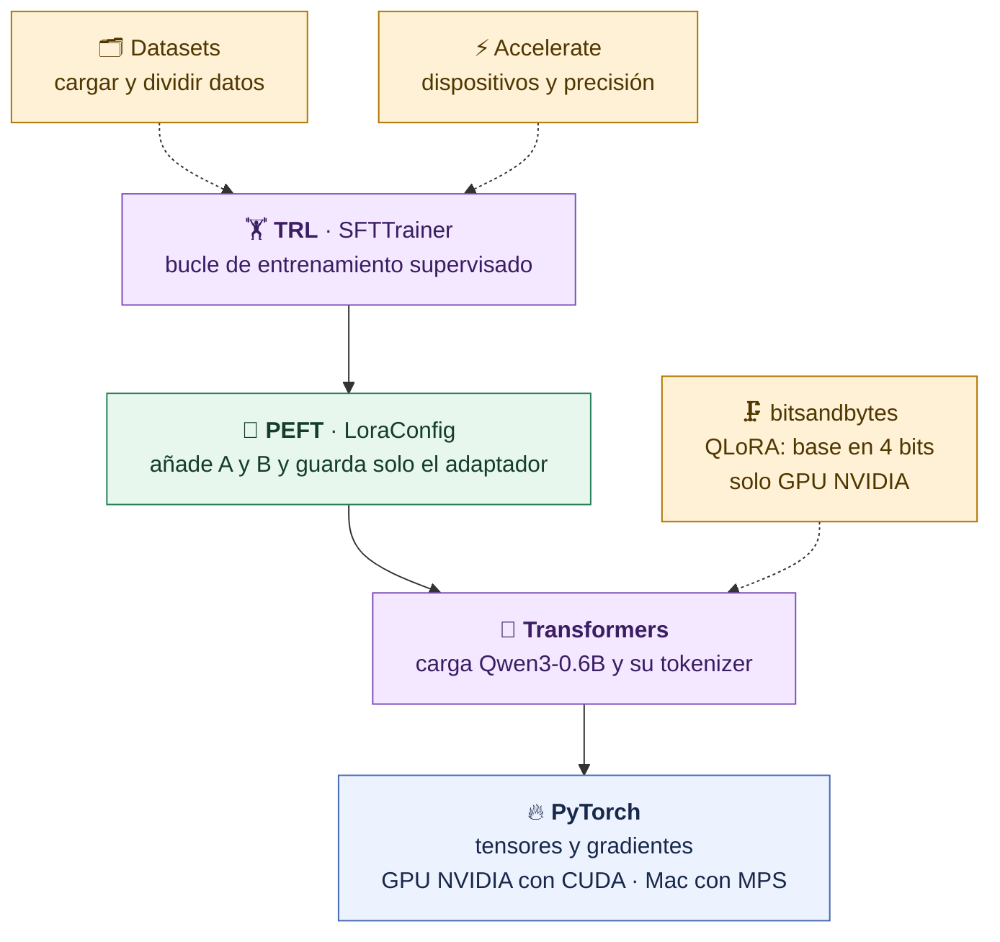

Cada capa usa la de abajo: SFTTrainer llama a PEFT, que modifica un modelo de Transformers, que se ejecuta sobre PyTorch. Nuestro entrenamiento usó MPS en el Mac, sin cuantizar la base.

La diapositiva del entrenamiento en pocas líneas muestra una configuración mínima (`r = 16`, `alpha = 32`, solo `q_proj` y `v_proj`). La receta del proyecto usa `r = 8`, `alpha = 16` y las 7 proyecciones: menos ancho, pero en más sitios.

## 14 · Errores frecuentes al entrenar

| Mensaje o síntoma | Qué significa | Qué hacer |
|---|---|---|
| `Salida no vacía; usa otro --salida…` | La carpeta ya tiene un entrenamiento | Usa otra carpeta: `--salida modelos/lora-soporte-2` |
| `Datos o protocolo cambiaron…` | Se tocó un dato, prompt o configuración congelada | `git diff -- datos prompts config`; en Windows, revisa saltos de línea CRLF |
| `Template entrenamiento/inferencia no coincide` | El chat template produce textos distintos al entrenar y al consultar | Revisa las versiones instaladas frente al lock |
| `Ejemplo excede max_length…` | Un ejemplo supera 768 tokens | No ocurre con los datos incluidos; con datos propios es otro experimento |
| `ModuleNotFoundError: peft` o `trl` | Entorno sin el lock de entrenamiento | Instala `requirements-training.lock` y activa `.venv` |
| Muy lento o sin memoria | CPU o memoria insuficiente | Comprueba el dispositivo y cierra otras aplicaciones; ver el apartado siguiente |
| `adaptador_local: false` | Aún no hay adaptador | Normal antes de entrenar |

## 15 · Dónde entrenar según tu equipo

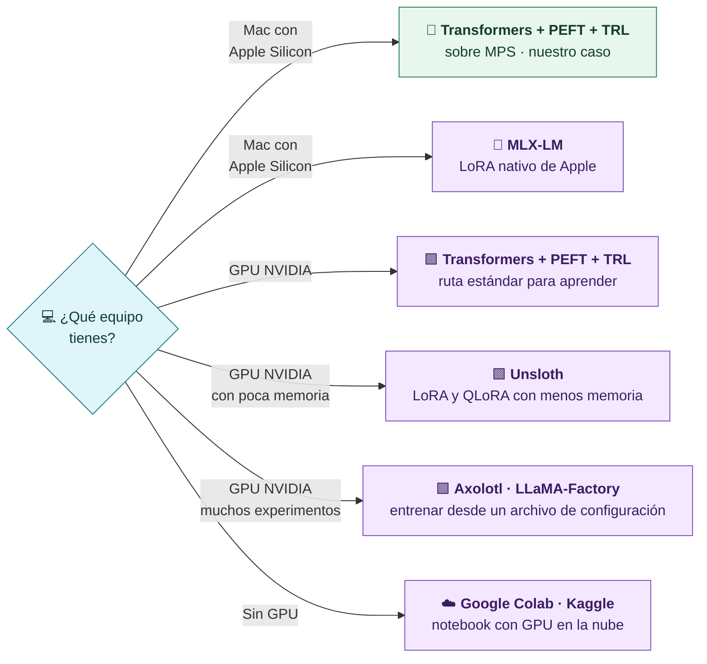

Si no puedes entrenar, la entrega admite la preparación completa con las métricas pendientes: ver `docs/ejercicio.md`. LoRA, QLoRA y sus alternativas se estudian a fondo en **S13**. En S7 nos basta con entender qué cambia, dónde se guarda y cómo se comprueba.

[← Prompting, few-shot y fine-tuning](06-Prompting-few-shot-y-fine-tuning.md) · [Siguiente: evaluar y entregar →](08-Evaluar-y-entregar.md)
