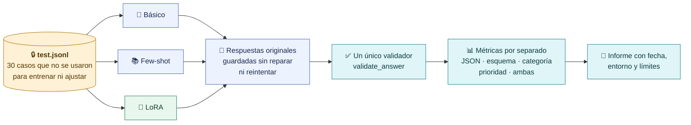
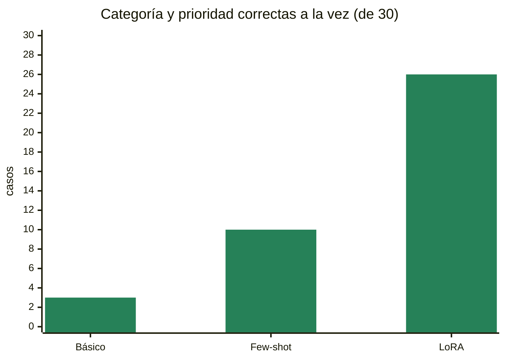
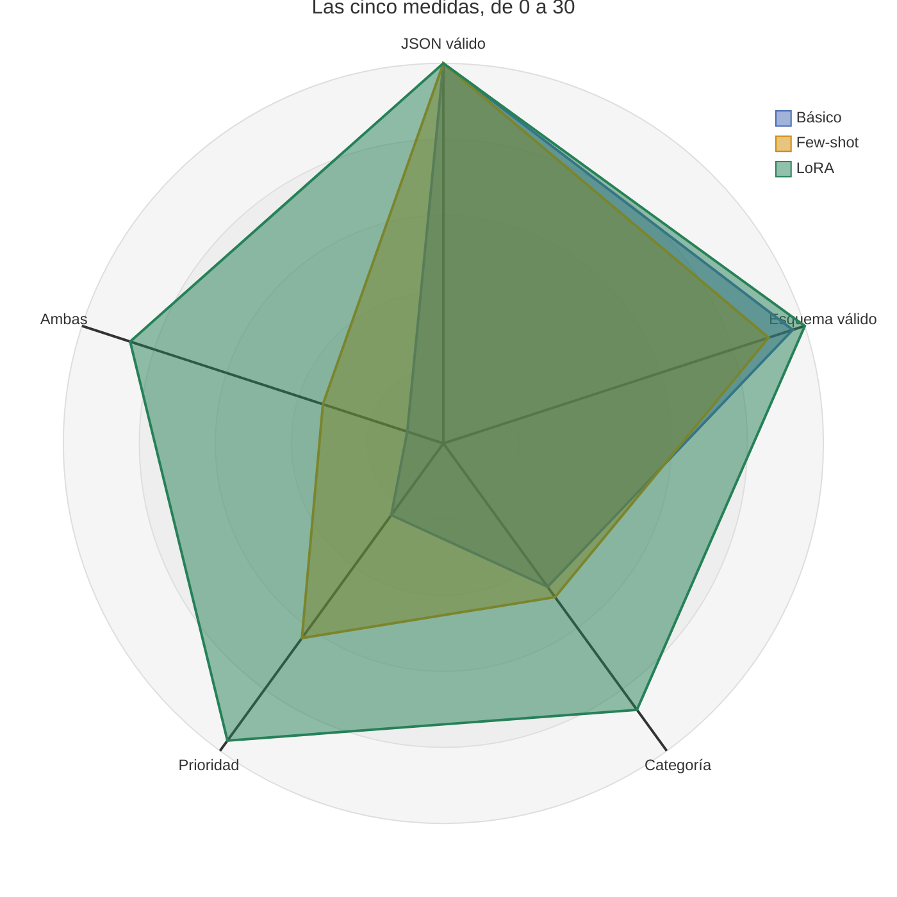
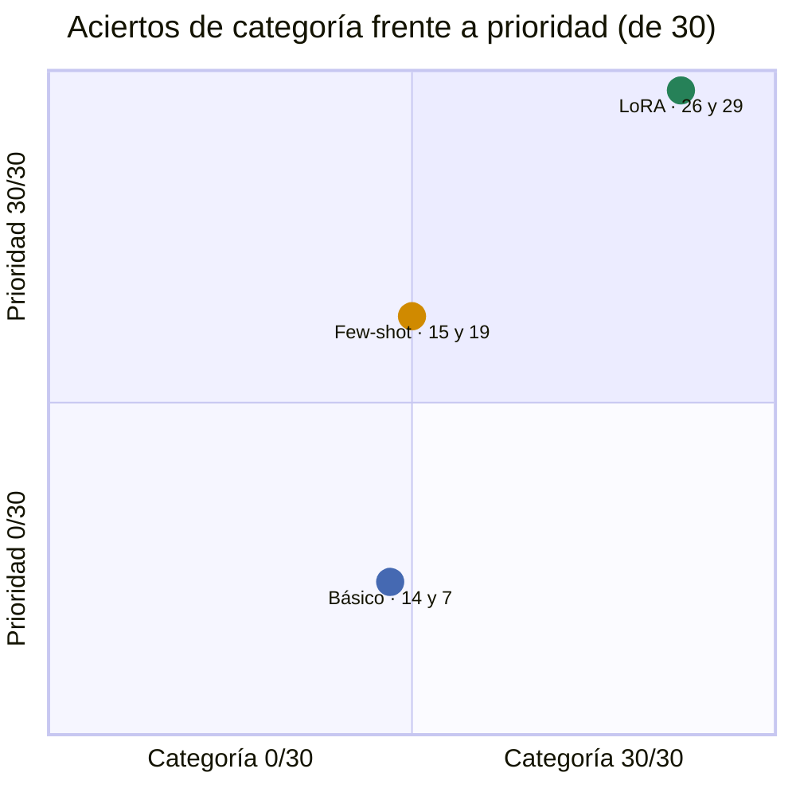
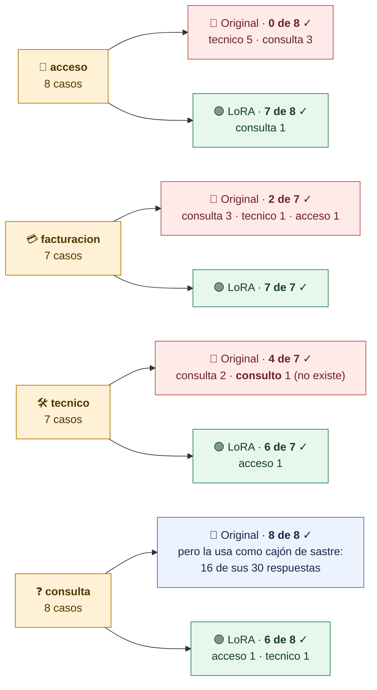
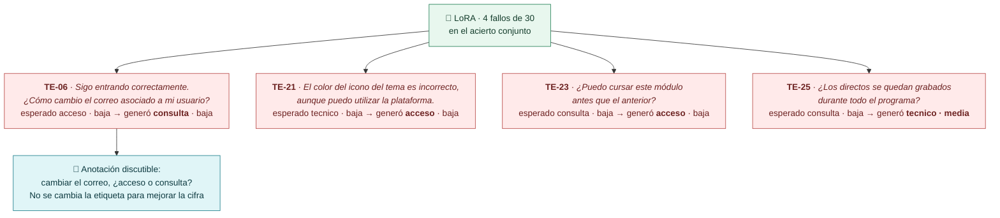
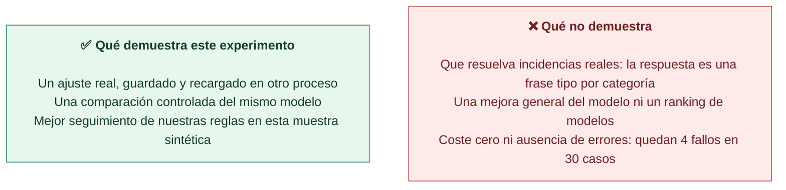
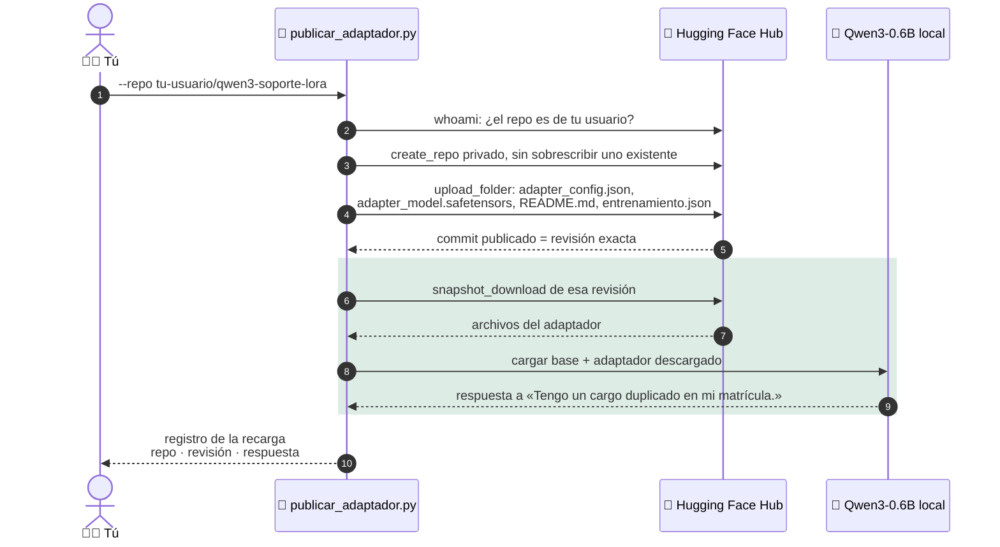
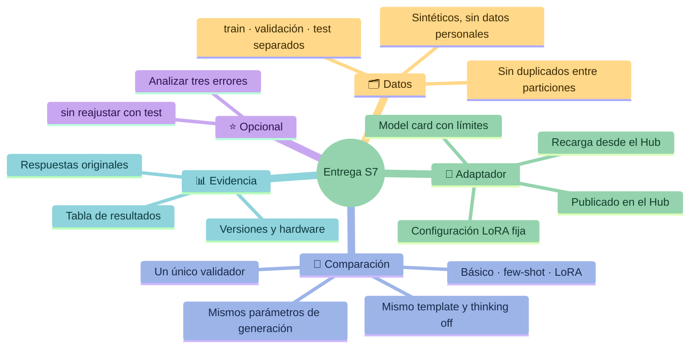

# Evaluar, explicar los errores y entregar

**Una mejora solo existe si se mide con casos separados, el mismo protocolo y el mismo validador. Después se documenta qué se ha demostrado y qué no.**

## El protocolo de evaluación

> [!important] Reglas que no se rompen
> - No se cambia el prompt, los datos ni el entrenamiento **después** de mirar el test.
> - Una respuesta que no es JSON cuenta como error en el denominador: no se borra.
> - No se extraen bloques de Markdown, no se repara el JSON y no se reintenta.
> - Tiempo y coste se registran con su entorno: `null` significa «no medido», no cero.

## Resultados de referencia

Experimento del **2 de octubre de 2026**, 30 casos sintéticos de test por condición, Qwen3-0.6B en un Apple M5 con 24 GB:

| Condición Qwen | JSON válido | Esquema válido | Categoría | Prioridad | **Ambas** |
|---|---:|---:|---:|---:|---:|
| Original + instrucciones | 30/30 | 29/30 | 14/30 | 7/30 | **3/30** |
| Original + few-shot | 30/30 | 27/30 | 15/30 | 19/30 | **10/30** |
| Original + LoRA | 30/30 | 30/30 | 26/30 | 29/30 | **26/30** |

Las tres condiciones producen JSON válido en 30 de 30. La diferencia está en **aplicar las reglas**: elegir una categoría admitida y la prioridad correcta.

Cada punto se sitúa en aciertos ÷ 30. Arriba a la derecha está la condición que aplica las dos reglas a la vez.

## Dónde se equivoca cada uno

### Categoría por categoría: original frente a LoRA

| | Categoría correcta | Prioridad correcta |
|---|---:|---:|
| Qwen original | 14/30 | 7/30 |
| Qwen con LoRA | 26/30 | 29/30 |

El original **no acertó ninguno de los 8 casos de acceso**, usó `consulta` como cajón de sastre e inventó la categoría `consulto`. En prioridad tendió a subir: dio `alta` a 5 casos que eran `baja` y a 8 que eran `media`.

### Los cuatro fallos del LoRA

## Por qué una loss baja no lo resuelve todo

Si usáramos estos errores del test para reajustar el modelo, el test dejaría de ser una medida independiente. Un siguiente experimento necesitaría decisiones previas y un test nuevo.

> [!question] Pregunta de cierre
> ¿Qué evidencia necesitarías antes de usar este clasificador con incidencias reales?

```mermaid
---
config:
  flowchart:
    wrappingWidth: 400
---
flowchart LR
    A["🧪 Clasificador<br/>que funciona en<br/>30 casos sintéticos"] --> B["📥 Incidencias reales<br/>anonimizadas y<br/>anotadas por personas"]
    B --> C["📊 Una muestra mayor<br/>con la distribución real<br/>de categorías y prioridades"]
    C --> D["⚖️ Coste de cada error<br/>¿qué pasa si una alta<br/>se clasifica como baja?"]
    D --> E["👀 Revisión humana<br/>en los casos dudosos<br/>o de prioridad alta"]
    E --> F["📈 Seguimiento continuo<br/>y un test nuevo<br/>para cada cambio"]
    classDef ajuste fill:#e8f7ee,stroke:#268158,color:#143d2c
    classDef datos fill:#fff1d6,stroke:#ae7500,color:#503700
    classDef decision fill:#e0f5f7,stroke:#1f7f8c,color:#0d3a40
    classDef aviso fill:#ffeaea,stroke:#b94a48,color:#6c2221
    class A ajuste
    class B,C datos
    class D aviso
    class E,F decision
```

## Publicar el adaptador y recargarlo desde el Hub

El ejercicio pide publicar el adaptador en **tu** cuenta de Hugging Face, con model card, y demostrar que se puede recargar desde allí. Es una comprobación distinta de la recarga local. `scripts/publicar_adaptador.py` sigue estos pasos:

> [!warning] Credenciales
> El inicio de sesión en Hugging Face es tuyo y local. Nunca incluyas tokens, `.env` ni capturas con claves en la entrega.

> [!note] Estado del adaptador de referencia
> El adaptador del profesor está recargado y comprobado **localmente**. Su publicación y recarga desde el Hub es una evidencia distinta y se presenta solo cuando exista.

## Qué entregar

> [!tip] Se valora la comparación reproducible
> Separación de datos, comparación justa, entrenamiento reproducible y recarga. **LoRA no tiene obligación de ganar**: un resultado peor, bien medido y documentado, es una entrega válida.

## Puente a S8

En la próxima sesión aplicaremos los mismos criterios a modelos servidos por API, como Gemini y Claude: misma tarea, mismos casos, mismo validador. Cambia dónde se ejecuta el modelo y qué podemos controlar, no la forma de comprobar si responde bien.

[← Cómo se entrena un LoRA](07-Como-se-entrena-un-LoRA.md) · [Volver a la guía](00-Guia-S7.md) · [Ir a S8 →](../S8-Modelos-cerrados/00-Guia-S8.md)
