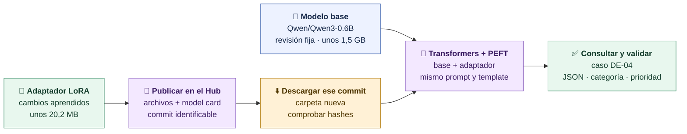
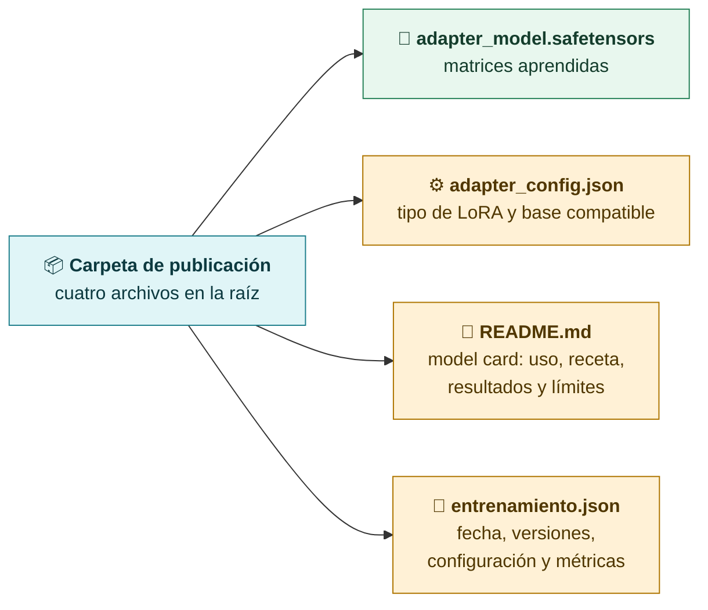
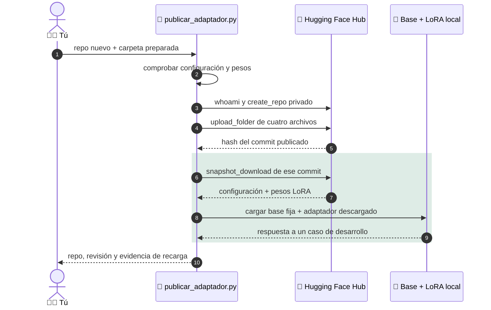
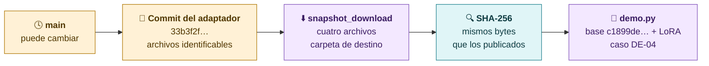
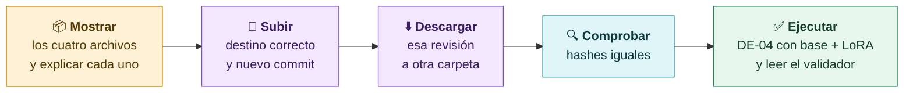

# Hugging Face: subir, descargar y ejecutar nuestro adaptador

**Vamos a compartir lo aprendido por nuestro LoRA, descargar una versión concreta y comprobar que funciona junto con el mismo Qwen3-0.6B. Subir archivos, descargarlos y ejecutar una consulta son tres comprobaciones diferentes.**

Esta guía completa [[03-Hugging-Face-y-formatos]] y [[08-Evaluar-y-entregar]]. Los comandos se ejecutan desde la **raíz del repositorio docente**, con su entorno Python activo. El ensayo del profesor se verificó el **13 de octubre de 2026**.

## 1 · Qué estamos publicando

Nuestro artefacto es un **adaptador LoRA**: unas matrices pequeñas que aprendieron a clasificar incidencias sintéticas y emitir JSON con `categoria`, `prioridad` y `respuesta`. Para ejecutar la respuesta necesitamos también los pesos y el tokenizer del modelo base.



| Pieza | Identidad o función |
|---|---|
| Modelo base | `Qwen/Qwen3-0.6B` |
| Revisión de la base | `c1899de289a04d12100db370d81485cdf75e47ca` |
| Adaptador original local | `modelos/lora-soporte` |
| Tarea | Clasificar incidencias sintéticas en español y emitir JSON |
| Entrenamiento del artefacto de referencia | 2/10/2026; 2 épocas, 60 pasos; r=8, alpha=16, dropout=0.05 |
| Tamaño de los pesos LoRA | 20.236.472 bytes: unos 20,2 MB decimales o 19,3 MiB |
| Ejecución | Python, PyTorch, Transformers y PEFT; CUDA, MPS o CPU según el equipo |

> [!important] El adaptador necesita la base
> Este repositorio de Hugging Face contiene los cambios LoRA. La base y su tokenizer se descargan de `Qwen/Qwen3-0.6B` en la revisión del curso. El adaptador no contiene un GGUF para abrir directamente en LM Studio. Publicarlo tampoco crea un endpoint de inferencia alojado.

> [!question] Pregunta al grupo
> Si el modelo original ocupa unos 1,5 GB, ¿por qué podemos compartir el ajuste en unos 20 MB? ¿Qué debe tener la otra persona para ejecutarlo?

## 2 · Preparar el equipo y los archivos

### Entorno de una copia nueva

Si ya tienes el repositorio y el entorno del curso, activa ese entorno y pasa a la comprobación. Para una copia nueva en macOS/Linux, con Git y uv instalados:

```bash
git clone https://github.com/JoseAntonioNuevo/thepower-modelos.git
cd thepower-modelos
uv venv --python 3.12 .venv
uv pip sync --python .venv requirements-training.lock
source .venv/bin/activate
```

En una copia existente, abre la terminal en su raíz y ejecuta solamente:

```bash
source .venv/bin/activate
python scripts/preflight.py
```

En Windows PowerShell, la activación es `.venv\Scripts\Activate.ps1`. Los bloques `python - <<'PY'` de esta guía son para macOS/Linux; en Windows guarda el contenido Python en un archivo temporal y ejecútalo con `python nombre.py` desde la raíz. Consulta la instalación completa en el [README del curso](../../../README.md).

La descarga pública y la ejecución Qwen no necesitan claves de proveedores ni un `.env`. La subida necesita tu cuenta de Hugging Face y permiso de escritura en el destino.

### Modelo base disponible

```bash
python scripts/descargar_modelo.py
```

Descarga la base fijada a la caché de Hugging Face; la primera vez necesita red y aproximadamente 1,5 GB para los pesos. Se ejecuta **antes** de la prueba offline. Descargar no entrena ni consulta el modelo.

### Adaptador disponible

El profesor ya tiene el adaptador entrenado. En una copia nueva del alumno, `modelos/` no viene en Git: puedes **descargar el adaptador publicado** siguiendo el apartado 6, o entrenar el tuyo siguiendo [[07-Como-se-entrena-un-LoRA]]. Para entrenar cuando todavía no existe esa carpeta:

```bash
python scripts/entrenar_lora.py --salida modelos/lora-soporte
```

El entrenador rechaza una salida no vacía. Para otro entrenamiento elige otra ruta y adapta los comandos siguientes. No hace falta volver a entrenar para publicar o ejecutar un adaptador que ya existe.

### Los cuatro archivos de la publicación



Comprueba primero los archivos de entrenamiento:

```bash
python - <<'PY'
from pathlib import Path

folder = Path("modelos/lora-soporte")
for name in ("adapter_config.json", "adapter_model.safetensors", "entrenamiento.json"):
    path = folder / name
    if not path.is_file():
        raise SystemExit(f"Falta {path}: confirma la carpeta del adaptador")
    print(f"{name}: {path.stat().st_size:,} bytes")
print("Model card existente:", (folder / "README.md").is_file())
PY
```

El entrenador no crea la model card. Si falta `README.md`, créalo en la carpeta del adaptador con estos metadatos al comienzo y completa el texto con tu entrenamiento real:

```yaml
---
license: apache-2.0
base_model: Qwen/Qwen3-0.6B
base_model_relation: adapter
library_name: peft
language:
- es
tags:
- lora
- education
- synthetic-data
---
```

La ficha debe explicar la tarea, la revisión base, los datos sintéticos y sus particiones, la configuración y fecha del entrenamiento, cómo cargarlo, los resultados **que hayas medido** y los límites. La pérdida de entrenamiento no sustituye a la evaluación de casos. La licencia indicada para la base es Apache-2.0; conserva los avisos y revisa las condiciones del artefacto que redistribuyes.

### Preparar una carpeta que solo contenga lo que se subirá

Este comando conserva el adaptador original, exige los cuatro archivos y crea una carpeta nueva. Si la carpeta de publicación ya existe, usa otro nombre; no borres el entrenamiento para repetir el ensayo.

```bash
python - <<'PY'
from pathlib import Path
import shutil

source = Path("modelos/lora-soporte")
destination = Path("modelos/publicacion-hf-s7")
names = ["adapter_config.json", "adapter_model.safetensors", "README.md", "entrenamiento.json"]
missing = [name for name in names if not (source / name).is_file()]
if missing:
    raise SystemExit(f"Faltan archivos antes de publicar: {missing}")
destination.mkdir(parents=True, exist_ok=False)
for name in names:
    shutil.copy2(source / name, destination / name)
print("Carpeta preparada:", destination.resolve())
PY
```

Revisa la copia de `README.md` antes de subirla. Una frase que diga «publicación pendiente» describe el estado anterior; documenta la fecha y la evidencia que corresponden, sin presentar un ensayo futuro como realizado. Cuando la ficha esté terminada, calcula los hashes de **los bytes que vas a subir**:

```bash
python - <<'PY'
from pathlib import Path
import hashlib
import json

folder = Path("modelos/publicacion-hf-s7")
names = ["adapter_config.json", "adapter_model.safetensors", "README.md", "entrenamiento.json"]
manifest = {}
for name in names:
    content = (folder / name).read_bytes()
    manifest[name] = {"bytes": len(content), "sha256": hashlib.sha256(content).hexdigest()}
receipt = Path("material/evidencias/hf-s7-archivos-subida.json")
receipt.parent.mkdir(parents=True, exist_ok=True)
with receipt.open("x", encoding="utf-8") as handle:
    json.dump(manifest, handle, ensure_ascii=False, indent=2)
    handle.write("\n")
print("Hashes guardados:", receipt)
PY
```

El recibo se crea con `open("x")` para no sobrescribir uno anterior. Si haces otra publicación o editas algún archivo después, usa otro nombre de recibo y repite el cálculo; los hashes identifican los bytes finales de ese ensayo.

En macOS puedes abrir la carpeta preparada en Finder:

```bash
open modelos/publicacion-hf-s7
```

> [!warning] Seleccionar archivos es publicar contenido
> Elige solo los cuatro archivos preparados. No subas la raíz del proyecto, `.env`, tokens, entornos, datos personales ni todas las carpetas de checkpoints. Los archivos de tokenizer que guardó el entrenamiento no son necesarios para esta ruta: `curso/qwen.py` carga el tokenizer de la base fijada.

## 3 · Elegir la ruta de subida

| Ruta | Destino | Inicio de sesión | Qué hace |
|---|---|---|---|
| **Navegador** | Repositorio nuevo o existente que hayas elegido | Sesión web de Hugging Face | Permite elegir público/privado y ver cada archivo antes del commit |
| **Script del curso** | Repositorio **privado nuevo** de tu propio usuario | Sesión local de `hf auth login` con escritura | Crea, sube, descarga el commit y consulta base + adaptador |

Son dos alternativas. Si creas el repositorio con la web, sigue la subida web. El script usa `exist_ok=False`: falla cuando el destino ya existe y no lo actualiza. La sesión del navegador y la de la CLI son independientes.

## 4 · Subir por navegador, paso a paso

Ruta observada en el ensayo del **13/10/2026**. Los nombres de los menús pueden cambiar; comprueba la interfaz antes de la clase.

```mermaid
---
config:
  flowchart:
    wrappingWidth: 400
---
flowchart LR
    U["👤 <b>1 · Sesión y destino</b><br/>tu usuario / tu repositorio"]
    U --> N["📁 <b>2 · Crear o abrir</b><br/>nombre · licencia<br/>público o privado"]
    N --> F["🗃️ <b>3 · Files and versions</b><br/>Contribute → Upload files"]
    F --> S["📦 <b>4 · Seleccionar</b><br/>cuatro archivos<br/>en la raíz"]
    S --> C["🕓 <b>5 · Commit changes</b><br/>mensaje y subida"]
    C --> V["✅ <b>6 · Verificar</b><br/>archivos · ficha<br/>hash del commit"]
    classDef decision fill:#e0f5f7,stroke:#1f7f8c,color:#0d3a40
    classDef datos fill:#fff1d6,stroke:#ae7500,color:#503700
    classDef herramienta fill:#f3e8ff,stroke:#7e4fb8,color:#3b1d63
    classDef ajuste fill:#e8f7ee,stroke:#268158,color:#143d2c
    class U,N decision
    class F,C herramienta
    class S datos
    class V ajuste
```



1. **Inicia sesión antes de proyectar.** En el menú de perfil confirma tu usuario. No muestres credenciales durante la clase.
2. **Crea el repositorio** en [huggingface.co/new](https://huggingface.co/new), o abre uno que ya hayas preparado. Para crear: Owner = tu usuario; nombre sugerido = `qwen3-soporte-lora-s7`; licencia = `apache-2.0`, coherente con la ficha; visibilidad = **Public** si quieres que los alumnos lo descarguen sin acceso adicional, o **Private** para un ensayo restringido. Pulsa **Create model**.
3. **Comprueba el destino.** El encabezado debe mostrar `TU_USUARIO/NOMBRE_REPO`. Si repites desde cero, elige otro nombre: conservar versiones anteriores facilita explicar qué cambió.
4. Entra en **Files and versions → Contribute → Upload files**.
5. Pulsa **Upload file(s)** y después la zona **Drag files/folders here or click to browse from your computer.** Selecciona `adapter_config.json`, `adapter_model.safetensors`, `README.md` y `entrenamiento.json` de `modelos/publicacion-hf-s7`. También puedes arrastrar esos cuatro archivos a la zona.
6. **Revisa la lista.** Los nombres deben quedar en la raíz del repo, sin una carpeta adicional que los envuelva. Comprueba que el archivo de pesos pesa aproximadamente 20 MB para el artefacto del profesor.
7. Deja seleccionada **Commit directly to the main branch** para tu propio repositorio docente. Escribe, por ejemplo, `Publicar adaptador LoRA docente de soporte para S7` y pulsa **Commit changes to main**.
8. **Espera a que termine.** `Uploading...` todavía es un estado intermedio. La comprobación es volver a la lista y ver los cuatro archivos con el nuevo commit.
9. Muestra **Model card**, **Files and versions** y **History**. Abre el commit y anota su hash completo: es la revisión de la descarga que probarás.
10. Si el repo es público, comprueba la lectura sin sesión o ejecuta la descarga con `token=False` del apartado 6. Si es privado, la descarga exige una cuenta con acceso.

> [!tip] Qué decir mientras se sube
> «Los pesos contienen lo aprendido. La configuración explica cómo aplicarlo. La ficha documenta para qué sirve y qué límites tiene. El commit identifica esta versión concreta para que otra persona pueda repetir la prueba».

## 5 · Alternativa: publicar con el script del curso

La CLI viene con las dependencias del lock de entrenamiento. Inicia sesión con tu propio usuario y una credencial con permiso de escritura en el repositorio de destino. Usa la autenticación interactiva; no pegues tokens en los comandos, en las notas o en Git.

```bash
hf auth login
hf auth whoami
```

Comprueba que `whoami` muestra el usuario que pondrás antes de `/`. Sustituye `TU_USUARIO` y usa un nombre que **todavía no exista**. El script acepta tu usuario personal; para una organización usa la ruta web y revisa allí el destino y los permisos.

```bash
python scripts/publicar_adaptador.py \
  --repo TU_USUARIO/qwen3-soporte-lora-s7 \
  --adaptador modelos/publicacion-hf-s7
```



Al terminar imprime un JSON con `repo`, `revision` y `private: true`. Guarda la evidencia en `material/evidencias/huggingface-recarga.json`; incluye la respuesta real. El caso de este script es **«Tengo un cargo duplicado en mi matrícula.»**, distinto en redacción de `DE-04`.

> [!note] Alcance de la comprobación automática
> El script recarga y genera una respuesta, pero no ejecuta `validate_answer` sobre ella ni compara hashes con una carpeta de origen. Para esas comprobaciones usa los apartados 7 y 8. Además, reutiliza la ruta fija `huggingface-recarga.json`: conserva ese recibo con otro nombre antes de repetir si necesitas guardar ensayos anteriores. Un fallo al recargar no revierte una subida que ya se completó; inspecciona el repo y conserva el error.

## 6 · Descargar nuestro adaptador por commit

Puedes seguir este apartado aunque no hayas entrenado ni publicado nada: el adaptador de referencia es público.

### Identidades verificadas del ensayo

| Qué | Valor |
|---|---|
| Repositorio | [JoseAntonioNuevo/the-power-model-classifier](https://huggingface.co/JoseAntonioNuevo/the-power-model-classifier) |
| Commit del adaptador | `33b3f2fd0d282d421258520eca867ef9c751034a` |
| Commit del modelo base | `c1899de289a04d12100db370d81485cdf75e47ca` |
| Archivos publicados | Configuración, pesos LoRA, ficha y registro de entrenamiento |
| Acceso comprobado | Público; descarga sin token |



### Ruta recomendada: Python

Elige una carpeta nueva para distinguir lo descargado del entrenamiento local. Este bloque rechaza un destino existente y fuerza una nueva descarga para el ensayo:

```bash
python - <<'PY'
from pathlib import Path
from huggingface_hub import snapshot_download

destination = Path("modelos/hf-s7-descargado")
if destination.exists():
    raise SystemExit("La carpeta ya existe: elige otra para una descarga nueva")
local = snapshot_download(
    repo_id="JoseAntonioNuevo/the-power-model-classifier",
    revision="33b3f2fd0d282d421258520eca867ef9c751034a",
    allow_patterns=["adapter_config.json", "adapter_model.safetensors", "README.md", "entrenamiento.json"],
    local_dir=str(destination),
    force_download=True,
    token=False,
)
print("Adaptador descargado en:", local)
PY
```

- `revision` fija la versión; no dependemos de cambios futuros en `main`.
- `allow_patterns` limita los archivos a los cuatro de la publicación.
- `local_dir` indica dónde encontrarlos para la siguiente consulta.
- `force_download=True` solicita descargar aunque hubiera caché; después del ensayo puedes omitirlo para aprovecharla.
- `token=False` comprueba el acceso público sin usar la sesión local. Para **tu repo privado**, cambia repo y commit, inicia sesión con `hf auth login` y **omite** `token=False` para usar la credencial local con acceso.

### Alternativa: CLI

Este comando usa la misma revisión y selecciona los cuatro nombres explícitamente. Usa esta alternativa **en lugar** del bloque anterior y conserva una carpeta diferente:

```bash
hf download JoseAntonioNuevo/the-power-model-classifier \
  adapter_config.json adapter_model.safetensors README.md entrenamiento.json \
  --revision 33b3f2fd0d282d421258520eca867ef9c751034a \
  --local-dir modelos/hf-s7-cli \
  --force-download
```

La CLI puede utilizar la credencial guardada. La demostración de **descarga anónima** del ensayo corresponde al bloque Python con `token=False`. Si eliges la CLI, cambia la ruta del comando de ejecución a `modelos/hf-s7-cli`.

### Descarga manual en navegador

En **Files and versions**, selecciona la revisión del commit y pulsa el icono de descarga de cada archivo. Guárdalos juntos con sus nombres originales, en una carpeta nueva, por ejemplo `modelos/hf-s7-manual`. Brave puede abrir un diálogo **Guardar** por archivo. Comprueba que no haya nombres como `adapter_config (1).json` ni descargas incompletas. Cambia la ruta de ejecución a esa carpeta.

La subida del ensayo se hizo con el navegador. La descarga completa y reproducible se verificó con el SDK Python; son evidencias de herramientas distintas.

## 7 · Comprobar la integridad de la descarga

Un archivo que se llama igual puede tener otro contenido. **SHA-256** resume sus bytes en un identificador: si cambia el contenido, cambia el hash. La igualdad verifica identidad de archivos; no mide la calidad del modelo.

Para el commit publicado del profesor, ejecuta este bloque sobre la carpeta descargada del apartado 6:

```bash
python - <<'PY'
from pathlib import Path
import hashlib

folder = Path("modelos/hf-s7-descargado")
expected = {
    "adapter_config.json": "860a14cc4be1ecf887fd56e5394f40079d171198ea331306e63fae92493d5036",
    "adapter_model.safetensors": "2ea33355de32769d83753599ddc9598761425df7103bf3ba631e1561c20ec79b",
    "README.md": "13b0e3ecee4ef0f3a000f44fd387b2c2c63e05e4d5cd0e459503d55ba864a5a0",
    "entrenamiento.json": "4b05c38ac16fbcebcf88c03b33c9ffaae91b8c7fbf16bd0ee496f00b3f3c3a06",
}
for name, expected_hash in expected.items():
    actual = hashlib.sha256((folder / name).read_bytes()).hexdigest()
    if actual != expected_hash:
        raise SystemExit(f"Hash distinto: {name}; revisa repo, commit y descarga")
    print(f"OK · {name} · {actual}")
print("Los cuatro archivos coinciden con el commit del ensayo")
PY
```

Estos hashes son **solo** del artefacto de referencia en el commit indicado. Para tu publicación, compara los hashes de la descarga con tu propio manifiesto del apartado 2; no uses los del profesor para otro entrenamiento o una ficha editada.

## 8 · Ejecutar lo descargado con el protocolo del curso

Primero consulta el caso de desarrollo con el adaptador descargado. La base debe haberse descargado antes, con `scripts/descargar_modelo.py`:

```bash
HF_HUB_OFFLINE=1 python scripts/demo.py \
  --proveedor qwen \
  --caso DE-04 \
  --adaptador modelos/hf-s7-descargado
```

`HF_HUB_OFFLINE=1` impide que esta carga consulte el Hub. El script carga la base fijada, aplica el adaptador de la carpeta indicada y genera con el prompt común, `enable_thinking=False`, `do_sample=False` y `max_new_tokens=180`. No vuelve a entrenar.

Para conservar una evidencia nueva sin sobrescribir otras:

```bash
HF_HUB_OFFLINE=1 python scripts/demo.py \
  --proveedor qwen \
  --caso DE-04 \
  --adaptador modelos/hf-s7-descargado \
  --salida resultados/hf-s7-recarga-DE04.json
```

Elige **uno** de esos dos comandos para la prueba. `--salida` rechaza un archivo existente: cambia el nombre en otro ensayo. En PowerShell, establece primero `$env:HF_HUB_OFFLINE = "1"` y ejecuta el comando `python` sin el prefijo de la variable; elimina después esa variable si quieres volver a usar la red: `Remove-Item Env:HF_HUB_OFFLINE`.

### Qué leer en la salida

| Campo | Qué demuestra |
|---|---|
| `respuesta_original` | El texto que produjo el modelo, sin reparación |
| `model` y `revision` | La identidad del **modelo base**, no el commit del adaptador |
| `hardware` | Dispositivo elegido: MPS, CUDA o CPU |
| `latencia_s` | Tiempo de generación; no incluye la carga inicial de los pesos |
| `valoracion.json_valido` y `esquema_valido` | Si el texto respeta JSON y los campos esperados |
| `categoria_correcta`, `prioridad_correcta`, `ambas_correctas` | Aciertos frente al objetivo del caso |

Guarda aparte el repo y commit del adaptador: el resultado de `demo.py` identifica la base y no incorpora automáticamente esa revisión del LoRA.

### Resultado real del ensayo del profesor

El **13/10/2026 a las 11:21:05, Europe/Madrid**, se ejecutó el adaptador descargado del commit `33b3f2f…`, con la base fijada, en MPS. Para **«Tengo un cobro repetido en mi matrícula.»** (`DE-04`), produjo:

```json
{
  "categoria": "facturacion",
  "prioridad": "media",
  "respuesta": "Indica el concepto y la fecha del pago para revisar la incidencia de facturación."
}
```

La generación duró **5,40 segundos**, con 264 tokens de entrada y 41 de salida. JSON, esquema, categoría y prioridad fueron correctos. La descarga forzada de los cuatro archivos duró unos **2,40 segundos** en ese ensayo; esos tiempos no son una promesa para otros equipos o conexiones.

> [!important] Lo que se ha demostrado
> Se publicaron cuatro archivos, se descargaron sin token desde su commit, coincidieron sus hashes y el adaptador descargado respondió correctamente a **un caso de desarrollo**. Las métricas de los 30 casos de test de [[08-Evaluar-y-entregar]] corresponden a la evaluación anterior del 2/10/2026; esta recarga no vuelve a medirlas ni garantiza el mismo resultado en cualquier tarea.

### Comparación opcional con el original

Para mostrar que la base sigue siendo la misma, ejecuta la condición original sin `--adaptador`:

```bash
HF_HUB_OFFLINE=1 python scripts/demo.py --proveedor qwen --caso DE-04
```

Compara las respuestas reales y las validaciones con la prueba del LoRA. No inventes la salida del original ni exijas que el adaptador gane para considerar correcta la publicación.

## 9 · Conectar la copia descargada con isbetter.ai

La API del curso puede cargar esta misma copia del adaptador:

```bash
HF_HUB_OFFLINE=1 python scripts/servir_comparacion.py \
  --adaptador modelos/hf-s7-descargado \
  --port 1235
```

Mantén esa terminal abierta. Desde otra terminal:

```bash
curl http://127.0.0.1:1235/health
curl http://127.0.0.1:1235/v1/models
```

En [isbetter.ai](https://isbetter.ai), **API keys → Local Base URL** = `http://localhost:1235/v1`. Selecciona `qwen-original` y `qwen-lora-soporte`; en **Advanced instructions** usa `prompts/basico.txt`. El catálogo debe mostrar ambas condiciones y `/health` identifica la revisión base y el hash del adaptador. Detén el servidor con **Ctrl+C**.

Esta conexión es un paso opcional posterior, descrito en [[04-LM-Studio-y-API-local]] y [[05-Comparar-respuestas]]. El ensayo de publicación del 13/10 verificó la consulta por terminal; no volvió a ensayar en esa ejecución la batalla en el navegador.

## 10 · Si algo falla

| Síntoma | Qué revisar |
|---|---|
| Faltan pesos o configuración | Carpeta de `--adaptador`; el adaptador no viene en Git. Descarga el publicado o completa el entrenamiento. |
| Falta `README.md` | Crea la model card con los metadatos y los resultados reales antes de publicar. |
| `hf` no se encuentra | Activa el entorno y usa el lock de entrenamiento; no actualices paquetes a ciegas durante la clase. |
| `401`/`403` al subir | Usuario de `hf auth whoami`, permiso de escritura y destino exacto. La sesión web no autentica la CLI. |
| El script dice que el repo ya existe | Usa otro nombre para la ruta del script; para el existente, usa la subida web autorizada. |
| `Uploading...` no termina | Estado de red y formulario. Comprueba **Files and versions** antes de repetir para saber si se creó el commit. |
| Descarga privada falla | Sesión local con acceso; omite `token=False`. Confirma repo y commit. |
| Hash distinto | Archivo, revisión y contenido subido. Una ficha modificada también cambia su hash. |
| Carga offline falla | Deben existir el adaptador local **y** la caché de la base/tokenizer. Descarga la base primero con red. |
| LoRA no carga sobre otra base | Conserva `Qwen/Qwen3-0.6B` y la revisión del curso; un adaptador no es compatible con cualquier modelo. |
| Respuesta incorrecta o inválida | Conserva el resultado. Haber publicado correctamente no garantiza acertar todos los casos. |
| `--salida` ya existe | Usa una ruta nueva; conserva la evidencia anterior. |
| isbetter.ai no ve los modelos | Servidor en 1235, URL terminada en `/v1`, `/health`, catálogo y permiso de red local del navegador. Sigue la guía de API local. |

## 11 · Guion breve para la clase



Antes de proyectar: sesión iniciada, entorno instalado, base en caché, carpeta de publicación y copia descargada disponibles. Para repetir una subida desde cero usa un nombre nuevo. Si la red falla, puedes mostrar el repositorio ya publicado y ejecutar la copia preparada offline, explicando qué parte estás reutilizando.

> [!question] Preguntas para cerrar
> - ¿Por qué fijamos **dos revisiones**, una para la base y otra para el adaptador?
> - ¿Qué verifica un hash y qué verifica el caso `DE-04`?
> - ¿Ver la ficha en Hugging Face demuestra que el modelo ya está servido por una API?
> - ¿Qué cambia al hacer un repositorio público frente a privado?

## Referencias

- [Repositorio docente y scripts](https://github.com/JoseAntonioNuevo/thepower-modelos).
- [Adaptador publicado y commit ensayado](https://huggingface.co/JoseAntonioNuevo/the-power-model-classifier/tree/33b3f2fd0d282d421258520eca867ef9c751034a).
- [Hugging Face: subir modelos desde la web](https://huggingface.co/docs/hub/models-uploading#using-the-web-interface).
- [Hugging Face Hub: descargar archivos y repositorios](https://huggingface.co/docs/huggingface_hub/en/guides/download).
- [Model cards y metadatos](https://huggingface.co/docs/hub/model-cards).
- [PEFT: cargar un adaptador junto con su base](https://huggingface.co/docs/hub/peft).

[← Evaluar y entregar](08-Evaluar-y-entregar.md) · [Guía S7](00-Guia-S7.md)
