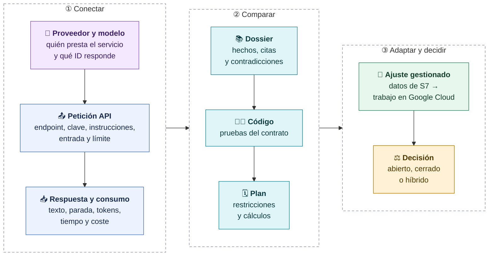
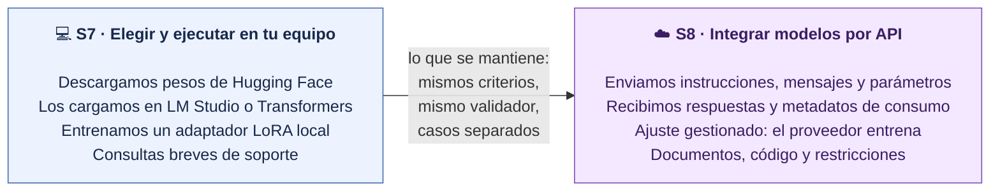
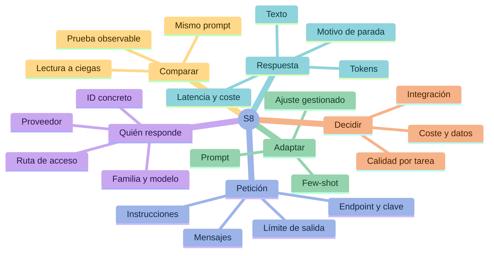

# S8 · Modelos cerrados y APIs: conectar, comparar y decidir

> [!question] La pregunta que resolvemos hoy
> **¿Cómo conecto mi aplicación a estos modelos y qué pruebas necesito para elegir el que mejor resuelve mi tarea?**

Estas notas son la documentación de la sesión para repasar después: cada nota responde a una pregunta y sigue el orden de la clase.

> [!info] Qué se ve en clase y qué queda para después
> En clase usamos la presentación, la terminal con el repositorio e isbetter.ai. De estas notas solo abrimos dos: [[05-Fine-tuning-gestionado]], para leer cómo se prepara el ajuste de Gemini, y la tabla «El problema de soporte: abiertos y cerrados con el mismo test» de [[06-Decidir-y-entregar]], para decidir. El resto, con sus peticiones, comandos y cifras, queda como material de consulta. No se crea ningún trabajo de ajuste en directo.

Las cifras proceden del proyecto `2-modelos`: llamadas reales fechadas, datos sintéticos de S7 y scripts comentados.

> [!tip] Repetir Gemini en tu propia cuenta
> [[05d-Gemini-manual-completo-fine-tuning]] incluye la práctica Nébula Hogar:
> catálogo y dataset publicados, login ADC, proyecto/bucket propios, presupuesto,
> subida verificada, entrenamiento, checkpoints, consultas y comparación.
> Se puede estudiar offline con los originales de referencia. El caso final
> del ensayo docente fue 48/48 ajustado frente a 8/48 base sin catálogo;
> el control con catálogo también acierta y el caso amplio conserva fallos.

## El recorrido de la sesión

## De S7 a S8: qué cambia

## Los 90 minutos

```mermaid
gantt
    title S8 · 18:30–20:00, hora de Madrid
    dateFormat HH:mm
    axisFormat %H:%M
    tickInterval 10minute
    section Introducción
        QR, repaso S7, proveedores y rutas   :a1, 18:30, 20m
    section APIs
        OpenRouter                           :b1, 18:50, 7m
        Gemini nativa                        :b2, after b1, 6m
        Claude Messages                      :b3, after b2, 7m
    section Comparar
        Dossier                              :c1, 19:10, 10m
        Código                               :c2, after c1, 10m
        Plan con restricciones               :c3, after c2, 10m
    section Ajustar
        Datos S7 y ajuste gestionado         :d1, 19:40, 10m
    section Decidir
        Decisión, entrega y preguntas        :e1, 19:50, 10m
```

| Hora | Qué hacemos | Dónde lo vemos en clase | Para repasar |
|---|---|---|---|
| 18:30–18:50 | QR, repaso de S7, abierto y cerrado, proveedores, rutas, petición y respuesta, comparación y ajuste gestionado | Presentación, diapositivas 1–11 | [[01-Abierto-cerrado-y-proveedores]], [[02-Rutas-y-peticiones-API]] |
| 18:50–18:57 | OpenRouter: un modelo abierto servido por API, la prueba «API lista» y la lectura de la respuesta | Terminal: `curl` y `python scripts/demo.py --proveedor openrouter` | [[02-Rutas-y-peticiones-API]], [[03-Respuesta-consumo-y-coste]] |
| 18:57–19:03 | Gemini por su API nativa (`generateContent`) | Terminal: `curl` | [[02-Rutas-y-peticiones-API]] |
| 19:03–19:10 | Claude Haiku 5.5 por la Messages API: texto, motivo de parada, tokens y coste | Terminal: `curl` y `python scripts/demo.py --caso DE-04` con la ruta de `.env` | [[02-Rutas-y-peticiones-API]], [[03-Respuesta-consumo-y-coste]] |
| 19:10–19:20 | Caso 1 · Dossier: hechos, citas y contradicciones | isbetter.ai, a ciegas | [[04-Comparar-por-tareas]] |
| 19:20–19:30 | Caso 2 · Código: las pruebas del contrato | isbetter.ai, a ciegas | [[04-Comparar-por-tareas]] |
| 19:30–19:40 | Caso 3 · Plan: restricciones y sumas | isbetter.ai, a ciegas | [[04-Comparar-por-tareas]] |
| 19:40–19:50 | Ajuste gestionado: datos de S7 convertidos, ciclo del trabajo y qué demuestra un ajuste | **Esta documentación**: [[05-Fine-tuning-gestionado]], y en la terminal `python scripts/gemini_tuning.py preparar`, que no llama a Google | [[05-Fine-tuning-gestionado]] |
| 19:50–20:00 | Decidir por tarea, el ejercicio de seis condiciones y preguntas | **Esta documentación**: tabla del mismo test en [[06-Decidir-y-entregar]] | [[06-Decidir-y-entregar]] |

> [!note] Gemini aparece con dos APIs
> Las peticiones de la clase y del repositorio usan `generateContent`, como en la tabla de la diapositiva 8 y en [[02-Rutas-y-peticiones-API]]. Google ofrece también la API Interactions, con otra estructura; no la usamos en este curso.

## Mapa de conceptos

## Notas en orden

| Nota | Pregunta que responde |
|---|---|
| [[01-Abierto-cerrado-y-proveedores]] | ¿Qué es un modelo cerrado y quién responde realmente a mi petición? |
| [[02-Rutas-y-peticiones-API]] | ¿Cómo se construye una petición en OpenRouter, Gemini y Claude? |
| [[03-Respuesta-consumo-y-coste]] | ¿Qué devuelve el servicio y qué tengo que registrar? |
| [[04-Comparar-por-tareas]] | ¿Cómo comparo modelos con pruebas en documentos, código y planes? |
| [[05-Fine-tuning-gestionado]] | ¿Cómo se ajusta un modelo que no puedo descargar y qué lo demuestra? |
| [[06-Decidir-y-entregar]] | ¿Abierto, cerrado o híbrido? ¿Qué tengo que entregar? |

**Clase anterior:** [[00-Guia-S7|S7 · Modelos abiertos]].

## Convenciones visuales

```mermaid
---
config:
  flowchart:
    wrappingWidth: 400
---
flowchart LR
    k1["Datos, instrucciones<br/>y objetivos"]
    k2["Modelo, petición<br/>y respuesta"]
    k3["Ajuste y acierto"]
    k4["Error, riesgo<br/>o límite"]
    k5["Proveedores, rutas<br/>y herramientas"]
    k6["Preguntas, decisiones<br/>y evaluación"]
    k1 ~~~ k2 ~~~ k3 ~~~ k4 ~~~ k5 ~~~ k6
    classDef datos fill:#fff1d6,stroke:#ae7500,color:#503700
    classDef base fill:#edf2ff,stroke:#4569b2,color:#17294a
    classDef ajuste fill:#e8f7ee,stroke:#268158,color:#143d2c
    classDef aviso fill:#ffeaea,stroke:#b94a48,color:#6c2221
    classDef herramienta fill:#f3e8ff,stroke:#7e4fb8,color:#3b1d63
    classDef decision fill:#e0f5f7,stroke:#1f7f8c,color:#0d3a40
    class k1 datos
    class k2 base
    class k3 ajuste
    class k4 aviso
    class k5 herramienta
    class k6 decision
```

El color acompaña a etiquetas explícitas: cada diagrama se entiende también sin distinguir colores.

## Mensajes que deben quedar

> [!important] Remoto y cerrado son decisiones distintas
> Abierto o cerrado depende de si se publican los pesos. Remoto o local depende de dónde se ejecuta. Un modelo de pesos abiertos servido por API es remoto, pero sigue siendo abierto.

> [!important] Conectar no es elegir
> Que la petición funcione demuestra que hemos conectado el servicio. Para saber si el modelo nos sirve, tenemos que probar **nuestra** tarea.

> [!warning] Una respuesta bien redactada puede incumplir la tarea
> Votamos con una prueba observable: una cita que existe, un test que pasa, una suma que cuadra. Puede haber ganador, empate o ninguna respuesta válida.

> [!note] Una llamada no es un ajuste
> Llamar a Gemini por OpenRouter demuestra inferencia. Un ajuste gestionado se demuestra con el trabajo de entrenamiento, su estado final, el modelo resultante y sus predicciones.

## De dónde salen los datos de estas notas

- Código de inferencia remota: `curso/remote.py`, `scripts/demo.py` y `scripts/evaluar_remotos.py`.
- Llamadas reales del **2 de octubre de 2026** por OpenRouter: el caso DE-01 y los 30 casos de test por condición. **En clase, Claude Haiku 5.5 (`claude-haiku-5-5`) se consulta directamente por la API de Anthropic (Messages API)**; las cifras de Claude de estas notas corresponden a Claude Haiku 4.5 por la ruta OpenRouter de esa fecha.
- El repositorio admite cualquier proveedor: la ruta se elige en `.env` con `LLM_PROVIDER` y `LLM_MODEL` (ver [[02-Rutas-y-peticiones-API]] y `docs/modelos-remotos.md`).
- Conversión y ajuste: `scripts/convertir_gemini.py`, `datos/gemini/` y `scripts/gemini_tuning.py`.
- Notebook: `notebooks/S8-Gemini-Claude.ipynb`. Guía del código: `docs/guia-codigo.md`.

Las cifras pertenecen a esas ejecuciones, con sus modelos, rutas y precios de esa fecha. No son un benchmark universal.

## Cómo abrir el material en Obsidian

Abre la carpeta `docs/obsidian` del repositorio como vault: contiene `S7-Modelos-abiertos` y `S8-Modelos-cerrados`. Usa **Vista de lectura** o **Live Preview**. Los diagramas están en bloques `mermaid`; GitHub también los dibuja si lees las notas en la web.

> [!tip] Si ves el código en lugar del diagrama
> Las versiones recientes de Obsidian piden permiso antes de dibujar diagramas Mermaid en un vault nuevo. Pulsa el botón de permitir que aparece sobre el primer diagrama: se aplica a todo el vault. En modo oscuro, Obsidian invierte los colores del diagrama; los tonos y su significado se mantienen.

[Empezar: abierto, cerrado y proveedores →](01-Abierto-cerrado-y-proveedores.md)
