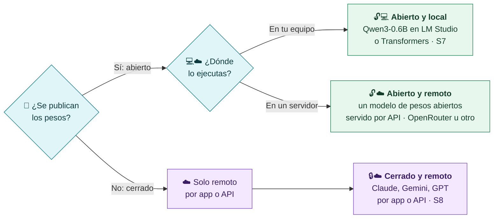
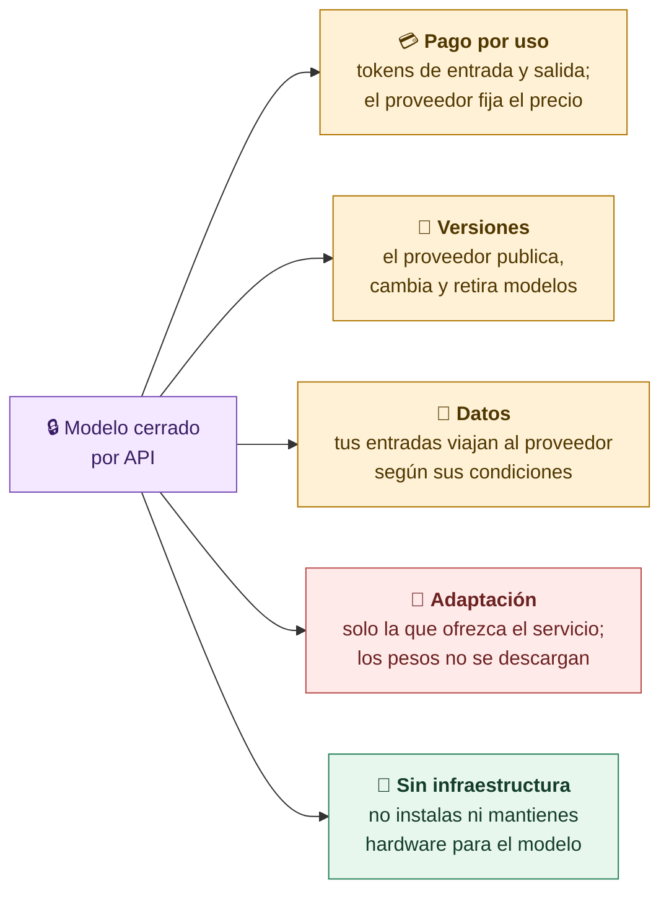
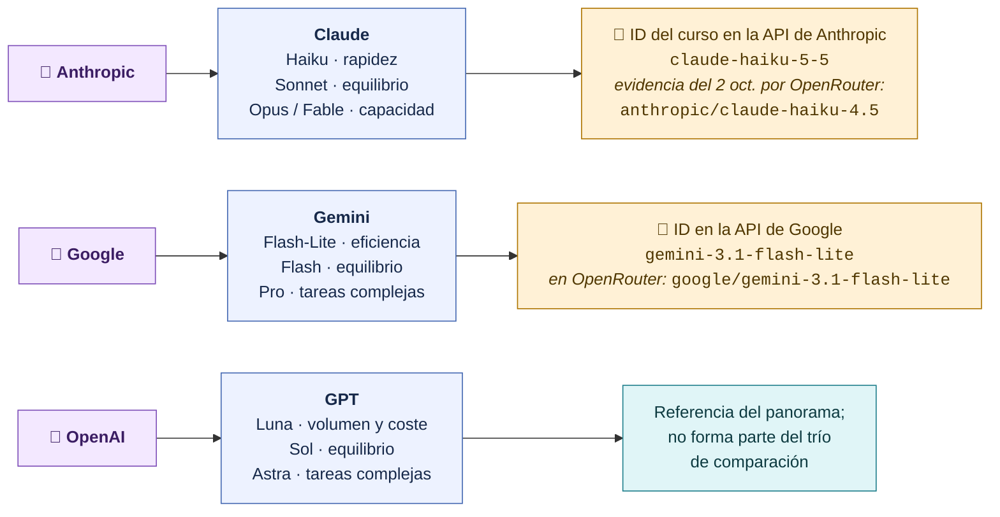
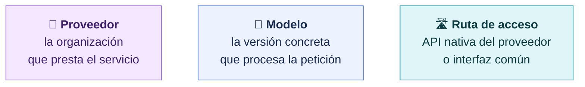
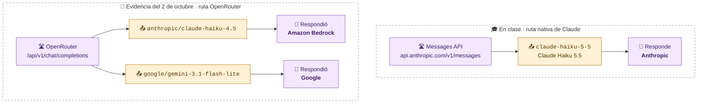

# Abierto, cerrado y quién responde a tu petición

**Abierto o cerrado depende de los pesos, no de cómo accedemos al modelo. En cada llamada conviene identificar tres cosas: el proveedor, el modelo concreto y la ruta por la que llega la petición.**

## Dos preguntas distintas

> [!important] Remoto no significa cerrado
> Un modelo de pesos abiertos servido por OpenRouter es remoto y se usa por API, pero sigue siendo abierto: podrías descargarlo y ejecutarlo tú. Un modelo cerrado solo existe como servicio.

## Qué implica usar un modelo cerrado

## Proveedor → familia → ID concreto

En la llamada no se escribe «Claude» ni «Gemini»: se escribe el **ID concreto** de un modelo. Panorama de la presentación de S8:

> [!warning] ChatGPT es una aplicación, no un modelo
> Igual que la app de Claude o la de Gemini: son interfaces que usan modelos por detrás. En una API eliges y registras el ID del modelo.

El mismo modelo tiene un ID distinto según la ruta. Los nombres de familia cambian con frecuencia; lo estable es el método: anotar el ID exacto de la petición y el que devuelve la respuesta. Con la API de Anthropic, `GET /v1/models` lista los IDs disponibles para tu clave.

## Tres distinciones que debemos conservar

### Un caso real: la ruta decide quién responde

En las pruebas del **2 de octubre de 2026** llamamos a Claude y a Gemini **a través de OpenRouter**. La respuesta indica qué proveedor sirvió cada petición. **En clase llamaremos a Claude Haiku 5.5 directamente por la API de Anthropic**, así que cambian el modelo y el proveedor que procesa los datos:

El modelo Claude es de Anthropic, pero la petición del 2 de octubre la sirvió **Amazon Bedrock** a través de OpenRouter. Por eso registramos siempre la ruta, el ID solicitado, el modelo devuelto, el proveedor y el identificador de la petición: las condiciones de datos, los precios y algunos parámetros dependen de quién procesa la llamada.

> [!question] Pregunta al grupo
> Si tu empresa solo permite enviar datos a un proveedor concreto, ¿basta con elegir el modelo? ¿Qué tendrías que fijar también en la ruta?

[← Guía](00-Guia-S8.md) · [Siguiente: rutas y peticiones API →](02-Rutas-y-peticiones-API.md)
