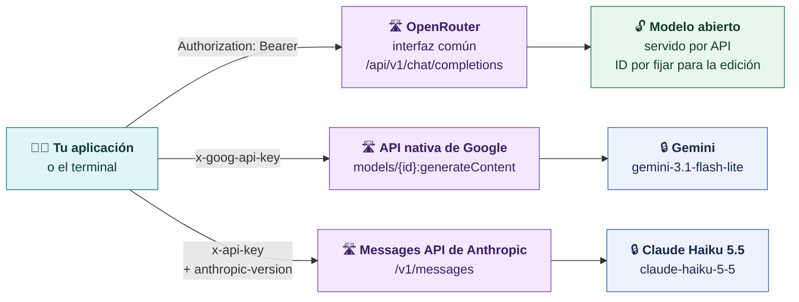
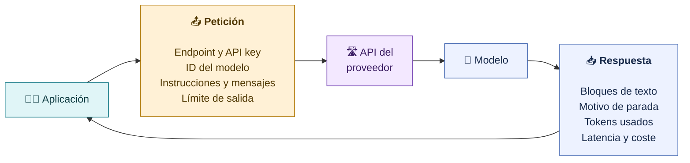
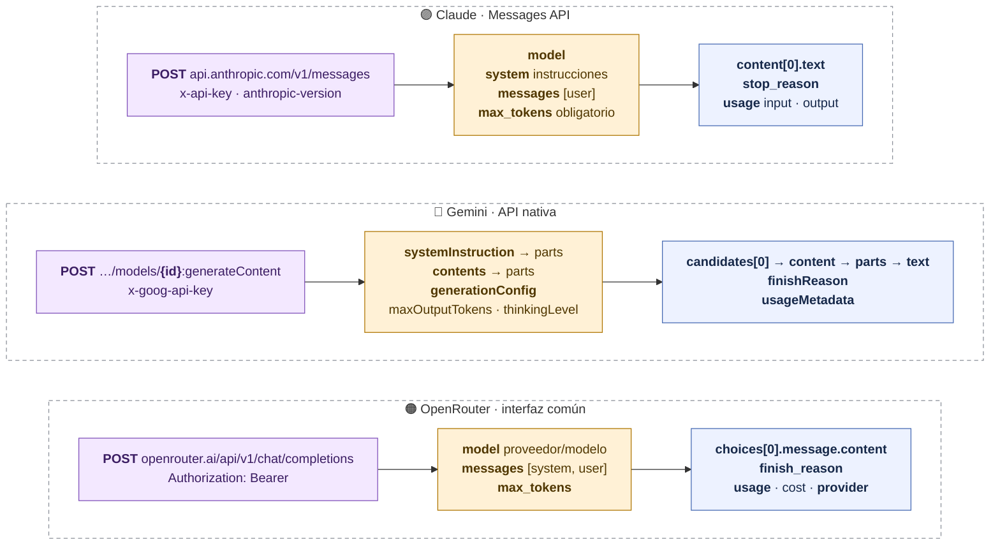
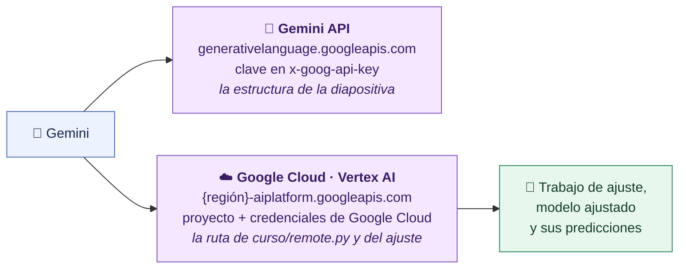
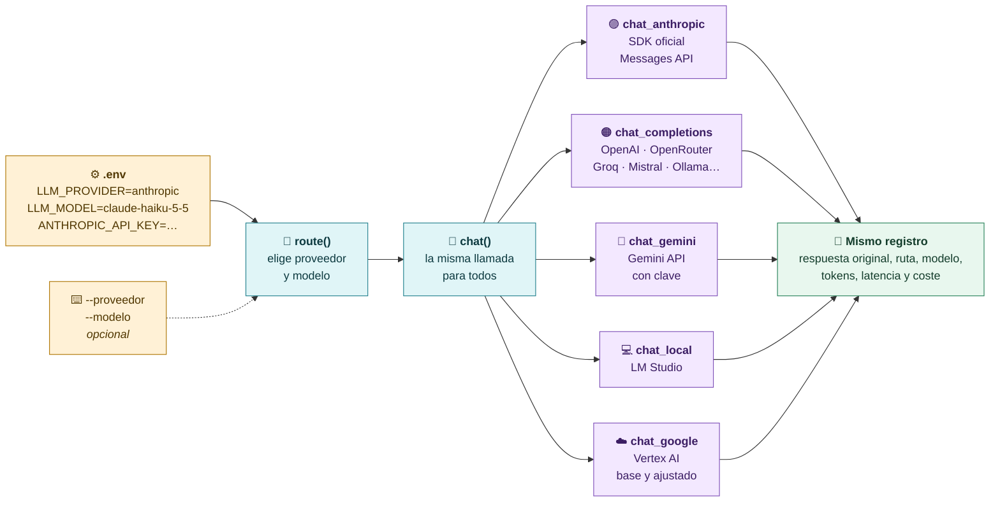
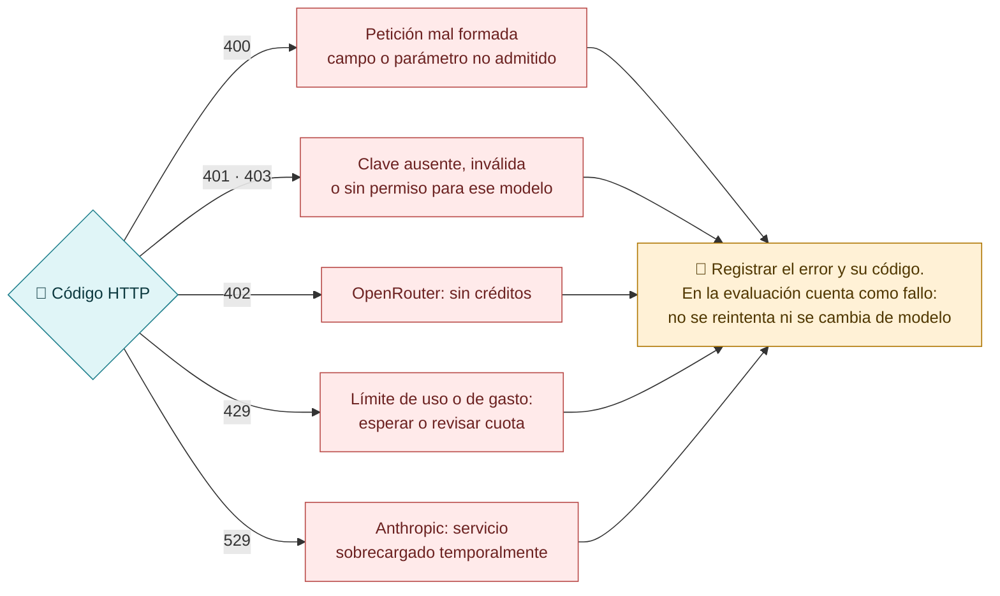

# Tres rutas para pedir una respuesta

**Una aplicación puede llegar a un modelo por una interfaz común, como OpenRouter, o por la API propia del proveedor. Todas llevan los mismos elementos, pero con distinto nombre y lugar.**

## Las rutas de esta clase



> [!warning] OpenRouter no es una familia de modelos
> Une a muchos proveedores bajo una misma interfaz. Reduce el trabajo de integración, pero **no iguala sus funciones**: cada proveedor admite parámetros distintos. Nuestro código añade `provider.require_parameters` para que OpenRouter solo use proveedores que acepten los parámetros enviados.

## Qué enviamos y qué comprobamos



> [!tip] La primera prueba: «Responde exactamente: API lista.»
> Comprueba que la clave, el endpoint y el ID funcionan. **No mide la calidad**: para eso hay que probar nuestra tarea.

## Misma llamada, tres estructuras

Los mismos elementos cambian de nombre y de lugar según la ruta:

| Elemento | Claude · Messages API | Gemini · API nativa | OpenRouter |
|---|---|---|---|
| **Endpoint** | `/v1/messages` | `models/{id}:generateContent` | `/api/v1/chat/completions` |
| **Clave** | `x-api-key` + `anthropic-version` | `x-goog-api-key` | `Authorization: Bearer` |
| **Modelo** | `model` | en la URL | `model: proveedor/modelo` |
| **Instrucciones** | `system` | `systemInstruction` | mensaje `role: system` |
| **Entrada** | `messages` | `contents → parts` | `messages` |
| **Límite** | `max_tokens` (obligatorio) | `generationConfig.maxOutputTokens` | `max_tokens` |
| **Texto** | `content[].text` | `candidates → content → parts → text` | `choices → message → content` |
| **Consumo** | `usage` | `usageMetadata` | `usage` (incluye `cost`) |
| **Parada** | `stop_reason` | `finishReason` | `finish_reason` y `native_finish_reason` |
| **Errores típicos** | 401 · 429 · 529 | 400 · 403 · 429 | 401 · 402 · 429 |



### La prueba mínima en cada ruta

Las claves se leen de variables de entorno: nunca se escriben en el código ni se enseñan en pantalla.

**Claude · Messages API** (la ruta de Claude en clase):

```bash
curl https://api.anthropic.com/v1/messages \
  -H "x-api-key: $ANTHROPIC_API_KEY" \
  -H "anthropic-version: 2023-06-01" \
  -H "content-type: application/json" \
  -d '{
    "model": "claude-haiku-5-5",
    "max_tokens": 50,
    "thinking": {"type": "disabled"},
    "system": "Eres un asistente de pruebas.",
    "messages": [{"role": "user", "content": "Responde exactamente: API lista."}]
  }'
```

**Gemini · API nativa de Google:**

```bash
curl "https://generativelanguage.googleapis.com/v1beta/models/gemini-3.1-flash-lite:generateContent" \
  -H "x-goog-api-key: $GEMINI_API_KEY" \
  -H "Content-Type: application/json" \
  -d '{
    "systemInstruction": {"parts": [{"text": "Eres un asistente de pruebas."}]},
    "contents": [{"role": "user", "parts": [{"text": "Responde exactamente: API lista."}]}],
    "generationConfig": {"maxOutputTokens": 50, "thinkingConfig": {"thinkingLevel": "MINIMAL"}}
  }'
```

**OpenRouter · interfaz común:**

```bash
curl https://openrouter.ai/api/v1/chat/completions \
  -H "Authorization: Bearer $OPENROUTER_API_KEY" \
  -H "Content-Type: application/json" \
  -d '{
    "model": "PROVEEDOR/MODELO_ELEGIDO",
    "max_tokens": 50,
    "messages": [
      {"role": "system", "content": "Eres un asistente de pruebas."},
      {"role": "user", "content": "Responde exactamente: API lista."}
    ]
  }'
```

Los IDs son los de referencia del curso; antes de clase hay que confirmar los elegidos para esta edición. Con la API de Anthropic, `GET /v1/models` devuelve los disponibles para tu clave.

> [!warning] Claude Haiku 5.5 y sus parámetros
> Haiku 5.5 razona por defecto y ese razonamiento consume salida: con un límite corto lo desactivamos (`"thinking": {"type": "disabled"}`). Tampoco admite una `temperature` distinta de la predeterminada: si la envías, devuelve un 400. Cada modelo tiene su contrato; por eso registramos los parámetros solicitados.

## Dos puertas de Google para Gemini



El cuerpo de la petición es casi idéntico (`systemInstruction`, `contents`, `generationConfig`), pero cambian la URL, la autenticación y el proyecto que se factura. El ajuste gestionado de [[05-Fine-tuning-gestionado]] se hace en Google Cloud.

## Cambiar de proveedor desde `.env`

El repositorio del curso no está atado a un proveedor. `curso/remote.py` lee la ruta del `.env` y llama al adaptador que corresponde; los scripts, el validador y el informe no cambian.



| Para usar… | `LLM_PROVIDER` | `LLM_MODEL` | Clave en `.env` |
|---|---|---|---|
| Claude, ruta del curso | `anthropic` | `claude-haiku-5-5` | `ANTHROPIC_API_KEY` |
| OpenAI | `openai` | el ID de tu cuenta | `OPENAI_API_KEY` |
| Cualquier modelo de OpenRouter | `openrouter` | `proveedor/modelo` | `OPENROUTER_API_KEY` |
| Gemini con clave | `gemini` | `gemini-3.1-flash-lite` | `GEMINI_API_KEY` |
| Groq, Mistral, Ollama… | `compatible` | el ID del servidor | `COMPAT_BASE_URL` y `COMPAT_API_KEY` |

```bash
python scripts/preflight.py          # qué ruta y qué credenciales ve el código, sin mostrar claves
python scripts/demo.py --caso DE-04  # una consulta con la ruta de .env
```

Lo que cambia entre proveedores (temperatura admitida, razonamiento, nombre del límite de salida) se ajusta con `LLM_TEMPERATURE` y `LLM_EXTRA_BODY`, sin tocar el código. Ese cambio forma parte del experimento: se anota junto a los resultados.

## Cuando la llamada falla



Nuestros scripts de evaluación no reintentan ni sustituyen el modelo cuando falla una llamada: así el denominador sigue siendo el mismo para todas las condiciones.

> [!warning] Claves fuera de pantalla
> Las claves viven en `.env` o en variables de entorno, fuera de Git. No se pegan en el código, en el notebook ni en capturas de la clase.

> [!question] Pregunta al grupo
> Si cambias de OpenRouter a la API nativa de Claude, ¿qué tienes que tocar en tu código? ¿Cambia algo de lo que mides en la respuesta?

[← Abierto, cerrado y proveedores](01-Abierto-cerrado-y-proveedores.md) · [Siguiente: respuesta, consumo y coste →](03-Respuesta-consumo-y-coste.md)
