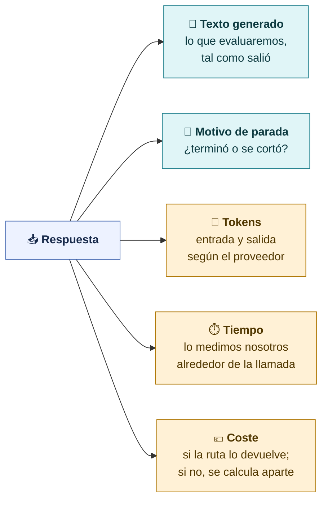
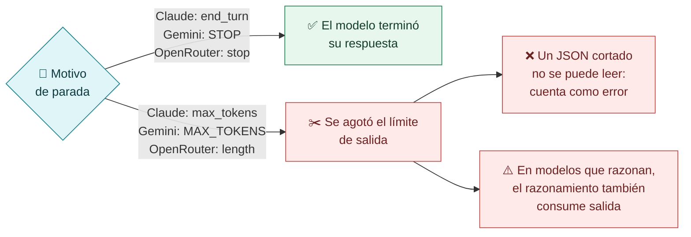
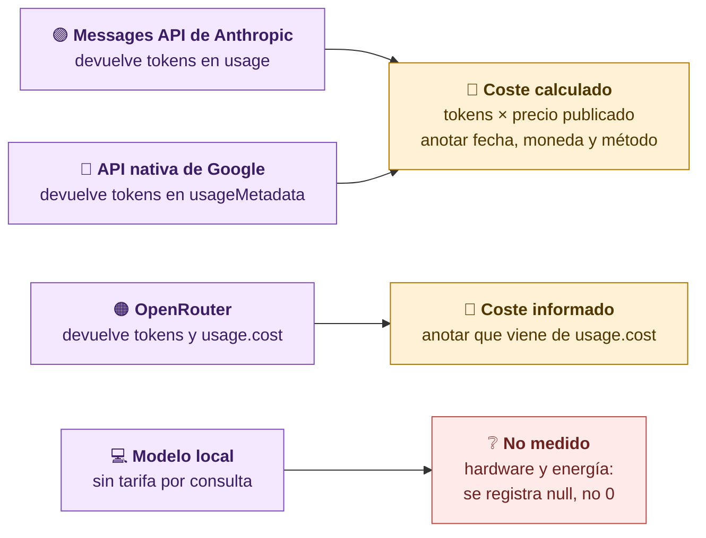
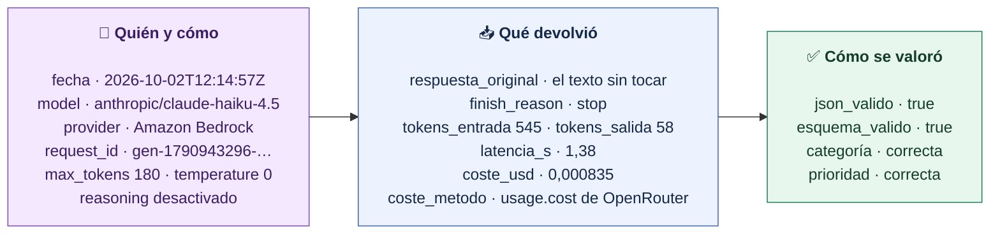
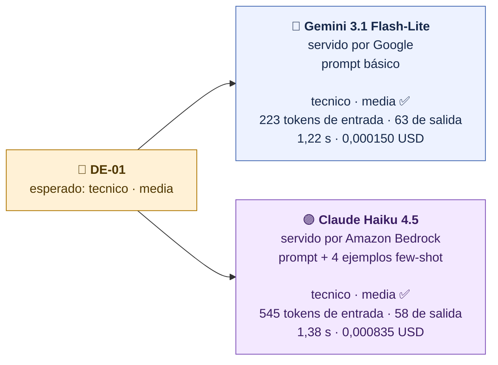
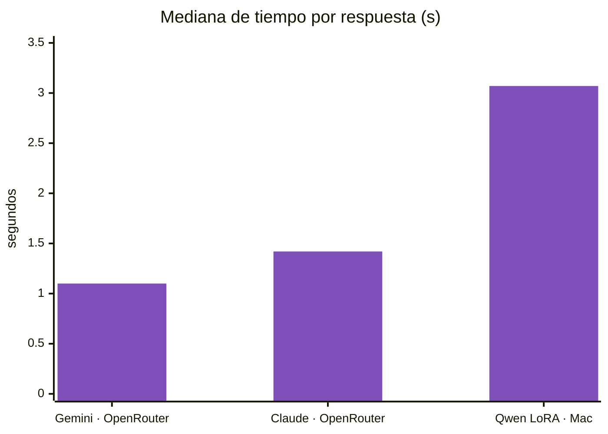
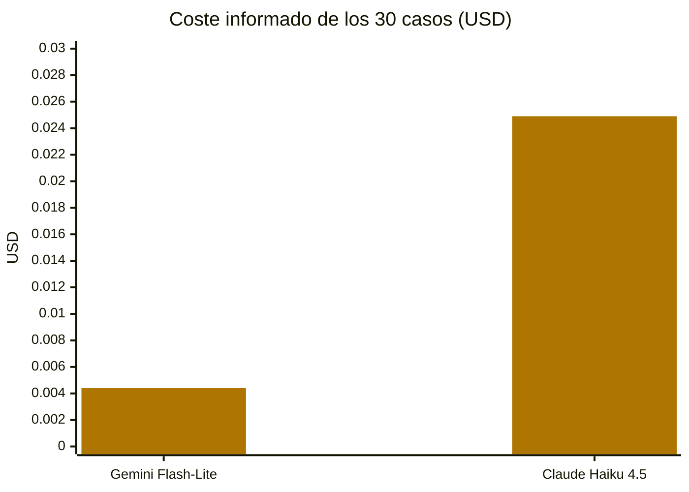

# Leer la respuesta: texto, parada, tokens, tiempo y coste

**Una respuesta de API trae mucho más que texto. Para comparar modelos con rigor registramos por qué terminó, cuántos tokens consumió, cuánto tardó y qué costó, junto con la ruta y el modelo que respondió.**

## Las cinco cosas que leemos

## ¿Terminó o se cortó?

Por eso fijamos un límite de salida suficiente para la tarea y controlamos el razonamiento: en nuestras llamadas Gemini usa nivel de pensamiento mínimo y Claude se llama sin razonamiento extendido.

## De dónde sale el coste

> [!important] `null` no es cero
> Si no hemos medido un coste, lo registramos como ausente. Un modelo local no paga por consulta, pero usa hardware y energía que no hemos medido.

## Qué registramos de cada llamada

Así queda un registro real del proyecto:

Con la API de Anthropic en clase cambian los nombres (`stop_reason`, `usage.input_tokens`, `usage.output_tokens`) y no hay `usage.cost`: el coste se calcula con el precio publicado. Lo que registramos es lo mismo.

> [!note] La tarifa de Claude Haiku 5.5
> Anthropic publica **0,10 USD por millón de tokens de entrada y 0,50 USD por millón de salida** para `claude-haiku-5-5` con prompts de hasta 100.000 tokens (Claude Haiku 4.5: 1 y 5 USD). El repositorio multiplica los tokens por la tarifa que declares en `.env` (`LLM_PRECIO_ENTRADA_USD_MTOK`, `LLM_PRECIO_SALIDA_USD_MTOK`); sin tarifa, el coste queda `null`. Haiku 5.5 usa un tokenizador nuevo: el mismo texto cuenta unos 30 % más tokens que en Haiku 4.5.

## Una consulta real, dos modelos

Caso de soporte `DE-01` (*La lección no carga para mí y no puedo verla*), 2 de octubre de 2026, ambos **por OpenRouter**:

> [!warning] Tokens de proveedores distintos no son comparables uno a uno
> Cada familia usa su propio tokenizador. Además, Claude recibió los cuatro ejemplos few-shot y Gemini solo el prompt básico. Comparamos el coste final y la calidad, no el número de tokens entre familias.

## Treinta casos: tiempo y coste

Los 30 casos de test de soporte, mismo validador, 2 de octubre de 2026:

| Condición | Ruta | Ambas etiquetas | Mediana s | Tokens entrada (mediana) | Coste 30 casos |
|---|---|---:|---:|---:|---:|
| Gemini 3.1 Flash-Lite, prompt básico | OpenRouter → Google | 26/30 | 1,10 | 225 | 0,0044 USD |
| Claude Haiku 4.5, prompt + few-shot | OpenRouter → Amazon Bedrock | 24/30 | 1,42 | 549 | 0,0249 USD |
| Qwen3-0.6B + LoRA | Mac M5 local | 26/30 | 3,07 | 267 | no medido |

> [!example] Cálculo orientativo
> A esos precios y con esos prompts, 10.000 consultas costarían unos **1,5 USD** con Gemini y unos **8,3 USD** con Claude (coste de 30 casos ÷ 30 × 10.000). Es aritmética sobre una muestra pequeña: los precios cambian y el few-shot encarece cada consulta de Claude.

> [!note] El tiempo depende de más cosas que el modelo
> Red, cola del proveedor, ruta y hardware local influyen. Las cifras de Claude son de Haiku 4.5 por la ruta OpenRouter; **en clase llamaremos a Claude Haiku 5.5 por la API de Anthropic** y sus tiempos serán otros. Medimos siempre igual: alrededor de la llamada completa.

> [!question] Pregunta al grupo
> Con estas cifras, ¿elegirías el modelo más barato? ¿Qué más necesitarías saber de tu tarea antes de decidir?

[← Rutas y peticiones](02-Rutas-y-peticiones-API.md) · [Siguiente: comparar por tareas →](04-Comparar-por-tareas.md)
