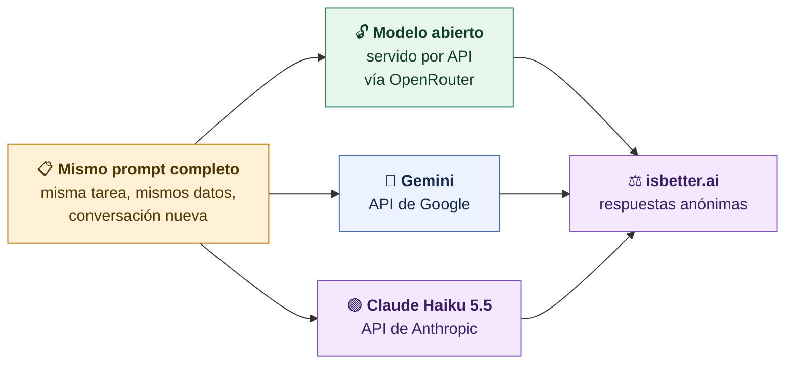
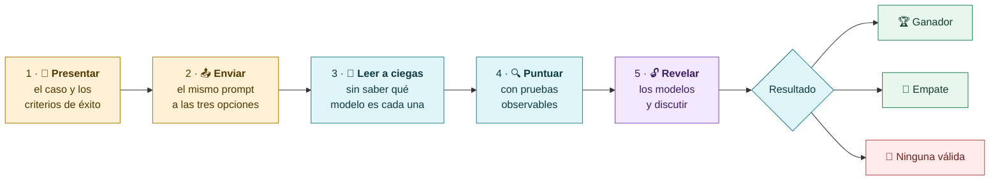
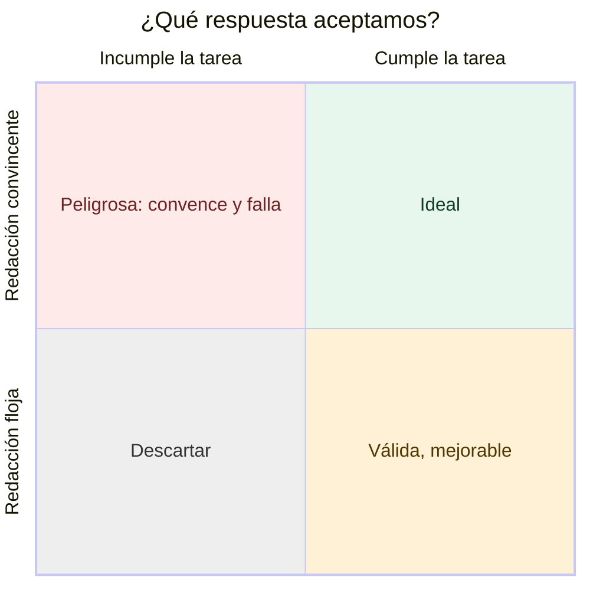
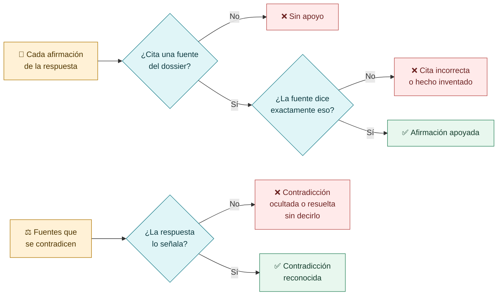
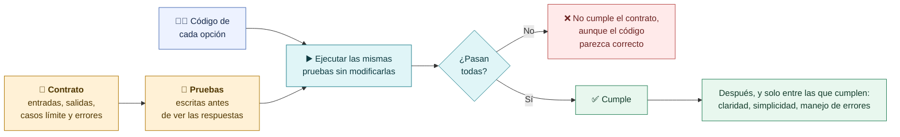
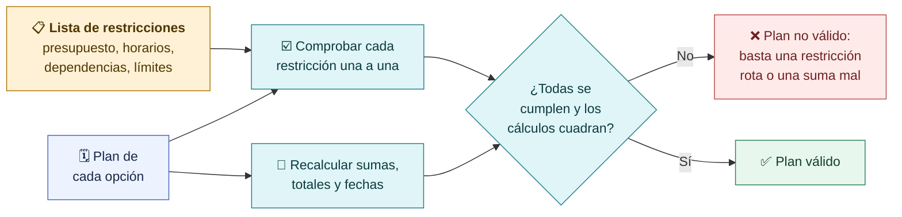
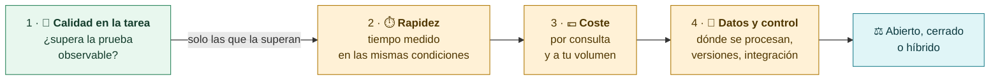

# Comparar por tareas: el voto necesita una prueba

**Comparamos tres opciones con el mismo caso y criterios definidos antes de leer. Una respuesta bien redactada puede incumplir la tarea: por eso cada voto se apoya en algo que se puede comprobar.**

## Las tres opciones del directo

## La misma dinámica en los tres casos

> [!warning] No es un benchmark
> Tres casos en directo sirven para aprender a evaluar. No dicen qué modelo es mejor en general: diferentes modelos pueden destacar en diferentes tareas.

## Forma frente a cumplimiento

El cuadrante de arriba a la izquierda es el que más engaña: suena seguro, está bien escrito y aun así inventa un dato, no pasa una prueba o se salta una restricción.

## Caso 1 · Dossier documental

**Qué pedimos:** sintetizar información de varias fuentes, apoyar cada afirmación y reconocer contradicciones.

**Prueba observable:** citas que existen, hechos que coinciden con la fuente, contradicciones señaladas, nada inventado.

## Caso 2 · Código con un contrato

**Qué pedimos:** una solución que cumpla requisitos definidos de antemano.

**Prueba observable:** las pruebas del contrato pasan. No se ajustan las pruebas a la respuesta ni se corrige el código de un modelo antes de ejecutarlo.

## Caso 3 · Planificación con restricciones

**Qué pedimos:** un plan que respete límites y condiciones.

**Prueba observable:** cada restricción cumplida y cada cálculo recalculado por nosotros, no aceptado porque el modelo lo afirme.

## El orden de los criterios

## Hoja de puntuación para el directo

Copia esta tabla y rellénala **antes** de revelar los modelos. Cada celda lleva un ✅ o ❌ y la evidencia que lo justifica.

| Prueba | Respuesta A | Respuesta B | Respuesta C |
|---|---|---|---|
| Dossier · afirmaciones con cita correcta | | | |
| Dossier · contradicciones señaladas | | | |
| Dossier · nada inventado | | | |
| Código · pruebas del contrato superadas | | | |
| Plan · todas las restricciones cumplidas | | | |
| Plan · sumas y fechas correctas | | | |
| Veredicto por caso: ganador, empate o ninguna | | | |

> [!question] Pregunta al grupo
> ¿Qué respuesta cumple mejor la tarea y **dónde lo ves**? Si dos opciones superan las pruebas, ¿qué criterio usarías para desempatar?

[← Respuesta, consumo y coste](03-Respuesta-consumo-y-coste.md) · [Siguiente: fine-tuning gestionado →](05-Fine-tuning-gestionado.md)
