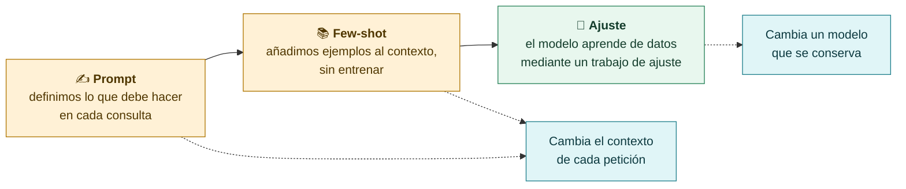
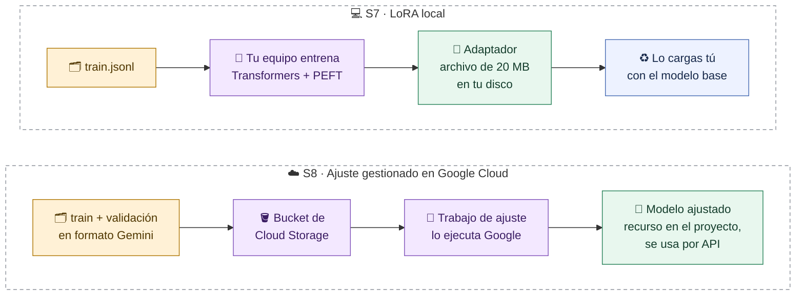
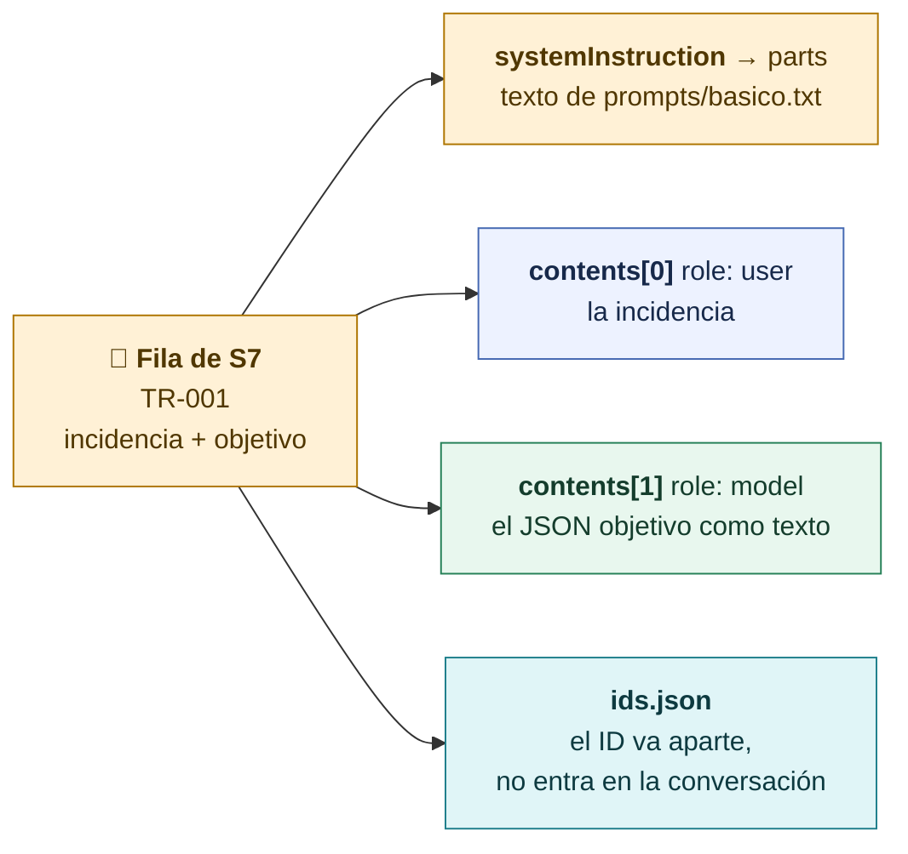
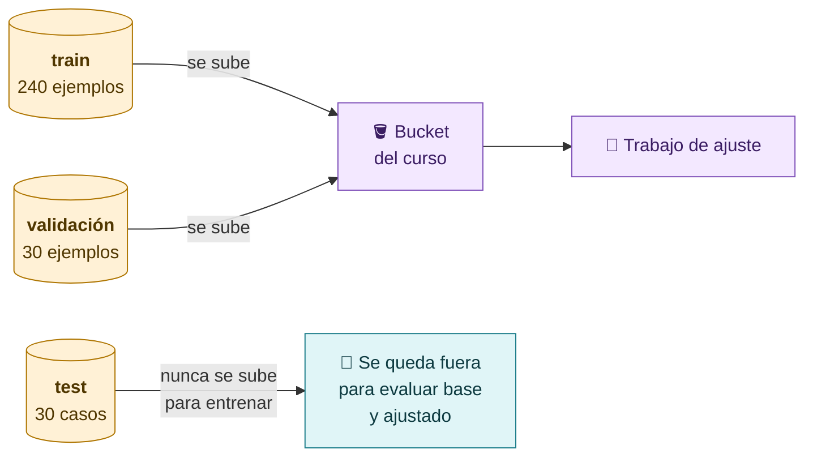
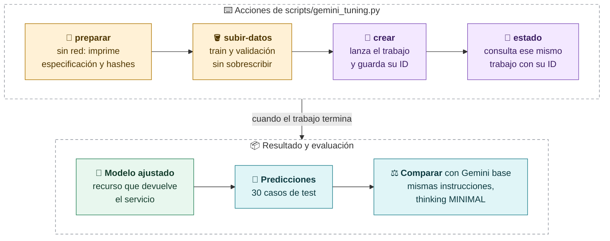
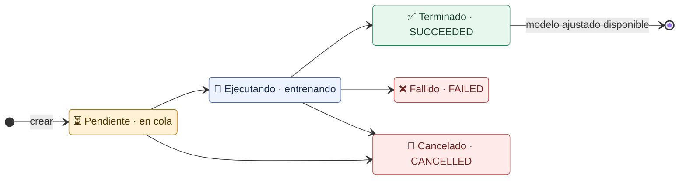
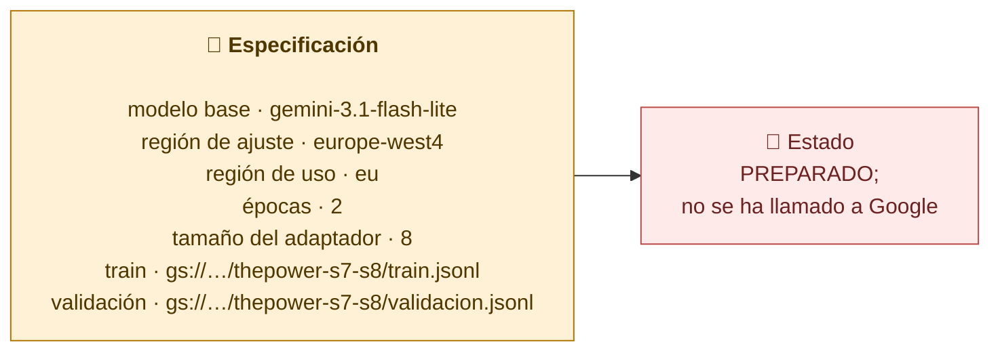
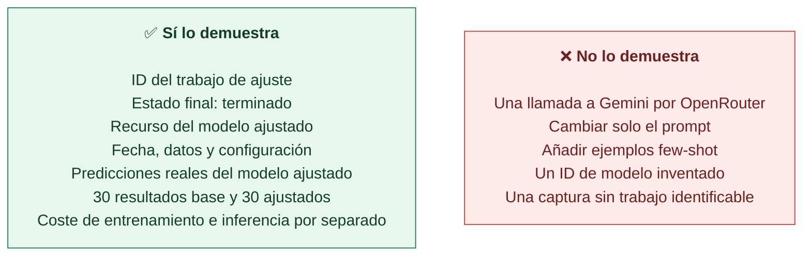

# Fine-tuning gestionado: ajustar un modelo que no puedes descargar

**En S7 entrenábamos un adaptador en nuestro equipo y lo guardábamos como archivo. En un ajuste gestionado entregamos los datos al servicio, este ejecuta un trabajo de entrenamiento y obtenemos un modelo ajustado al que llamamos por API. Los pesos no se descargan.**

## Tres formas de cambiar el comportamiento



| Condición del ejercicio | Cómo se adapta | Ruta |
|---|---|---|
| **Gemini base** | Prompt básico | Google Cloud |
| **Gemini ajustado** | Ajuste gestionado con train y validación de S7 | Google Cloud |
| **Claude Haiku 5.5** | Prompt + los mismos 4 ejemplos few-shot de S7, sin ajustar | API de Anthropic (`claude-haiku-5-5`) |

## S7 frente a S8: dónde ocurre el entrenamiento



> [!important] La frase para recordar
> En S7 guardábamos un adaptador local. En un ajuste gestionado entregamos los datos al servicio y obtenemos un recurso de modelo ajustado. Para demostrarlo necesitamos identificar el trabajo, comprobar que terminó y usar su resultado.

## 1 · Convertir los datos de S7

Reutilizamos **exactamente** las particiones de S7. `scripts/convertir_gemini.py` transforma cada fila al formato que espera Google:



Primera línea real de `datos/gemini/train.jsonl` (instrucciones recortadas):

```json
{
  "systemInstruction": {"parts": [{"text": "Eres un clasificador de incidencias de una plataforma educativa ficticia.…"}]},
  "contents": [
    {"role": "user",  "parts": [{"text": "No puedo iniciar sesión con mi cuenta del curso."}]},
    {"role": "model", "parts": [{"text": "{\"categoria\": \"acceso\", \"prioridad\": \"media\", \"respuesta\": \"Indica el error de acceso y el paso en que aparece, sin compartir tu contraseña.\"}"}]}
  ]
}
```

En S7 el rol del modelo se llamaba `assistant`; en Gemini se llama `model`. Es el mismo ejemplo con otra estructura.



## 2 · El ciclo del trabajo de ajuste

`scripts/gemini_tuning.py` separa cada paso en una acción distinta:



> [!warning] `crear` dos veces lanza dos entrenamientos
> Para saber cómo va un trabajo se usa `estado` con su ID. Volver a ejecutar `crear` inicia otro trabajo y otro coste.

### Los estados de un trabajo



El trabajo se consulta con intervalos razonables y se espera fuera del directo: no forma parte de los 90 minutos.

## 3 · La especificación preparada

Salida real de `preparar`, con nombres de ejemplo **no creados**:



Antes de ejecutar hacen falta: un **proyecto identificado del curso**, permisos, facturación y presupuesto revisados, un bucket, cuota y acceso al modelo en la región elegida.

> [!warning] El presupuesto anotado no es un tope
> El script comprueba que la estimación no supera el presupuesto declarado, pero **Google no deja de cobrar** por ese número. Las alertas de presupuesto avisan; no apagan el consumo.

## 4 · Qué demuestra que un modelo se ha ajustado



> [!note] Estado del laboratorio
> El laboratorio de Google Cloud y el ajuste real de Gemini están **pendientes**: aún no hay proyecto del curso configurado, ni trabajo, ni modelo ajustado que mostrar. En clase explicamos la conversión y la especificación preparada; no presentamos resultados de un ajuste que no existe.

> [!question] Pregunta al grupo
> Si el proveedor retira el modelo base dentro de un año, ¿qué pasa con tu modelo ajustado? ¿Y con el adaptador LoRA de S7?

[← Comparar por tareas](04-Comparar-por-tareas.md) · [Siguiente: decidir y entregar →](06-Decidir-y-entregar.md)
