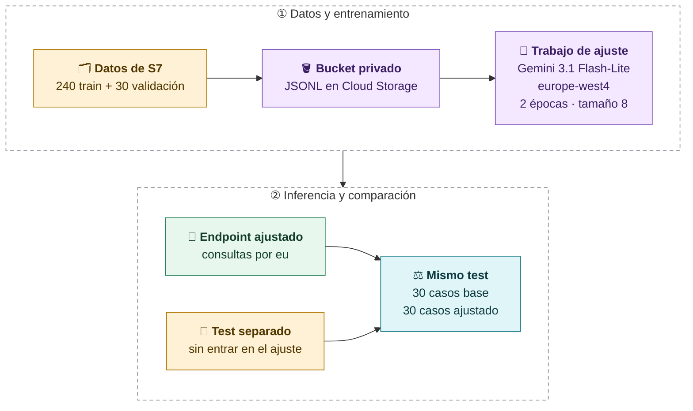

# Gemini: del dataset al modelo ajustado, paso a paso

**La API de AI Studio permite consultar Gemini con una clave. Este ajuste se ejecuta en Vertex AI, con credenciales de Google Cloud. La prueba «API lista» confirma la primera conexión; para demostrar un ajuste necesitamos un trabajo terminado y predicciones de su endpoint.**



## 1 · Qué se entrena

La tarea sigue siendo convertir una incidencia sintética en texto JSON con `categoria`, `prioridad` y `respuesta`. Se mantienen el prompt, las particiones y el validador de S7. El JSONL contiene las instrucciones, el mensaje `user` y la respuesta objetivo con rol `model`.

| Parámetro | Receta del curso |
|---|---|
| Modelo base | `gemini-3.1-flash-lite` |
| Entrenamiento / validación / test | 240 / 30 / 30 ejemplos |
| Región del trabajo | `europe-west4` |
| Multirregión de inferencia | `eu` |
| Épocas / tamaño del adaptador | 2 / 8 |
| Generación para comparar | Temperatura 0, 180 tokens de salida, thinking `MINIMAL` |
| Resultado | Recurso de modelo y endpoint, sin descarga de pesos |

> [!important] Entrenamiento e inferencia tienen ubicaciones distintas
> `estado` consulta el trabajo en `europe-west4`. El endpoint de este modelo se consulta por `eu`. El código convierte la ubicación regional del endpoint recibido a la multirregión de inferencia y conserva su ID. Para la alternativa `us-central1`, se usa `us`.

## 2 · Terminal, identidad y proyecto

Desde la raíz de la copia del curso, activa el entorno instalado:

```bash
source .venv/bin/activate
gcloud auth list --filter=status:ACTIVE --format='value(account)'
```

Define el proyecto y el nombre del bucket **elegidos para el laboratorio**. Estos dos valores son marcadores; no son recursos ya creados:

```bash
export GOOGLE_CLOUD_PROJECT="ID_PROYECTO_CURSO"
export GOOGLE_CLOUD_QUOTA_PROJECT="$GOOGLE_CLOUD_PROJECT"
export TUNING_BUCKET="NOMBRE_BUCKET_CURSO"
export GEMINI_SERVING_LOCATION="eu"

gcloud projects describe "$GOOGLE_CLOUD_PROJECT" \
  --format='json(projectId,projectNumber,name,lifecycleState)'
gcloud billing projects describe "$GOOGLE_CLOUD_PROJECT" \
  --format='json(projectId,billingEnabled)'
```

Los comandos llevan el proyecto explícito; no cambian el proyecto global de `gcloud`. Las variables de la terminal tienen prioridad sobre `.env`. No muestres el contenido de `.env` ni tokens en pantalla.

ADC es la identidad que usarán los scripts Python. Si falta o pertenece a otra cuenta, inicia sesión con la cuenta del laboratorio. La variable `GOOGLE_CLOUD_QUOTA_PROJECT` fija la cuota para esta terminal; también puede guardarse en el `.env` local. Conserva el archivo ADC global si lo comparten otros proyectos:

```bash
gcloud auth application-default login
```

La clave `GEMINI_API_KEY` de AI Studio no sustituye estas credenciales. Un saldo de prepago en AI Studio tampoco confirma por sí solo el acceso o la cobertura de costes de Vertex AI: revisa la facturación Cloud y los créditos elegibles para sus servicios.

## 3 · Servicios, bucket y cuota

**Estos comandos habilitan servicios y crean recursos en Google Cloud. Se ejecutan después de identificar proyecto, permisos y presupuesto.**

En un proyecto recién creado por AI Studio puede faltar `serviceusage.googleapis.com`. Si `gcloud services enable` devuelve `SERVICE_DISABLED` para Service Usage, abre su ficha en la biblioteca de APIs de la consola, comprueba el proyecto y pulsa **Habilitar**. Después vuelve a ejecutar el comando. No uses como proyecto de cuota otro laboratorio para evitar ese error.

```bash
gcloud services enable aiplatform.googleapis.com storage.googleapis.com \
  --project="$GOOGLE_CLOUD_PROJECT" --billing-project="$GOOGLE_CLOUD_PROJECT"

gcloud storage buckets create "gs://$TUNING_BUCKET" \
  --project="$GOOGLE_CLOUD_PROJECT" --billing-project="$GOOGLE_CLOUD_PROJECT" \
  --location=europe-west4 \
  --uniform-bucket-level-access \
  --public-access-prevention

gcloud storage buckets describe "gs://$TUNING_BUCKET" \
  --project="$GOOGLE_CLOUD_PROJECT" --billing-project="$GOOGLE_CLOUD_PROJECT" --format=json
```

Si ya hay un bucket correcto, compruébalo y omite `create`. Si el nombre pertenece a otra cuenta, elige otro; no reutilices un destino ajeno.

En la consola del proyecto revisa la cuota **Global concurrent tuning jobs**, la disponibilidad de Gemini 3.1 Flash-Lite y los permisos de tuning y lectura/escritura de objetos. Google documenta una cuota predeterminada de al menos un trabajo, pero hay que verificar el proyecto real. Comprueba que el agente de servicio de Vertex AI puede leer los datos. No hagas público el bucket ni concedas Owner a alumnos para resolver un permiso concreto.

## 4 · Revisar los datos y preparar sin entrenar

```bash
python scripts/convertir_gemini.py
python scripts/preflight.py
python scripts/gemini_tuning.py preparar \
  --proyecto "$GOOGLE_CLOUD_PROJECT" --bucket "$TUNING_BUCKET"
```

`convertir_gemini.py` conserva las particiones y escribe `datos/gemini/{train,validacion,test}.jsonl` e `ids.json`. `preparar` imprime especificación y hashes; no consulta Google ni inicia un ajuste.

Antes de subir, abre un ejemplo y comprueba los recuentos y hashes. Train y validación se subirán; test quedará fuera. Si cambia el experimento congelado, resuelve la causa antes de continuar.

## 5 · Coste y creación del único trabajo

Tarifa verificada el **14/10/2026** para Gemini 3.1 Flash-Lite: **3 USD por millón de tokens de entrenamiento**. La fórmula es `tokens de train × épocas × tarifa / 1.000.000`. Almacenamiento e inferencia se contabilizan aparte. Revisa la tarifa si ejecutas esta guía otro día.

Para los datos actuales, un recuento de todos los textos de train en una consulta `countTokens` da **62.768 tokens** y una estimación de **0,376608 USD** para 2 épocas. Es orientativa: agrupa los textos en una petición y no es el `totalBillableTokenCount` del trabajo Vertex. No es una factura ni confirma que los créditos promocionales cubran el ajuste.

El siguiente ejemplo de ejecución propone **5 USD de presupuesto autorizado** y **1 USD de estimación total con margen**. Sustitúyelos si el presupuesto elegido es otro; declararlos no impone un tope técnico en Google.

```bash
python scripts/gemini_tuning.py subir-datos \
  --proyecto "$GOOGLE_CLOUD_PROJECT" --bucket "$TUNING_BUCKET" \
  --presupuesto-usd 5 --coste-estimado-usd 1

gcloud storage ls "gs://$TUNING_BUCKET/thepower-s7-s8/" \
  --project="$GOOGLE_CLOUD_PROJECT" --billing-project="$GOOGLE_CLOUD_PROJECT"

python scripts/gemini_tuning.py crear \
  --proyecto "$GOOGLE_CLOUD_PROJECT" --bucket "$TUNING_BUCKET" \
  --presupuesto-usd 5 --coste-estimado-usd 1
```

`subir-datos` usa `if_generation_match=0`: no sobrescribe objetos existentes. Si ya están subidos, revisa su contenido y conserva la evidencia antes de decidir cómo continuar. `crear` guarda el recibo en `resultados/google-tuning/job-FECHA.json` e imprime `job` y `state`.

> [!warning] Crear no sirve para consultar
> Ejecutar `crear` de nuevo inicia otro entrenamiento. Conserva el ID del primero y usa `estado`. No crees otro por un timeout sin comprobar antes si Google aceptó el trabajo.

## 6 · Consultar el trabajo y obtener el endpoint real

Copia el valor completo de `job` del recibo, sin inventar IDs:

```bash
export GEMINI_TUNING_JOB="RECURSO_REAL_DEL_TRABAJO"
mkdir -p resultados/google-tuning

python scripts/gemini_tuning.py estado \
  --proyecto "$GOOGLE_CLOUD_PROJECT" --job "$GEMINI_TUNING_JOB"
```

Consulta con intervalos razonables. Solo al llegar a `JOB_STATE_SUCCEEDED`, guarda el estado final en un archivo nuevo y extrae el endpoint:

```bash
python scripts/gemini_tuning.py estado \
  --proyecto "$GOOGLE_CLOUD_PROJECT" --job "$GEMINI_TUNING_JOB" \
  > resultados/google-tuning/estado-final.json

GEMINI_TUNED_ENDPOINT="$(python -c 'import json; d=json.load(open("resultados/google-tuning/estado-final.json")); assert d["state"] == "JOB_STATE_SUCCEEDED", "El trabajo todavía no ha terminado"; assert d["tuned_model"]["endpoint"], "Falta el endpoint"; print(d["tuned_model"]["endpoint"])')" && export GEMINI_TUNED_ENDPOINT
```

`estado-final.json` es salida del SDK Python y usa `tuned_model`. La REST API usa `tunedModel`: no mezcles ambos formatos. Un trabajo fallido se conserva y se diagnostica; no se presenta como un modelo disponible.

## 7 · Ensayo antes de la clase y comparación formal

Abre una terminal nueva de ensayo, define las mismas variables y usa salidas nuevas para preservar cualquier prueba anterior:

```bash
export ENSAYO_GEMINI="resultados/ensayo-gemini-$(date +%Y%m%dT%H%M%S)"
mkdir -p "$ENSAYO_GEMINI"

python scripts/demo.py --proveedor google \
  --modelo gemini-3.1-flash-lite --caso DE-04 \
  --salida "$ENSAYO_GEMINI/base-DE04.json"

python scripts/demo.py --proveedor google \
  --modelo "$GEMINI_TUNED_ENDPOINT" --caso DE-04 \
  --salida "$ENSAYO_GEMINI/ajustado-DE04.json"

python scripts/evaluar_remotos.py --condicion gemini_base --split test \
  --salida "$ENSAYO_GEMINI/gemini_base.jsonl"

python scripts/evaluar_remotos.py --condicion gemini_ajustado \
  --modelo "$GEMINI_TUNED_ENDPOINT" --split test \
  --salida "$ENSAYO_GEMINI/gemini_ajustado.jsonl"

python scripts/resumir.py --carpeta "$ENSAYO_GEMINI" \
  --destino "$ENSAYO_GEMINI/informe"
```

Las llamadas consumen inferencia. El informe exige 30 casos de test por condición; los errores siguen contando. Muestra JSON válido, esquema, categoría, prioridad y ambas etiquetas por separado. El ajustado puede empatar o empeorar; eso también es un resultado.

## 8 · Los diez minutos del directo

| Minuto | Mostrar | Evidencia necesaria |
|---|---|---|
| 0–2 | Una incidencia y su objetivo; convertir los datos | JSONL revisado y hashes |
| 2–4 | `preparar`, región, épocas y tamaño | Especificación del mismo experimento |
| 4–6 | El trabajo ya terminado, sus datos y métricas | Recibo real y `JOB_STATE_SUCCEEDED` |
| 6–8 | Consultar base y ajustado con DE-04 | Dos respuestas originales del ensayo y una consulta en directo |
| 8–10 | Tabla de los 30 casos y conclusión | Informe completo, costes y límites |

**Ejecuta el entrenamiento antes de clase.** Su duración y cola no están garantizadas. En directo se puede mostrar la creación si ese es el objetivo, pero sin prometer que termine dentro de esos diez minutos. Conserva una evidencia real previa para explicar el resultado si falla la red; identifícala por fecha y no la presentes como la consulta recién ejecutada.

[← Fine-tuning gestionado](05-Fine-tuning-gestionado.md) · [Decidir y entregar →](06-Decidir-y-entregar.md)

Fuentes: [modelo, límites y cuotas](https://docs.cloud.google.com/gemini-enterprise-agent-platform/models/tuning/supervised-tuning), [crear, consultar e inferir](https://docs.cloud.google.com/gemini-enterprise-agent-platform/models/tuning/supervised-tuning/use), [tarifas](https://cloud.google.com/vertex-ai/generative-ai/pricing).
