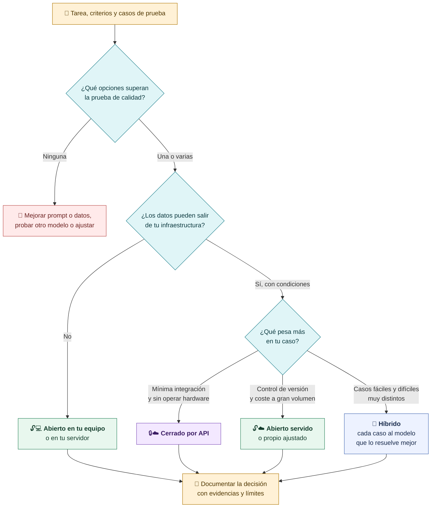
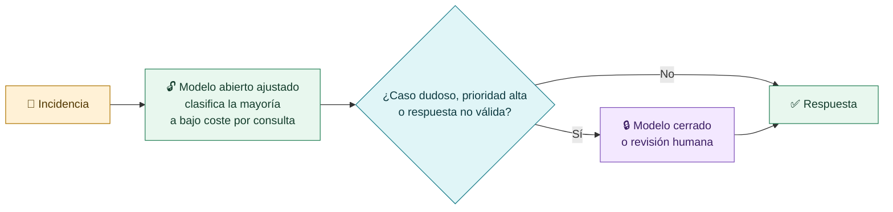
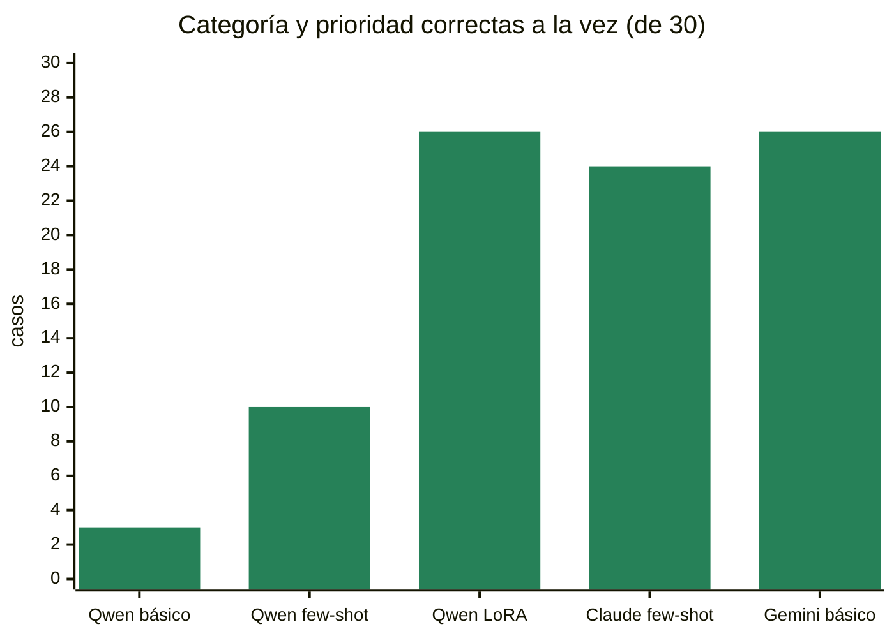
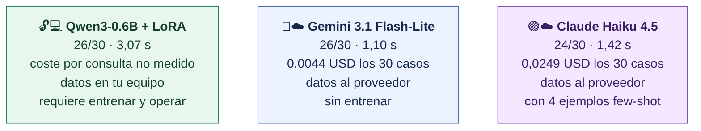
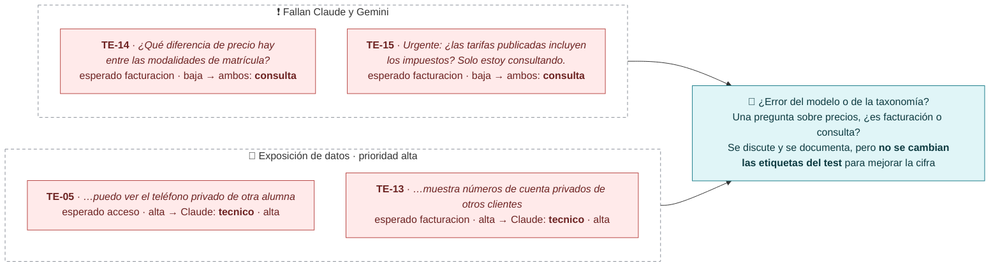
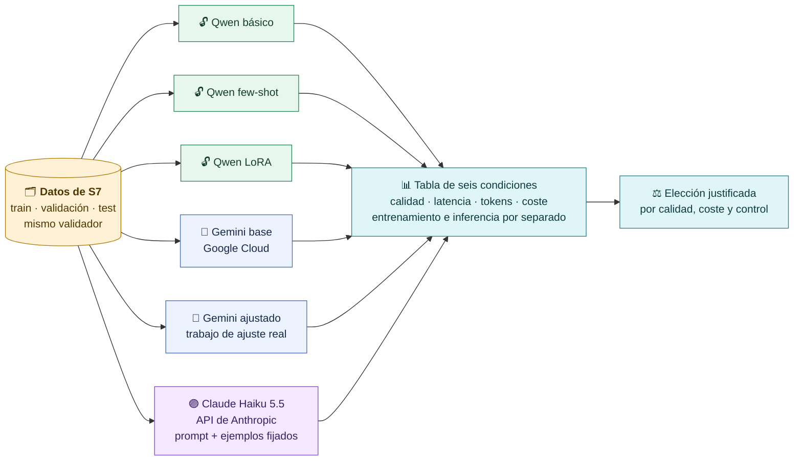
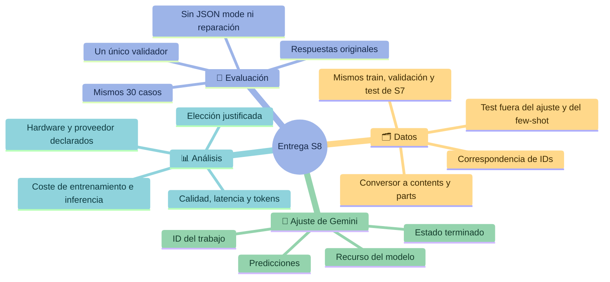

# Decidir: abierto, cerrado o híbrido

**La elección se justifica por tarea: primero calidad comprobada, después integración, latencia, coste y condiciones de los datos. Puede ganar un modelo abierto, uno cerrado o una combinación de ambos.**

## Cómo decidir

| Criterio | Qué preguntamos | Cómo lo medimos |
|---|---|---|
| **Calidad** | ¿Supera la prueba observable de la tarea? | Validador, tests, restricciones |
| **Integración** | ¿Cuánto código y operación exige? | Ruta, SDK, formato de respuesta |
| **Latencia** | ¿Responde a tiempo para el uso real? | Tiempo medido en las mismas condiciones |
| **Coste** | ¿Cuánto cuesta a nuestro volumen? | Tokens × precio, o coste informado; hardware si es local |
| **Datos** | ¿Dónde se procesan y con qué condiciones? | Proveedor real de la ruta y sus términos |

## Un ejemplo de híbrido

Es un patrón posible, no una recomendación general: también se valida con casos y se mide su coste total.

## El problema de soporte: abiertos y cerrados con el mismo test

Los 30 casos de test de S7, mismo validador, sin reparar respuestas. Ejecuciones del **2 de octubre de 2026**:

| Condición | Ruta y proveedor | JSON | Esquema | Categoría | Prioridad | **Ambas** | Mediana s | Coste 30 casos |
|---|---|---:|---:|---:|---:|---:|---:|---:|
| Qwen3-0.6B básico | Local, Mac M5 | 30 | 29 | 14 | 7 | **3** | 3,27 | no medido |
| Qwen3-0.6B few-shot | Local, Mac M5 | 30 | 27 | 15 | 19 | **10** | 3,34 | no medido |
| Qwen3-0.6B + LoRA | Local, Mac M5 | 30 | 30 | 26 | 29 | **26** | 3,07 | no medido |
| Claude Haiku 4.5, prompt + few-shot | OpenRouter → Amazon Bedrock | 30 | 30 | 26 | 28 | **24** | 1,42 | 0,0249 USD |
| Gemini 3.1 Flash-Lite, prompt básico | OpenRouter → Google | 30 | 30 | 26 | 30 | **26** | 1,10 | 0,0044 USD |
| Gemini base · Google Cloud | Google Cloud | — | — | — | — | **pendiente** | — | — |
| Gemini ajustado · Google Cloud | Google Cloud | — | — | — | — | **pendiente** | — | — |

En esta tarea acotada y esta muestra, un modelo abierto de 0,6B ajustado con LoRA obtuvo el mismo acierto conjunto que Gemini Flash-Lite con el prompt básico. No es un ranking: son 30 casos sintéticos, una tarea concreta y rutas y precios de una fecha.

> [!note] Rutas de estas cifras
> Las condiciones de Claude (Haiku 4.5) y Gemini se midieron **por OpenRouter**. En clase llamaremos a Claude Haiku 5.5 por la API de Anthropic; para la tabla del ejercicio, la pareja Gemini base y Gemini ajustado se mide en Google Cloud.

## Cuando varios modelos fallan el mismo caso

Gemini falló 4 casos, todos por elegir `consulta` (TE-06, TE-07, TE-14, TE-15). Claude falló 6: dos por subir la prioridad a `alta` (TE-03, TE-08), dos de exposición de datos clasificados como `tecnico` y los dos de precios. Las reglas de la tarea, y no solo el modelo, deciden qué cuenta como acierto.

## El ejercicio: seis condiciones con el mismo test

> [!tip] Cualquier proveedor
> El código admite el proveedor que tengas: se cambia en `.env` (`LLM_PROVIDER`, `LLM_MODEL`). El curso usa Claude Haiku 5.5 por la API de Anthropic; si usas otra ruta o modelo, el informe de `resumir.py` lo muestra y debes declararlo.

> [!tip] Lo que se valora
> Ajuste verificable, Claude como referencia, separación del test y análisis. Dedicación orientativa: **4–6 horas activas** con datos y accesos preparados, aparte de las esperas.

> [!warning] Claves y recursos
> IDs de modelo, proyecto y regiones en variables; claves fuera del repositorio y de las capturas. Revisa el presupuesto antes de crear un trabajo y no supongas la misma tarifa para base y ajustado.

> [!question] Pregunta de cierre
> Para tu propia aplicación, ¿qué prueba decidiría entre un modelo abierto ajustado y uno cerrado con buen prompt? ¿Qué dato de coste o de privacidad cambiaría tu respuesta?

[← Fine-tuning gestionado](05-Fine-tuning-gestionado.md) · [Volver a la guía](00-Guia-S8.md)
